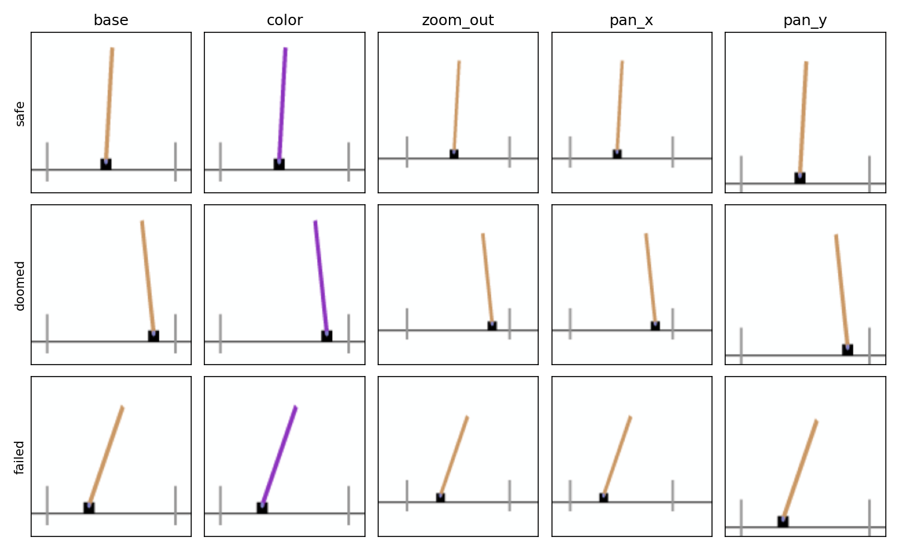

# Archive

Experiments and findings that were dropped or are not in the main reports, kept for reference.

## Dubins goal marker (2026-11-04 to 2026-11-05, dropped)

### Where the marker is

- Training data (`dubins_expert.h5`): the green goal marker is static within an episode and moves only vertically between episodes: always on the right edge ($x \approx 1.3$, pixel column 118.6-118.7 of 128), with $y$ jittered per episode over about $[-0.9, 0.6]$ (pixel rows 39-87). The world model never saw the marker anywhere else.
- The marker is dark green, RGB about $(0, 128, 0)$.
- `DubinsSwmEnv` draws it at `goal_position`, which defaults to $(1.3, 0)$ (`x_max - 0.2`); `_set_goal_state` moves it to the goal state.
- The GP margin functions (`train_gp_margin_dubins.py`, `dub_fixed_margin.py`) are trained on uniform states re-rendered by the swm env, so only ever with the marker at the default $(1.3, 0)$.

### What the current sg25clean CEM shows

- Observations: the env draws the marker at the episode's goal state (`_set_goal_state`). sg25clean goals are states 25 steps ahead in an annulus around the obstacles, so during planning the marker is usually mid-arena, a placement absent from the training data.
- Goal image, red runs: the stored dataset frame, so the marker is on the $x \approx 1.3$ line. Observations and goal image therefore disagree about the marker in red runs.
- Goal image, OOD runs (purple, diamond): re-rendered by `eval.py` `_rerender_goal`, which is meant to put the marker where the dataset frame shows it, but its detector looks for bright green (G > 150, R < 100, B < 100) and never finds the dark-green marker, so it falls back to the goal state. The code comment ("goal marker where the dataset frame shows it") is wrong in practice. In OOD runs observations and goal image agree (both at the goal state), unlike red runs.
- So red and OOD CEM cells use different marker handling.

### Marker sensitivity of $h$ (start-frame A/B)

Found while explaining why `diag_imag_steps.py` disagreed with Table 8 of post-oct-21.md for sigreg and adv_h. Table 8 (`train_gp_margin_imag_dubins.py`) starts imagined rollouts from the stored dataset frame (marker jittered on the 1.3 line); `diag_imag_steps.py`, `diag_imag_color_dubins.py` and `diag_purple_drift.py` re-render the start state (marker at the default). The two frames differ only in the marker (about 0.3% of pixels). Same starts, plans, labels and margin function (CEM's 5000-step $h$), `imag_startframe_ab.py`:

| Model | Start frame | Imagined AUC | False-safe |
| --- | --- | ---: | ---: |
| sigreg | re-rendered | 0.814 | 0.423 |
| sigreg | dataset frame | 0.664 | 0.967 |
| adv_h | re-rendered | 0.661 | 0.796 |
| adv_h | dataset frame | 0.584 | 0.983 |
| jac | re-rendered | 0.969 | 0.115 |
| jac | dataset frame | 0.968 | 0.115 |

- The dataset-frame rows reproduce Table 8 (sigreg 0.642 / 0.968, adv_h 0.637 / 0.971).
- $h$ on sigreg and adv_h reads the marker height as if it carried safety information; jac ignores it. The earlier real-frame check (post-oct-21.md, Diagnostics) had found the marker to be a nuisance for sigreg only (AUC 0.985 -> 0.901 when the marker moves).

### Default-marker CEM experiment

Idea: draw the marker at the default $(1.3, 0)$ in every observation and goal image, decoupled from the goal used for success, so planning frames stay in the training distribution and observations and goal image always agree. (The alternative considered, goal at $(1.3, 0)$ with starts 25 steps before it, would have been a new protocol.)

- Implementation: branch `marker-default`, commit 9b3c78c, not merged. `DUBINS_MARKER=default` makes `dubins_swm_env.py` draw the marker at a fixed $(1.3, 0)$ (rotated with the world under `DUBINS_ROT_DEG`), while `goal_position` still drives success and termination; `eval.py` re-renders every goal frame under the same flag. Queue script `le-wm/scripts/marker_default_queue.sh`.
- Check: with a goal at $(0.9, 0.9)$, success uses $(0.9, 0.9)$ and the marker is drawn at $(1.32, 0.0)$ in the observation and the re-rendered goal frame; all 200 goal frames were re-rendered in the CEM run.
- Not validated for the 90° rotation condition.

Red, sg25clean, 200 episodes, success / collision (%). Baselines are the current main-table cells (raw CEM; GP safety-first, $w = 1000$, $C = 10^4$, open loop).

| Model | Planner | Current protocol | Default marker |
| --- | --- | ---: | ---: |
| jac | raw | 81.5 / 22.5 | 79.5 / 27.0 |
| jac | safety-first | 79.0 / 8.5 | 79.0 / 8.5 |
| sigreg | raw | 62.5 / 50.0 | 44.5 / 56.5 |
| sigreg | safety-first | 57.5 / 49.5 | 43.0 / 57.0 |
| adv_h | raw | 57.5 / 57.0 | 43.0 / 61.5 |

- jac is unchanged (safety-first identical; raw within noise and equal to another raw jac run, 79.5 / 26.0).
- sigreg and adv_h get 14.5-18 points worse in success, about 4-5 binomial SDs at 200 episodes. The opposite of what was expected.
- Untested explanation: in the current protocol every observation shows the marker at the goal location; marker-sensitive encoders (sigreg base) may use it as a goal cue, so the default marker removes information they rely on. If so, the current protocol has a mild leak (observations show the goal location) that helps the sigreg base, and the default marker would widen the jac-vs-sigreg gap.
- Stopped before adv_h safety-first and adv_λ (raw and safety-first); OOD conditions not run. Logs: `run_logs/softcem_*_gp_mkdef_*_red.log`.
- Dropped (2026-11-05): not expected to help the main results.

### Ideas not pursued

- Train $h$ on uniform states with the marker drawn at random positions, so $h$ cannot read the marker.
- Measure sigreg's goal fidelity with the marker at the goal location vs the default, to test the goal-cue explanation.
- Fix `_rerender_goal`'s detector (dark green) if the OOD goal images should really put the marker where the dataset frame shows it.

## Free-running rollout loss, SLS-squared style (2026-11-03 to 2026-11-05, paused)

Status: paused, not abandoned. At 50 epochs the rollout loss keeps the imagined-state ranking on red longer, but safety-first CEM is no better on red and mixed under purple (jac worse, jac+pull+adv_h encoder-only better, 50 episodes), and on sigreg it degraded the encoder. It failed the decision rule set before the 50-epoch runs (keep it only if red with replanning beats the original by about 10 points and purple is not worse). jac+pull was stopped at epoch 32 of 50.

What is saved:

- World models (weights of every epoch, `weights_epoch_<k>.pt`): `/data/seongbin/lewm/checkpoints/lewm_dubins_{sigreg,jac,jacpull_safeadv_linf_enc}_roll5b50/` (epochs 1-50) and `lewm_dubins_jacpull_roll5b50/` (epochs 1-32). Only weights are saved, no optimizer state, so finishing jac+pull would mean retraining or resuming with a fresh optimizer at the matching point of the cosine schedule.
- 15-epoch versions: `lewm_dubins_jac_roll5b/`, `lewm_dubins_jacpull_safeadv_linf_enc_roll5b/`; failed first version (rollout from 3 frames): `lewm_dubins_{sigreg,jac,jacpull,jacpull_safeadv_linf_enc}_roll5/`.
- Margin functions of the evaluated checkpoints: `/data/seongbin/dreamer/lewm/lewm_dubins_*_roll5b50_e50/margin_gp_fail_red_s0.pt` (and `_roll5b_e<k>/` for the screens). The `_e<k>` directories are symlink views of one epoch of the training directory.
- Code: branch `rollout-loss` (`le-wm/train.py`, `rollout_steps = K`; scripts `train_rollout5_dubins.sh`, `roll5b_check.sh`, `roll5b_quick_cem.sh`, `roll5b50_eval_queue.sh`, `diag_purple_drift.py`). CEM logs: `run_logs/softcem_*roll5b*`.

Tables in this section are numbered R1-R7; "Table N" alone refers to post-oct-21.md, numbered as after this section was moved out of it.

Question: does training the predictor on its own multi-step rollouts make CEM plan better, in-distribution and under OOD shifts? Code on branch `rollout-loss` (`train.py`, `rollout_steps = K`); scripts `train_rollout5_dubins.sh`, `roll5b_check.sh` (per-step test of Table 13), `roll5b_quick_cem.sh`, `roll5b50_eval_queue.sh`.

### How le-wm and SLS-squared train the predictor

- le-wm (all Dubins WMs so far): windows of 4 frames, one forward pass of the causal transformer on the 3 real context latents, MSE of the predictions at all 3 positions to the next real latents. So every context length (1, 2, 3 frames) is trained, but only one step ahead from real latents; the predictor never sees its own outputs.
- SLS-squared (`SLS-squared/<env>/train/mlpdyn_train.py`): an MLP predictor on a single Markov state $[z_t, z_t - z_{t-1}]$, unrolled 5 steps on its own predictions, MSE averaged over the 5 steps. This replaces the one-step loss (step 0 is the one-step prediction from a real state). Plus SIGReg and a trajectory-straightening loss; model error is calibrated afterwards with conformal prediction.
- Ours ("rollout loss", $K = 5$): replaces the le-wm loss with the mean MSE over 5 free-running steps; the regularizers keep their original 4-frame window. Everything else (seed, 50 epochs, regularizer weights) as the original model.

### First attempt: rollout from 3 real frames (failed)

The first version started each rollout from 3 real latents and scored only the last position. CEM never trains on this case: its rollouts start from 1 frame and grow to 3, so predictions from 1-2 frames of context lost their training signal. After 50 epochs the rollouts collapse after step 5 (imagined latents converge to one region; median $h$ on safe and unsafe states both 0.70), and planning breaks.

Table R1. Per-step AUC of $h$ on imagined latents from a red start (as Table 13), jac, original vs first rollout-loss version (both 50 epochs). The original row is from `diag_purple_drift.py` (400 held-out states), the rollout-loss row from `diag_imag_color_dubins.py` (600); same plan distribution.

| jac | Step 1 | Step 3 | Step 5 | Step 10 | Step 15 | Step 25 |
| --- | ---: | ---: | ---: | ---: | ---: | ---: |
| original | 1.00 | 1.00 | 0.99 | 0.99 | 0.97 | 0.88 |
| rollout loss from 3 frames | 0.98 | 0.91 | 0.88 | 0.43 | 0.42 | 0.51 |

Table R2. CEM, replanning every 5 steps, goal cost at every imagined step, success / collision (%). Original: 200 episodes; first rollout-loss version: 100 episodes.

| Model | Planner | Red | Purple | Diamond | Rotated 90° |
| --- | --- | ---: | ---: | ---: | ---: |
| jac, original | raw | 77.5 / 48.5 | 20.5 / 75.5 | 79.5 / 29.5 | 47.5 / 54.0 |
| jac, rollout loss from 3 frames | raw | 19.0 / 61.0 | 15.0 / 73.0 | 23.0 / 53.0 | 33.0 / 59.0 |
| jac, original | safety-first | 84.0 / 8.0 | 34.5 / 43.0 | 80.0 / 6.5 | 50.0 / 40.0 |
| jac, rollout loss from 3 frames | safety-first | 17.0 / 63.0 | 15.0 / 73.0 | 23.0 / 53.0 | 33.0 / 58.0 |
| sigreg, original | raw | 63.0 / 55.5 | 14.5 / 72.0 | 59.5 / 46.5 | 56.0 / 58.5 |
| sigreg, rollout loss from 3 frames | raw | 26.0 / 70.0 | 18.0 / 59.0 | 37.0 / 51.0 | 33.0 / 58.0 |

### Fixed version: rollout from 1 real frame

The fixed version starts every training rollout from one real frame and lets the context grow to 3, exactly as CEM does, so every context length is trained. To get an answer fast, jac and jac+pull+adv_h encoder-only were trained for 15 epochs (learning-rate schedule fitted to 15) and compared with the original models' checkpoints at a similar number of epochs.

Table R3. Per-step AUC of $h$ on imagined latents (as Table 13), red and purple starts, at matched training length. The original jac only kept every 10th checkpoint.

| Model | Epoch | Start | Step 1 | Step 3 | Step 5 | Step 10 | Step 15 | Step 25 |
| --- | ---: | --- | ---: | ---: | ---: | ---: | ---: | ---: |
| jac, original | 10 | red | 0.99 | 0.99 | 0.98 | 0.82 | 0.66 | 0.55 |
| jac, rollout loss | 10 | red | 0.99 | 0.99 | 0.98 | 0.93 | 0.83 | 0.75 |
| jac, rollout loss | 15 | red | 0.99 | 0.99 | 0.99 | 0.95 | 0.86 | 0.72 |
| jac+pull+adv_h, encoder-only, original | 15 | red | 0.99 | 0.99 | 0.99 | 0.85 | 0.68 | 0.55 |
| jac+pull+adv_h, encoder-only, rollout loss | 15 | red | 0.99 | 0.99 | 0.99 | 0.95 | 0.82 | 0.73 |
| jac+pull+adv_h, encoder-only, original | 15 | purple | 0.81 | 0.57 | 0.54 | 0.52 | 0.52 | 0.47 |
| jac+pull+adv_h, encoder-only, rollout loss | 15 | purple | 0.52 | 0.64 | 0.62 | 0.52 | 0.49 | 0.48 |
| jac+pull+adv_h, encoder-only, original | 50 | purple | 0.80 | 0.88 | 0.81 | 0.54 | 0.54 | 0.51 |

- On red the rollout loss keeps the ranking much longer at equal training: +10-18 AUC points at steps 10-25 on both models.
- On purple it makes no net difference at epoch 15; both are at chance from step 10. (jac is near chance on purple for every version, since it is not color-robust.)

Table R4. Quick CEM screen, 50 episodes, success / collision (%), goal cost at every imagined step. jac: original epoch 10 vs rollout loss epoch 15.

| Setting | Original, epoch 10 | Rollout loss, epoch 15 |
| --- | ---: | ---: |
| Red, open loop, raw | 58.0 / 50.0 | 56.0 / 48.0 |
| Red, open loop, safety-first | 42.0 / 50.0 | 46.0 / 54.0 |
| Purple, open loop, raw | 22.0 / 68.0 | 6.0 / 78.0 |
| Purple, open loop, safety-first | 14.0 / 62.0 | 32.0 / 50.0 |
| Red, replan every 5, raw | 64.0 / 52.0 | 56.0 / 52.0 |
| Red, replan every 5, safety-first | 52.0 / 48.0 | 50.0 / 46.0 |
| Purple, replan every 5, raw | 16.0 / 56.0 | 14.0 / 76.0 |
| Purple, replan every 5, safety-first | 24.0 / 56.0 | 20.0 / 46.0 |

Table R5. Same screen for jac+pull+adv_h encoder-only, original vs rollout loss, both at epoch 15.

| Setting | Original, epoch 15 | Rollout loss, epoch 15 |
| --- | ---: | ---: |
| Red, open loop, raw | 46.0 / 48.0 | 46.0 / 44.0 |
| Red, open loop, safety-first | 40.0 / 54.0 | 44.0 / 56.0 |
| Purple, open loop, raw | 28.0 / 58.0 | 4.0 / 82.0 |
| Purple, open loop, safety-first | 32.0 / 42.0 | 26.0 / 60.0 |
| Red, replan every 5, raw | 48.0 / 54.0 | 62.0 / 46.0 |
| Red, replan every 5, safety-first | 52.0 / 44.0 | 60.0 / 32.0 |
| Purple, replan every 5, raw | 22.0 / 68.0 | 14.0 / 78.0 |
| Purple, replan every 5, safety-first | 10.0 / 64.0 | 24.0 / 66.0 |

- At 50 episodes a gap needs to be about 15 points to be clear. Fully trained models plan much better than these 10-15-epoch checkpoints (jac at 50 epochs: red open loop safety-first 76.0 / 22.0, 200 episodes), so these tables compare training recipes at equal length, not final models.
- Red: a tie open loop; with replanning, modestly better for jac+pull+adv_h encoder-only (8-14 more points of success, 8-12 fewer of collision) and a tie for jac.
- Purple, raw CEM: worse with the rollout loss in all 4 comparisons (success 22 -> 6 and 28 -> 4 open loop). Purple, safety-first: mixed.

### 50-epoch results (before pausing)

Same per-step test and CEM screen as the 15-epoch versions, on the fully trained models (50 epochs, cosine schedule fitted to 50). CEM: 50 episodes per rollout-loss cell; originals are the 200-episode runs of the main report.

Table R6. Per-step AUC of $h$ on imagined latents (as Table 13), 50 epochs. Original rows from Table 13 of post-oct-21.md and Table R1; blank = not measured. Held-out AUC of the GP margin function on real red latents: sigreg 0.902 with the rollout loss (the original sigreg margin function reaches 0.987 on the Table 5 states), jac 0.992, jac+pull+adv_h encoder-only 0.999.

| Model | Start | Step 1 | Step 3 | Step 5 | Step 10 | Step 15 | Step 25 |
| --- | --- | ---: | ---: | ---: | ---: | ---: | ---: |
| sigreg, rollout loss | red | 0.87 | 0.84 | 0.81 | 0.65 | 0.56 | 0.54 |
| sigreg, rollout loss | purple | 0.72 | 0.74 | 0.74 | 0.56 | 0.53 | 0.51 |
| jac, original | red | 1.00 | 1.00 | 0.99 | 0.99 | 0.97 | 0.88 |
| jac, rollout loss | red | 0.98 | 0.99 | 0.99 | 0.98 | 0.97 | 0.91 |
| jac, rollout loss | purple | 0.51 | 0.49 | 0.49 | 0.49 | 0.51 | 0.52 |
| jac+pull+adv_h, encoder-only, original | red | 1.00 | 1.00 | 1.00 | 0.98 | 0.93 | 0.77 |
| jac+pull+adv_h, encoder-only, rollout loss | red | 1.00 | 1.00 | 1.00 | 0.98 | 0.96 | 0.88 |
| jac+pull+adv_h, encoder-only, original | purple | 0.80 | 0.88 | 0.81 | 0.54 | 0.54 | 0.51 |
| jac+pull+adv_h, encoder-only, rollout loss | purple | 0.50 | 0.59 | 0.59 | 0.48 | 0.43 | 0.51 |

Table R7. CEM at 50 epochs, goal cost at every imagined step, success / collision (%). Raw = no safety cost; safety-first = GP margin function, $w = 1000$, $C = 10^4$. Blank = not run.

| Model | Setting | Scenario | Rollout loss, raw | Original, raw | Rollout loss, safety-first | Original, safety-first |
| --- | --- | --- | --- | --- | --- | --- |
| sigreg | replan every 5 | red | 12.0 / 66.0 | 63.0 / 55.5 | 16.0 / 64.0 | 63.0 / 55.5 |
| sigreg | replan every 5 | purple | 8.0 / 70.0 | 14.5 / 72.0 | 16.0 / 64.0 | 14.0 / 72.5 |
| sigreg | open loop | red | 20.0 / 68.0 | 61.0 / 52.5 | 22.0 / 58.0 | 60.0 / 52.0 |
| sigreg | open loop | purple | 16.0 / 66.0 | 35.5 / 67.0 | 20.0 / 54.0 | 34.5 / 68.5 |
| jac | replan every 5 | red | 76.0 / 42.0 | 77.5 / 48.5 | 76.0 / 10.0 | 84.0 / 8.0 |
| jac | replan every 5 | purple | 16.0 / 62.0 | 20.5 / 75.5 | 20.0 / 60.0 | 34.5 / 43.0 |
| jac | open loop | red | 74.0 / 48.0 | 68.0 / 52.0 | 66.0 / 26.0 | 76.0 / 22.0 |
| jac | open loop | purple | 48.0 / 56.0 | 16.0 / 80.5 | 52.0 / 24.0 | 43.0 / 26.5 |
| jac+pull+adv_h, encoder-only | replan every 5 | red | 76.0 / 38.0 | | 70.0 / 20.0 | 76.0 / 20.5 |
| jac+pull+adv_h, encoder-only | replan every 5 | purple | 36.0 / 66.0 | | 38.0 / 38.0 | 30.5 / 47.5 |
| jac+pull+adv_h, encoder-only | open loop | red | 66.0 / 34.0 | | 66.0 / 28.0 | |
| jac+pull+adv_h, encoder-only | open loop | purple | 36.0 / 68.0 | | 32.0 / 38.0 | |

- Red: the gain in imagined-state ranking at long horizons (step 25: jac 0.88 -> 0.91, jac+pull+adv_h encoder-only 0.77 -> 0.88) does not reach safety-first CEM: jac 84.0 / 8.0 -> 76.0 / 10.0 with replanning and 76.0 / 22.0 -> 66.0 / 26.0 open loop; jac+pull+adv_h encoder-only ties (76.0 / 20.5 vs 70.0 / 20.0).
- Purple, safety-first with replanning: mixed. jac collides more (43.0 -> 60.0); jac+pull+adv_h encoder-only collides less (47.5 -> 38.0, 50 episodes, about 1.2 binomial SDs), although its early-step ranking on purple, the only window where the original had any signal (0.80-0.88 at steps 1-5), drops to 0.50-0.59. Worth a 200-episode confirmation if the rollout loss is picked up again.
- The one large gain is raw CEM, open loop, purple for jac (16.0 / 80.5 -> 48.0 / 56.0, 50 episodes), consistent with better long-horizon rollouts; it disappears once the safety cost is on.
- sigreg: the rollout loss with only SIGReg on the latent made the encoder less informative (margin function 0.902 held-out AUC on real red latents; imagined red AUC 0.87 at step 1) and planning collapsed (red success 60-63 -> 12-22). The jac-base encoders were unaffected (0.992, 0.999).
- If picked up again: longer rollouts ($K = 10$ or 25) would matter mainly for open loop; the purple failure is the size of $h$'s gap, not prediction (Table 17), so a predictor-side loss is not expected to fix it.

## Cartpole Margin Runs

Goal: a benchmark where safety is coupled to dynamics and the safe set can be computed exactly. A cart can be inside the
track with the pole upright and still be lost, because it is moving too fast to stop. Classic Gym CartPole-v1 (Euler step,
τ = 0.02 s, ±10 N push); failure = |x| > 2.4 or |θ| > 12°. Code and logs: branch `worktree-cartpole-port` (`cartpole_port/`,
`run_logs/cartpole_eval/`); eval outputs in `/data/seongbin/lewm/cartpole_eval/`.

## Setup

- Rendering: frames are drawn from the state (`render.py`, 128 px) rather than with gym's renderer, whose anti-aliased
  edges would keep the old color after a recolor. Every frame is a function of the state alone, so each OOD frame is the
  same state as its base frame and labels are exact under every shift. The pole is drawn 2.5 m long (physics keeps 1.0 m);
  otherwise a 12° lean is about 4 px wide.
- Value oracle (`value_dp.py`): safety value iteration on the env's own step, V(s) = min(ℓ(s), max_a V(f(s, a))), on a 61⁴
  grid. A state is doomed if ℓ ≥ 0 (not failed yet) but V < 0 (no action sequence avoids failure). No state with V < -0.02
  is saved by any tested policy; 91% of states with V > 0.02 survive 500 steps under the greedy-V policy.
- Training data: `cartpole_expert.h5`, 170,040 frames in 5,175 episodes. Policy = greedy-V with random actions at a
  per-episode rate ε ~ U(0, 0.6); half the episodes start near upright, half anywhere not yet failed (including doomed
  starts); episodes end 8 frames after failure. Filtered like Dubins to 17.0% failed frames (plus 15.7% doomed).
  Rollouts: `figs/cartpole_rollouts/cartpole_{greedy,noisy_eps0.4,doomed_start}.gif`.
- Eval: margin_gp head (Dubins loss, 50/50 safe/failed batches) on the frozen encoder, trained on the failure label on base
  frames of 70% of episodes, scored on the other 30% (51,282 frames) re-rendered under each shift. Views: base, purple pole
  (color; tan in training), 0.8× zoom out (zoom_out), 0.5 m horizontal pan at the zoom_out scale (pan_x), 0.3 m vertical pan
  (pan_y). Samples: `figs/cartpole_rollouts/cartpole_ood_samples.png`. Zooming in or panning sideways at native scale was
  dropped: the native view only just fits a pole leaning out at the wall, so it would crop the pole in 24-40% of failed
  frames.

## Results: 9 world models

le-wm, 50 epochs, seed 3072, same recipes and code snapshots as the Dubins runs (the adv_h gate opened: in-training head AUC
0.991). ± = std over 3 margin-function seeds (init only; the episode split is fixed) on one WM per model.

Frames are fed in the training orientation (fixed 2026-10-28). The earlier cartpole numbers came from `eval_cartpole.encode_pixels`, which passes numpy HWC frames to `ToImage` and so transposes them (the cart lying on its side); a rerun of that path reproduces the old table (AUC within 0.001, sign accuracy within 0.004). Scripts `cp_bal/margin_ood_bal_fixed.py`, outputs `/data/seongbin/lewm/cartpole_eval_balanced/fixed_orient/`.

AUC

| Model | base | color | zoom_out | pan_x | pan_y |
|---|---|---|---|---|---|
| sigreg | 1.000 ± 0.000 | 0.853 ± 0.006 | 0.984 ± 0.000 | 0.978 ± 0.001 | 0.971 ± 0.001 |
| jac | 1.000 ± 0.000 | 0.978 ± 0.001 | 0.977 ± 0.002 | 0.971 ± 0.002 | 0.928 ± 0.000 |
| jac+pull | 1.000 ± 0.000 | 0.971 ± 0.001 | 0.994 ± 0.000 | 0.986 ± 0.000 | 0.938 ± 0.001 |
| adv_h | 1.000 ± 0.000 | 0.983 ± 0.001 | 0.970 ± 0.000 | 0.964 ± 0.001 | 0.865 ± 0.006 |
| jac+adv_h | 1.000 ± 0.000 | 0.944 ± 0.001 | 0.991 ± 0.001 | 0.993 ± 0.000 | 0.939 ± 0.001 |
| jac+pull+adv_h | 1.000 ± 0.000 | 0.855 ± 0.001 | 0.989 ± 0.001 | 0.991 ± 0.000 | 0.950 ± 0.003 |
| adv_λ | 1.000 ± 0.000 | 0.983 ± 0.000 | 0.985 ± 0.000 | 0.977 ± 0.001 | 0.874 ± 0.006 |
| jac+adv_λ | 1.000 ± 0.000 | 0.973 ± 0.000 | 0.979 ± 0.001 | 0.988 ± 0.000 | 0.953 ± 0.001 |
| jac+pull+adv_λ | 0.999 ± 0.000 | 0.967 ± 0.001 | 0.980 ± 0.000 | 0.985 ± 0.001 | 0.944 ± 0.002 |

Sign accuracy, balanced: (TPR_safe + TPR_unsafe) / 2 on the full test set, i.e. the expected accuracy on a 50/50 safe/failed split (0.500 = everything called one class). The margin function is trained on the natural split.

| Model | base | color | zoom_out | pan_x | pan_y |
|---|---|---|---|---|---|
| sigreg | 0.992 ± 0.001 | 0.658 ± 0.001 | 0.877 ± 0.009 | 0.873 ± 0.009 | 0.880 ± 0.002 |
| jac | 0.990 ± 0.001 | 0.914 ± 0.003 | 0.864 ± 0.009 | 0.847 ± 0.011 | 0.679 ± 0.008 |
| jac+pull | 0.992 ± 0.001 | 0.780 ± 0.006 | 0.894 ± 0.006 | 0.905 ± 0.005 | 0.801 ± 0.007 |
| adv_h | 0.992 ± 0.001 | 0.802 ± 0.003 | 0.889 ± 0.001 | 0.894 ± 0.001 | 0.747 ± 0.003 |
| jac+adv_h | 0.992 ± 0.001 | 0.650 ± 0.002 | 0.846 ± 0.005 | 0.820 ± 0.005 | 0.768 ± 0.003 |
| jac+pull+adv_h | 0.992 ± 0.002 | 0.648 ± 0.001 | 0.827 ± 0.004 | 0.829 ± 0.003 | 0.821 ± 0.002 |
| adv_λ | 0.993 ± 0.000 | 0.724 ± 0.010 | 0.872 ± 0.003 | 0.894 ± 0.006 | 0.748 ± 0.001 |
| jac+adv_λ | 0.989 ± 0.001 | 0.651 ± 0.001 | 0.827 ± 0.009 | 0.819 ± 0.010 | 0.808 ± 0.008 |
| jac+pull+adv_λ | 0.988 ± 0.001 | 0.669 ± 0.010 | 0.830 ± 0.002 | 0.842 ± 0.003 | 0.829 ± 0.007 |

Reading:

- Viewpoint is mostly easy for every model (AUC 0.865-0.994). The earlier "viewpoint breaks every model" came from the transpose.
- Color: sigreg is the weakest (0.853); jac, adv_h and adv_λ reach 0.978-0.983; jac+pull+adv_h is low (0.855).
- Thresholds: OOD sign errors almost all lean toward calling states safe (balanced predicted-safe fraction > 0.5). On color only jac keeps its threshold (0.914); sigreg calls 83% of frames safe despite AUC 0.853. adv_h is the only model calibrated (predicted-safe about 0.50) on all three viewpoint shifts.
- Why viewpoint fails, the value functions, and support vs aliasing were computed on the transposed frames; they are in `archive.md` until rerun.

## Cartpole: why viewpoint fails, value functions, caveats (transposed frames, superseded 2026-10-28)

Moved from `post-oct-21.md` (it was hidden there in an HTML comment). Computed with `eval_cartpole.encode_pixels`, which passed numpy HWC frames to `ToImage` and so transposed them; the cartpole OOD tables in the main report were rerun on correct frames, these sections were not. Rerun before using any number here.

### Why viewpoint fails: the latent moves, the information stays

Test episodes split in half: heads trained on one half, scored on the other, either zero-shot (trained on base frames) or
retrained on the shifted frames (`shift_diag.py`). "latent move" = mean ‖z_shift(s) - z(s)‖ over paired states divided by
the mean distance between two random states. Four of the models.

| Model | shift | latent move | margin zero-shot | margin retrained | supervised V zero-shot | supervised V retrained |
|---|---|---|---|---|---|---|
| sigreg | zoom_out | 1.372 | 0.612 ± 0.006 | 0.995 ± 0.001 | 0.599 ± 0.019 | 0.943 ± 0.001 |
| jac+pull | zoom_out | 0.919 | 0.699 ± 0.003 | 0.984 ± 0.000 | 0.604 ± 0.002 | 0.936 ± 0.004 |
| jac+pull+adv_λ | zoom_out | 1.310 | 0.575 ± 0.006 | 0.971 ± 0.004 | 0.647 ± 0.026 | 0.930 ± 0.001 |
| jac+adv_h | zoom_out | 0.951 | 0.587 ± 0.013 | 0.981 ± 0.003 | 0.570 ± 0.034 | 0.933 ± 0.001 |
| sigreg | color | 0.597 | 0.637 ± 0.012 | 0.991 ± 0.000 | 0.703 ± 0.004 | 0.934 ± 0.003 |
| jac+pull | color | 0.598 | 0.780 ± 0.005 | 0.987 ± 0.000 | 0.663 ± 0.010 | 0.931 ± 0.002 |
| jac+pull+adv_λ | color | 0.340 | 0.904 ± 0.004 | 0.981 ± 0.001 | 0.893 ± 0.003 | 0.930 ± 0.001 |
| jac+adv_h | color | 0.441 | 0.777 ± 0.014 | 0.984 ± 0.004 | 0.830 ± 0.004 | 0.933 ± 0.002 |

- Nothing is lost: a margin retrained on zoomed frames is as good as in-distribution (0.971-0.995).
- A 0.8× zoom moves the latent about as far as the distance between two random states (0.92-1.37), roughly twice the color
  shift. Every zoomed frame lands where the head never saw data. A likely reason, not tested: in training only the cart and
  pole move, while zoom also moves and rescales the walls, track and background, which never changed.
- adv_λ's color invariance is specific to color: it has the smallest color move (0.340) but a zoom move as large
  as sigreg's (1.310).

### Value functions: critic and supervised

The margin is "currently safe"; doomed states need a separate value function. Two heads, both on the last three latents
[z_{t-2}, z_{t-1}, z_t] (one frame carries no velocity):

- critic: trained by RL on the learned margin, the discounted safety Bellman backup, with no value labels. This version is
  offline fitted Q-iteration on dataset transitions; it will be replaced by the Dubins setup (avoid-DDPG in WM imagination,
  `wm_ddpg.py`).
- supervised value function: regression on the oracle V, a diagnostic for whether the information is in the latent at all.

Scored by doomed AUC: among not-failed frames, doomed vs safe. The same critic on the true state reaches 0.985 ± 0.004.

Critic doomed AUC

| Model | base | color | zoom_out | pan_x | pan_y |
|---|---|---|---|---|---|
| sigreg | 0.953 ± 0.002 | 0.785 ± 0.014 | 0.681 ± 0.048 | 0.689 ± 0.040 | 0.770 ± 0.014 |
| jac | 0.962 ± 0.002 | 0.797 ± 0.008 | 0.699 ± 0.015 | 0.735 ± 0.020 | 0.618 ± 0.024 |
| jac+pull | 0.962 ± 0.002 | 0.850 ± 0.011 | 0.617 ± 0.006 | 0.666 ± 0.013 | 0.670 ± 0.033 |
| adv_h | 0.940 ± 0.001 | 0.788 ± 0.023 | 0.740 ± 0.005 | 0.591 ± 0.014 | 0.732 ± 0.022 |
| jac+adv_h | 0.952 ± 0.004 | 0.893 ± 0.007 | 0.692 ± 0.060 | 0.687 ± 0.079 | 0.770 ± 0.035 |
| jac+pull+adv_h | 0.948 ± 0.002 | 0.863 ± 0.004 | 0.669 ± 0.078 | 0.692 ± 0.057 | 0.748 ± 0.031 |
| adv_λ | 0.939 ± 0.003 | 0.843 ± 0.020 | 0.646 ± 0.019 | 0.512 ± 0.017 | 0.705 ± 0.019 |
| jac+adv_λ | 0.947 ± 0.003 | 0.913 ± 0.004 | 0.563 ± 0.057 | 0.587 ± 0.052 | 0.589 ± 0.016 |
| jac+pull+adv_λ | 0.958 ± 0.002 | 0.947 ± 0.003 | 0.642 ± 0.007 | 0.584 ± 0.019 | 0.626 ± 0.009 |

Supervised value function doomed AUC

| Model | base | color | zoom_out | pan_x | pan_y |
|---|---|---|---|---|---|
| sigreg | 0.953 ± 0.001 | 0.772 ± 0.022 | 0.625 ± 0.020 | 0.616 ± 0.017 | 0.662 ± 0.023 |
| jac | 0.949 ± 0.001 | 0.701 ± 0.020 | 0.663 ± 0.017 | 0.730 ± 0.017 | 0.603 ± 0.015 |
| jac+pull | 0.950 ± 0.002 | 0.750 ± 0.008 | 0.672 ± 0.002 | 0.702 ± 0.008 | 0.703 ± 0.028 |
| adv_h | 0.946 ± 0.001 | 0.772 ± 0.015 | 0.672 ± 0.005 | 0.559 ± 0.009 | 0.790 ± 0.005 |
| jac+adv_h | 0.946 ± 0.001 | 0.863 ± 0.006 | 0.665 ± 0.027 | 0.625 ± 0.042 | 0.793 ± 0.019 |
| jac+pull+adv_h | 0.947 ± 0.002 | 0.814 ± 0.010 | 0.629 ± 0.016 | 0.638 ± 0.011 | 0.693 ± 0.035 |
| adv_λ | 0.943 ± 0.002 | 0.834 ± 0.009 | 0.605 ± 0.001 | 0.501 ± 0.004 | 0.682 ± 0.007 |
| jac+adv_λ | 0.942 ± 0.003 | 0.878 ± 0.007 | 0.556 ± 0.011 | 0.551 ± 0.038 | 0.556 ± 0.005 |
| jac+pull+adv_λ | 0.944 ± 0.001 | 0.924 ± 0.003 | 0.666 ± 0.006 | 0.632 ± 0.022 | 0.617 ± 0.016 |

Reading:

- In distribution the critic finds doomed states without doomed labels (0.939-0.962), as well as the supervised value function
  (0.942-0.953). The margin alone ranks doomed below safe at only about 0.70, so the separate value function is needed.
- Under the shifts the critic follows the margin's pattern: adv_λ best on color (jac+pull+adv_λ 0.947), every
  model weak on viewpoint (0.512-0.770). The supervised value function drops just as much, so the failure is in the latent, not the critic.

### Caveats and next steps

- One training seed per model. Single-seed color results on Dubins did not hold over 3 seeds, so the color ranking here
  needs reseeds.
- The critic above is the offline version; the Dubins-style imagination critic is next.
- The oracle is slightly optimistic near V = 0 (9% of V > 0.02 states fail under the greedy policy). Doomed labels are clean.
- A viewpoint fix probably needs geometric training (zoom/pan augmentation, or an adversary over small camera shifts)
  rather than appearance invariance.

## Support vs. aliasing (transposed frames, superseded 2026-10-28)

Moved from `post-oct-21.md` (hidden there in an HTML comment). All three benchmarks' latents here came from the transposed-frame evals; rerun before using any number.

### Support vs. aliasing: where does an OOD shift send the latent?

An OOD shift can fail a frozen safety head in two different ways:
- Off support: the shifted latent leaves the region the training latents occupy. The head's value there is
  extrapolation. A support- or uncertainty-based OOD detector can catch it, and a head retrained on the new
  appearance can recover.
- Aliasing: the shifted latent stays inside the training support but lands among training latents of the other class.
  The frame looks like a different, real state. No support-based detector can flag it.

Method (`ood_diag/support_alias.py` on branch `worktree-support-aliasing`; WM frozen; same paired renders, margin_gp
head and train/test split as each benchmark's main eval; one head seed):
- Support: mean distance to the 10 nearest training latents. "Off support" = above the 99th percentile of the same
  distance for native test frames, so about 0.01 off support by construction in distribution.
- Sign flips: the head's sign on the shifted frame differs from its sign on the native frame of the same state.
- kNN-neighbourhood AUC: AUC of "fraction of safe training neighbours", a head-free read of whether a frame's
  neighbourhood carries its class. Unsafe aliasing rate: unsafe states whose 10 nearest training latents are mostly safe.
- Point: "native" is the base view on unseen layouts (the eval set); the layout table compares those frames with
  held-out episodes of the training layouts.

#### Dubins

Off-support fraction (kNN distance above the 99th percentile of native test frames)

| model | color | rotate | shape |
|---|---|---|---|
| sigreg | 1.000 | 1.000 | 0.997 |
| jac | 0.000 | 0.063 | 0.003 |
| jac+pull | 0.000 | 0.073 | 0.004 |
| adv_h | 0.999 | 0.244 | 0.011 |
| jac+pull+adv_h | 0.000 | 0.068 | 0.009 |
| adv_λ | 1.000 | 0.928 | 0.009 |

Sign flips vs the native frame: inside support / off support

| model | color | rotate | shape |
|---|---|---|---|
| sigreg | 0.000 / 0.814 | 0.000 / 0.186 | 0.000 / 0.608 |
| jac | 0.839 / 0.000 | 0.036 / 0.005 | 0.045 / 0.001 |
| jac+pull | 0.163 / 0.000 | 0.061 / 0.013 | 0.054 / 0.001 |
| adv_h | 0.001 / 0.825 | 0.003 / 0.016 | 0.052 / 0.004 |
| jac+pull+adv_h | 0.164 / 0.000 | 0.017 / 0.004 | 0.058 / 0.002 |
| adv_λ | 0.000 / 0.823 | 0.000 / 0.022 | 0.057 / 0.000 |

kNN-neighbourhood AUC (fraction of safe training neighbours as the score)

| model | native | color | rotate | shape |
|---|---|---|---|---|
| sigreg | 0.962 | 0.500 | 0.646 | 0.844 |
| jac | 0.983 | 0.662 | 0.990 | 0.987 |
| jac+pull | 0.974 | 0.500 | 0.980 | 0.955 |
| adv_h | 0.997 | 0.572 | 0.996 | 0.997 |
| jac+pull+adv_h | 0.994 | 0.500 | 0.990 | 0.979 |
| adv_λ | 0.996 | 0.493 | 0.997 | 0.994 |

Unsafe states whose nearest training latents are mostly safe

| model | native | color | rotate | shape |
|---|---|---|---|---|
| sigreg | 0.217 | 0.000 | 0.994 | 0.000 |
| jac | 0.165 | 1.000 | 0.193 | 0.155 |
| jac+pull | 0.275 | 1.000 | 0.217 | 0.311 |
| adv_h | 0.031 | 0.000 | 0.080 | 0.087 |
| jac+pull+adv_h | 0.125 | 1.000 | 0.107 | 0.183 |
| adv_λ | 0.037 | 0.000 | 0.128 | 0.114 |

#### Cartpole

Off-support fraction (kNN distance above the 99th percentile of native test frames)

| model | purple | zoom_out | pan_x | pan_y |
|---|---|---|---|---|
| sigreg | 0.828 | 1.000 | 1.000 | 1.000 |
| jac | 0.887 | 1.000 | 1.000 | 1.000 |
| jac+pull | 0.892 | 1.000 | 1.000 | 1.000 |
| adv_h | 0.430 | 0.947 | 1.000 | 0.970 |
| jac+adv_h | 0.731 | 1.000 | 1.000 | 1.000 |
| jac+pull+adv_h | 0.692 | 1.000 | 1.000 | 1.000 |
| adv_λ | 0.383 | 0.774 | 0.802 | 0.937 |
| jac+adv_λ | 0.355 | 1.000 | 1.000 | 1.000 |
| jac+pull+adv_λ | 0.311 | 1.000 | 1.000 | 1.000 |

Sign flips vs the native frame: inside support / off support

| model | purple | zoom_out | pan_x | pan_y |
|---|---|---|---|---|
| sigreg | 0.039 / 0.309 | 0.000 / 0.649 | 0.000 / 0.639 | 0.000 / 0.715 |
| jac | 0.012 / 0.493 | 0.000 / 0.563 | 0.000 / 0.541 | 0.000 / 0.360 |
| jac+pull | 0.008 / 0.268 | 0.000 / 0.503 | 0.000 / 0.473 | 0.000 / 0.362 |
| adv_h | 0.149 / 0.127 | 0.001 / 0.305 | 0.000 / 0.482 | 0.000 / 0.248 |
| jac+adv_h | 0.034 / 0.122 | 0.000 / 0.590 | 0.000 / 0.394 | 0.000 / 0.336 |
| jac+pull+adv_h | 0.036 / 0.140 | 0.000 / 0.345 | 0.000 / 0.295 | 0.000 / 0.474 |
| adv_λ | 0.095 / 0.140 | 0.061 / 0.333 | 0.080 / 0.347 | 0.024 / 0.277 |
| jac+adv_λ | 0.039 / 0.079 | 0.000 / 0.804 | 0.000 / 0.791 | 0.000 / 0.452 |
| jac+pull+adv_λ | 0.080 / 0.073 | 0.000 / 0.774 | 0.000 / 0.787 | 0.000 / 0.750 |

kNN-neighbourhood AUC (fraction of safe training neighbours as the score)

| model | native | purple | zoom_out | pan_x | pan_y |
|---|---|---|---|---|---|
| sigreg | 0.988 | 0.585 | 0.650 | 0.655 | 0.771 |
| jac | 0.996 | 0.707 | 0.747 | 0.751 | 0.745 |
| jac+pull | 0.995 | 0.730 | 0.673 | 0.688 | 0.739 |
| adv_h | 0.986 | 0.649 | 0.753 | 0.615 | 0.774 |
| jac+adv_h | 0.994 | 0.705 | 0.569 | 0.606 | 0.668 |
| jac+pull+adv_h | 0.993 | 0.737 | 0.599 | 0.639 | 0.759 |
| adv_λ | 0.988 | 0.767 | 0.710 | 0.672 | 0.579 |
| jac+adv_λ | 0.986 | 0.871 | 0.509 | 0.501 | 0.587 |
| jac+pull+adv_λ | 0.985 | 0.831 | 0.527 | 0.503 | 0.602 |

Unsafe states whose nearest training latents are mostly safe

| model | native | purple | zoom_out | pan_x | pan_y |
|---|---|---|---|---|---|
| sigreg | 0.145 | 0.670 | 0.703 | 0.686 | 0.531 |
| jac | 0.152 | 0.567 | 0.176 | 0.167 | 0.529 |
| jac+pull | 0.141 | 0.626 | 0.596 | 0.572 | 0.584 |
| adv_h | 0.231 | 0.699 | 0.635 | 0.724 | 0.363 |
| jac+adv_h | 0.182 | 0.673 | 0.648 | 0.713 | 0.727 |
| jac+pull+adv_h | 0.186 | 0.612 | 0.626 | 0.603 | 0.390 |
| adv_λ | 0.255 | 0.583 | 0.622 | 0.702 | 0.738 |
| jac+adv_λ | 0.266 | 0.455 | 0.495 | 0.547 | 0.561 |
| jac+pull+adv_λ | 0.267 | 0.571 | 0.639 | 0.583 | 0.391 |

#### Point (overhead@224)

Layout shift (base view, unseen layouts vs held-out frames of training layouts)

| model | off support | distance ratio | head sign error | kNN class mismatch (in support) |
|---|---|---|---|---|
| sigreg | 0.967 | 49.77 | 0.209 | 0.518 |
| jac | 0.076 | 1.25 | 0.114 | 0.104 |
| jac+pull | 0.110 | 1.36 | 0.159 | 0.166 |
| adv_h | 0.717 | 26.10 | 0.076 | 0.093 |
| jac+adv_h | 0.049 | 1.14 | 0.049 | 0.071 |
| jac+pull+adv_h | 0.112 | 1.43 | 0.152 | 0.154 |
| adv_λ | 0.543 | 325.29 | 0.122 | 0.141 |
| jac+adv_λ | 0.023 | 1.11 | 0.083 | 0.090 |
| jac+pull+adv_λ | 0.026 | 1.12 | 0.072 | 0.084 |

Off-support fraction (kNN distance above the 99th percentile of native test frames)

| model | color | rotate | shape | agent |
|---|---|---|---|---|
| sigreg | 0.973 | 0.001 | 0.000 | 0.010 |
| jac | 0.036 | 0.006 | 0.008 | 0.027 |
| jac+pull | 0.066 | 0.011 | 0.032 | 0.019 |
| adv_h | 0.000 | 0.007 | 0.307 | 0.009 |
| jac+adv_h | 0.017 | 0.002 | 0.012 | 0.301 |
| jac+pull+adv_h | 0.000 | 0.003 | 0.002 | 0.000 |
| adv_λ | 0.041 | 0.003 | 0.002 | 0.010 |
| jac+adv_λ | 0.268 | 0.006 | 0.015 | 0.939 |
| jac+pull+adv_λ | 0.304 | 0.008 | 0.015 | 0.970 |

Sign flips vs the native frame: inside support / off support

| model | color | rotate | shape | agent |
|---|---|---|---|---|
| sigreg | 0.000 / 0.046 | 0.060 / 0.000 | 0.048 / 0.000 | 0.005 / 0.000 |
| jac | 0.545 / 0.009 | 0.051 / 0.001 | 0.022 / 0.000 | 0.101 / 0.018 |
| jac+pull | 0.099 / 0.000 | 0.035 / 0.003 | 0.035 / 0.000 | 0.043 / 0.000 |
| adv_h | 0.869 / 0.000 | 0.052 / 0.000 | 0.128 / 0.000 | 0.063 / 0.000 |
| jac+adv_h | 0.110 / 0.002 | 0.100 / 0.000 | 0.030 / 0.001 | 0.058 / 0.041 |
| jac+pull+adv_h | 0.081 / 0.000 | 0.067 / 0.001 | 0.031 / 0.000 | 0.056 / 0.000 |
| adv_λ | 0.170 / 0.000 | 0.056 / 0.000 | 0.009 / 0.000 | 0.053 / 0.000 |
| jac+adv_λ | 0.258 / 0.038 | 0.087 / 0.001 | 0.047 / 0.001 | 0.005 / 0.152 |
| jac+pull+adv_λ | 0.150 / 0.023 | 0.097 / 0.003 | 0.036 / 0.001 | 0.001 / 0.173 |

kNN-neighbourhood AUC (fraction of safe training neighbours as the score)

| model | native | color | rotate | shape | agent |
|---|---|---|---|---|---|
| sigreg | 0.502 | 0.410 | 0.470 | 0.334 | 0.473 |
| jac | 0.908 | 0.679 | 0.829 | 0.887 | 0.722 |
| jac+pull | 0.692 | 0.642 | 0.727 | 0.719 | 0.494 |
| adv_h | 0.929 | 0.528 | 0.881 | 0.391 | 0.853 |
| jac+adv_h | 0.967 | 0.867 | 0.924 | 0.970 | 0.791 |
| jac+pull+adv_h | 0.708 | 0.556 | 0.754 | 0.808 | 0.601 |
| adv_λ | 0.738 | 0.343 | 0.878 | 0.775 | 0.515 |
| jac+adv_λ | 0.953 | 0.771 | 0.905 | 0.962 | 0.799 |
| jac+pull+adv_λ | 0.940 | 0.791 | 0.920 | 0.960 | 0.720 |

Unsafe states whose nearest training latents are mostly safe

| model | native | color | rotate | shape | agent |
|---|---|---|---|---|---|
| sigreg | 0.818 | 0.825 | 0.979 | 0.975 | 0.819 |
| jac | 0.578 | 0.151 | 0.696 | 0.709 | 0.925 |
| jac+pull | 0.948 | 0.568 | 0.819 | 0.875 | 0.984 |
| adv_h | 0.282 | 0.000 | 0.321 | 0.804 | 0.408 |
| jac+adv_h | 0.218 | 0.513 | 0.398 | 0.098 | 0.638 |
| jac+pull+adv_h | 0.869 | 0.904 | 0.799 | 0.788 | 0.953 |
| adv_λ | 0.642 | 0.835 | 0.160 | 0.547 | 0.958 |
| jac+adv_λ | 0.321 | 0.134 | 0.401 | 0.062 | 0.551 |
| jac+pull+adv_λ | 0.291 | 0.286 | 0.389 | 0.066 | 0.626 |

#### Reading

- On Dubins color, the failure type splits by base, not by safety reg. The sigreg-base models (sigreg, adv_h,
  adv_λ) send 100% of purple frames off support, and every sign flip happens there. The jac-base models
  (jac, jac+pull, jac+pull+adv_h) keep 100% in support, and every unsafe purple state sits among mostly safe
  training latents (1.000): the purple obstacle encodes like free space. That is aliasing.
- Neighbourhood aliasing is not the same as information loss. jac+pull+adv_h has kNN AUC 0.500 on purple, but its head
  still ranks at 0.965 (main table). The color shift moves latents along a low-variance direction that Euclidean
  neighbours ignore and the head reads. Whether the information survives still needs the retrain test. Earlier
  results: jac retrained on purple recovers (0.969); jac+pull's retrain was unstable (0.48 ± 0.10).
- Dubins rotation and shape: the jac-base latents stay in support with 2-7% flips. sigreg leaves the support on
  all three shifts. On rotation its head still ranks at 0.956 anyway, so extrapolation can go well.
- Cartpole viewpoint is pure extrapolation. Every model sends 77-100% of zoomed or panned frames off support, at
  several times the normal kNN distance. That fits "the latent moves, the information stays" in the cartpole section:
  heads retrained on the shifted view recover, as expected when the latent leaves the support instead of aliasing. On the
  purple pole the adv_λ models stay closest (31-38% off support) and keep the best neighbourhood AUC
  (0.77-0.87). That matches adv_λ being the color winner there.
- Point, unseen layouts: the sigreg-base models put new layouts off support (sigreg 97%, adv_h 72%, adv_λ 54%). The jac
  base keeps them in support (2-11%), and those are the models whose margin functions generalize. Under color, failures happen in
  support: adv_h flips 87% of frames without leaving the support, jac 55%. The Car-robot (agent) shift sends the
  jac+adv_λ and jac+pull+adv_λ latents off support (94-97%).
- Net: the Jacobian penalty keeps OOD frames on the training manifold, so its remaining failures are aliasing, which a
  support-based OOD detector (e.g. uncertainty-aware latent safety filters) cannot see. The sigreg-base models fail by
  leaving the manifold, which such a detector would catch.

#### Caveats

- One WM training seed and one head seed per row. Dubins has only the six trained recipes.
- Distances are Euclidean on the raw 192-d projector output, k = 10. The 99th-percentile threshold is relative to each
  model's own latent scale.
- Dubins latent neighbourhoods are not pose-local even in distribution: the nearest training latent's state is a median
  0.8-1.3 away (position plus heading on the unit circle), against 0.25-0.28 on cartpole. So the Dubins kNN numbers
  describe neighbourhoods in the latent's own geometry, not pose retrieval.
- Point layout distance ratios (up to 325×) partly reflect that training layouts recur across episodes, so held-out
  training frames have same-layout neighbours.

## Dubins CEM: replanning every 5 steps with the final-step goal cost (superseded)

Moved from `post-oct-21.md`, Secondary results. Superseded by the every-step goal cost ("fair replanning"), which is what every replanning result in the report uses.

Same sg25clean goals and 25-step horizon, but CEM replans every 5 steps (`REC=5`) with the original final-step goal cost. Superseded by the every-step goal cost above. Purple with a consistent goal frame:

| Model | red, raw | red, GP safety-first | purple, raw | purple, GP safety-first |
| --- | ---: | ---: | ---: | ---: |
| sigreg | 47.5 / 61.5 | 45.5 / 61.5 | 18.0 / 68.0 | 17.5 / 69.5 |
| adv_h | 48.5 / 55.5 | 50.0 / 55.0 | 29.0 / 66.0 | 29.5 / 67.0 |
| adv_λ | 33.0 / 70.5 | 39.5 / 66.5 | 20.5 / 68.5 | 22.0 / 63.5 |
| jac | 43.5 / 56.5 | 60.5 / 11.0 | 32.5 / 66.5 | 27.5 / 40.0 |
| jac+adv_h | 52.5 / 43.0 | 55.0 / 27.5 | 19.5 / 73.0 | 23.5 / 49.0 |
| jac+adv_λ | 57.5 / 39.5 | 57.5 / 16.5 | 29.5 / 54.0 | 26.5 / 47.0 |
| jac+pull | 60.5 / 46.0 | 66.5 / 11.5 | 26.0 / 57.0 | 21.5 / 48.5 |
| jac+pull+adv_h | 62.5 / 36.5 | 64.5 / 26.0 | 26.5 / 70.5 | 37.0 / 44.5 |
| jac+pull+adv_λ | 56.0 / 37.0 | 58.5 / 23.5 | 27.0 / 68.5 | 22.0 / 44.0 |

- Frequent replanning lowers raw CEM for every model (e.g. jac 81.5 / 22.5 -> 43.5 / 56.5 on red), because the goal cost scores only the final predicted step and each replan pushes arrival later.
- Within this setting the GP safety-first cost cuts collision on every jac-base model (red: jac 56.5 -> 11.0, jac+pull 46.0 -> 11.5) and still does nothing on the sigreg base.

## Dubins: the "predictor drift" reading of the purple failure (superseded 2026-11-04)

Moved from the conclusions of "Fixing the optimistic $h$" in `post-oct-21.md`. Superseded by "Why purple imagined states fail" there: the predictor tracks the purple world about as well as the red one, and the failure is $h$'s safe/unsafe gap. The original bullet:

- The encoder is color-robust (real purple frames: 0.885-0.963 AUC, Table 12), and $h$ on imagined purple latents is near chance after 5-10 steps. At the time we read this as the predictor failing to carry the safety information forward. The two sections below revise that: the predictor tracks the purple world about as well as the red one, and the failure is $h$'s tiny safe/unsafe gap in the purple region (Table 17).

