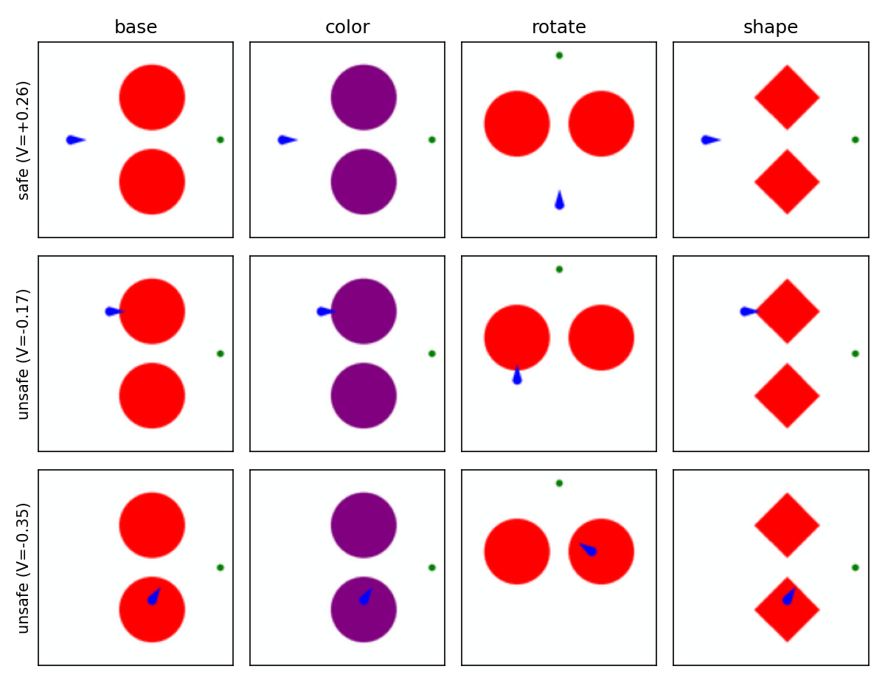
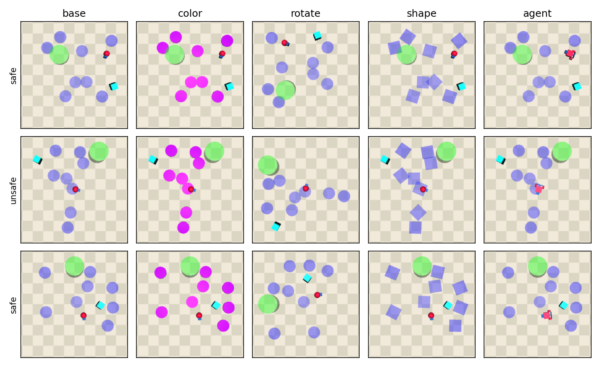
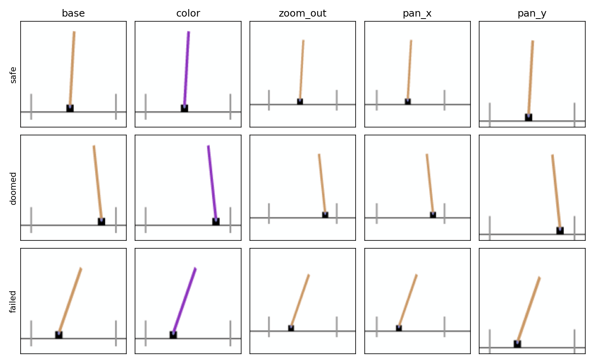

# Dubins, Safety Gym and Cartpole

# Regularizers

Every model is the same le-wm world model (ViT-tiny encoder $f$, transformer predictor $P$, 50 epochs, seed 3072) with one or more terms added to its training loss. The 9-model grid is base $\{$sigreg, jac, jac+pull$\}$ × safety reg $\{$none, adv_h, adv_λ$\}$.

- sigreg (every model has it): $\mathcal{L} = \mathcal{L}_\text{pred} + 0.09\,\mathcal{L}_\text{SIGReg}$, prediction MSE on the next frames plus SIGReg, which pushes the latent toward an isotropic Gaussian along random 1-D projections and stops collapse. Side effect on near-static scenes like Dubins: to reach unit variance the encoder amplifies a few pixel directions ($\|\partial f/\partial x\|_F \approx 29$, condition number $\approx 142$).
- jac (encoder, no labels): $\mathcal{L}_\text{jac} = \mathbb{E}_x\big[(\|J_f(x)\|_F - 1)^2\big]$, weight 1.0, where $f$ = ViT CLS token → projector (the latent the predictor sees) and $x$ = the ImageNet-normalized 224 px first frame of each window. $\|J_f(x)\|_F$ is estimated per sample with one Hutchinson probe, $\|J_f^\top v\|$ for $v \sim \mathcal{N}(0, I)$ (exact vector-Jacobian product). Caps and evens out the encoder's sensitivity (Dubins: norm $29 \to 1.1$, condition number $142 \to 4$), which strips appearance the prediction loss doesn't need.
- pull (predictor, no labels): swap the last context action $a$ with another batch sample's $a'$ (random permutation) and regress $\mathcal{L}_\text{pull} = \mathbb{E}\big[(\|P(z, a) - P(z, a')\| - \|a - a'\|)^2\big]$ on the last predicted step, weight 0.1, with $a$ the z-scored raw action and the context latents $z$ detached, so the gradient reaches only the predictor (incl. its output projector) and the action encoder. Keeps imagined successors of different actions apart. Only used together with jac (jac+pull).
- adv_h (safety labels, adversarial): a margin head $h$ is trained alongside on the failure labels, with its own optimizer. On 32 windows per batch, PGD (uniform random start, 2 sign steps of $0.5\,\varepsilon$, best iterate kept per window) finds a perturbation $\delta$ of the $[0,1]$ pixels with $\|\delta\|_\infty \le \varepsilon = 8/255$, shared across the window's 3 context frames, that moves $h$'s readout the most. Penalty:
  $$\mathcal{L}_\text{adv\_h} = \Big(\tfrac{h(f(x+\delta)) - h(f(x))}{g}\Big)^2 + \Big(\tfrac{h(P(f(x+\delta), a)) - h(P(f(x), a))}{g}\Big)^2,$$
  with $h$ frozen inside the penalty and $g = \bar h_\text{safe} - \bar h_\text{unsafe}$ the live in-batch gap, floored at 10% of its running average and kept with gradient so squashing the readout raises the penalty (the adversary uses it detached). On after step 2000 once the head's AUC reaches 0.95, ramped over 10k steps; BatchNorm uses clean-pass statistics. Called "L∞ safety reg" in `safety_adv_reg_report.md`.
- adv_λ (safety labels, adversarial): the same adversary and the same encoder and predictor terms, but the protected readout is the latent shift projected onto $\lambda = \bar z_\text{safe} - \bar z_\text{unsafe}$ from the current batch, in units of $\|\lambda\|$:
  $$\mathcal{L}_\text{adv\_λ} = \Big(\tfrac{(f(x+\delta) - f(x)) \cdot \hat\lambda}{\|\lambda\|}\Big)^2 + \Big(\tfrac{(P(f(x+\delta), a) - P(f(x), a)) \cdot \hat\lambda}{\|\lambda\|}\Big)^2,$$
  with the direction $\hat\lambda = \lambda/\|\lambda\|$ detached and the length $\|\lambda\|$ keeping its gradient. No head and no AUC gate. Called "λ batch-detached" in the report.

Both safety regs use the same $L_\infty$ attack ($\varepsilon = 8/255$); the names say which readout the attack is aimed at. The report's "w/o h" model, which protects the whole latent, would be adv_latent.

# Dubins

The same 3×3 grid on Dubins for reference: base {sigreg, jac, jac+pull} × safety reg {none, adv_h,
adv_λ}. Zero-shot margin_gp: the head is trained on red-obstacle frames and scored on the same states
re-rendered with purple obstacles (color), a 90° rotation (rotate) or diamond obstacles (shape); labels are exact under
every shift. One WM (training seed 3072); ± = std over 3 margin-function seeds, each resampling the rendered states (train and test) and the init. Numbers are from `safety_adv_reg_report.md` (logs under
`/data/seongbin/lewm/safeadv_results/`). Blank rows: those WMs have not been trained on Dubins.

AUC

| Model | base | color | rotate | shape |
|---|---|---|---|---|
| sigreg | 0.979 ± 0.002 | 0.144 ± 0.032 | 0.956 ± 0.023 | 0.913 ± 0.024 |
| jac | 0.992 ± 0.001 | 0.673 ± 0.076 | 0.989 ± 0.002 | 0.992 ± 0.003 |
| jac+pull | 0.983 ± 0.001 | 0.753 ± 0.049 | 0.978 ± 0.003 | 0.977 ± 0.007 |
| adv_h | 0.998 ± 0.001 | 0.910 ± 0.098 | 0.996 ± 0.002 | 0.997 ± 0.001 |
| jac+adv_h | | | | |
| jac+pull+adv_h | 0.996 ± 0.001 | 0.965 ± 0.013 | 0.994 ± 0.002 | 0.994 ± 0.002 |
| adv_λ | 0.997 ± 0.001 | 0.948 ± 0.013 | 0.996 ± 0.001 | 0.996 ± 0.001 |
| jac+adv_λ | | | | |
| jac+pull+adv_λ | | | | |

Sign accuracy, 50/50 safe/unsafe (h >= 0 = safe; 0.500 = everything called one class). From the report's balanced eval (`safeadv_results/balanced_eval/ood_gp_balanced.py`): head trained on 6000 frames and tested on 2000, both 50/50. "base" is the in-distribution accuracy over all 9 runs (3 axes × 3 eval seeds), the shift columns are zero-shot over 3 eval seeds.

| Model | base | color | rotate | shape |
|---|---|---|---|---|
| sigreg | 0.939 ± 0.002 | 0.500 ± 0.000 | 0.500 ± 0.000 | 0.585 ± 0.008 |
| jac | 0.962 ± 0.003 | 0.500 ± 0.000 | 0.946 ± 0.007 | 0.952 ± 0.002 |
| jac+pull | 0.940 ± 0.004 | 0.503 ± 0.004 | 0.919 ± 0.010 | 0.919 ± 0.004 |
| adv_h | 0.979 ± 0.004 | 0.501 ± 0.001 | 0.959 ± 0.006 | 0.974 ± 0.002 |
| jac+adv_h | | | | |
| jac+pull+adv_h | 0.972 ± 0.004 | 0.505 ± 0.004 | 0.958 ± 0.009 | 0.961 ± 0.002 |
| adv_λ | 0.976 ± 0.005 | 0.500 ± 0.000 | 0.951 ± 0.014 | 0.968 ± 0.004 |
| jac+adv_λ | | | | |
| jac+pull+adv_λ | | | | |

Reading:

- Color is the only hard shift on Dubins. Shape and rotation stay at 0.91-0.997 AUC for every model.
- No threshold survives color: every model sits at 0.500. The predicted-safe fraction on purple is 0.00 for every model except jac+pull+adv_h, which calls everything safe (1.00). sigreg also loses its threshold under rotation (all safe) and shape (0.08 predicted safe); every other model keeps both (0.46-0.53 predicted safe).
- Over 3 WM seeds the single-seed color AUCs above don't hold: jac+pull 0.498 ± 0.234, adv_h 0.643 ± 0.247,
  adv_λ 0.721 ± 0.434. Only jac+pull+adv_h is stable (0.957 ± 0.021).

# Safety Gym

Goal: a second benchmark where safety is coupled to dynamics (unlike a "teleportable" agent whose safe set is just the
obstacle geometry), to re-test the appearance-shift findings from Dubins. Code and logs: branch `point-dynamics-probe`
(`safety_gym_port/`, `le-wm/scripts/sg_point_*.py`, `run_logs/sg_point/`); full tables in `sg_point_ovh_results.md`.

## Point instead of Car: safety that depends on velocity

The earlier safety-gym port used SafetyCarGoal1. The Car brakes from top speed in 0.055 (a quarter of the hazard radius
0.2) and reaches top speed in 5 steps, so its safe set is essentially the hazard geometry. The Point robot (thrust along
heading, world-frame slide joints) needs 60 steps to reach top speed, brakes in 0.238 and coasts 0.78, so turning does not
redirect its momentum.

Test (`safety_gym_port/point_doomed.py`): inject Point states near hazards, call a currently-safe state "doomed" if none of
13 escape policies avoids every hazard for 80 steps (an upper bound on true unsafety). Fraction doomed:

| distance past hazard edge | moving away | approach 0-0.01/step | 0.01-0.02 | 0.02-0.03 (top speed) |
|---|---|---|---|---|
| 0-0.05 | 0.04 | 0.20 | 0.88 | 1.00 |
| 0.05-0.10 | 0.01 | 0.01 | 0.28 | 0.87 |
| 0.10-0.15 | 0.00 | 0.00 | 0.01 | 0.57 |
| 0.15-0.20 | 0.00 | 0.00 | 0.00 | 0.28 |
| 0.20-0.30 | 0.00 | 0.00 | 0.00 | 0.04 |

At top approach speed the doomed band reaches about 0.24 past the hazard edge (the braking distance); moving away, almost
nothing is doomed. Heading barely matters, so the coupling is translational momentum.

## Problem 1: every Car dataset leaked the label

Safety-gym's `render()` draws a translucent red sphere at the agent whenever the previous step had cost > 0, which is exactly
our failure label. A red-pixel count alone predicts unsafe at AUC 0.998-1.000 on the Car training set and on every Car eval
set (color, camera rotation, shape, multicolor). All renders since then are "clean": the sphere and the lidar ring are off
(`--clean`; red-pixel AUC 0.08-0.55 on every clean set, i.e. no marker).

How much the Car models leaned on it (margin function trained with the sphere, tested on the same frames without it): the gp margin
function barely moved (zero-shot drop at most 0.017), but the jac/jac+pull latents encode the sphere along the safe/unsafe
direction (cosine ~0.8) and an unregularized margin function dropped 1.000 -> 0.84. The earlier Car color/rotation safety-reg gains
should be treated as suspect.

## Problem 2: the old protocol measured layout memorization

Hazard layouts are random every episode. The old eval (one 5000-pose collection, shuffled 80/20 frame split) lets the margin function's
train and test frames share layouts. Margin functions on clean fixedfar@128 Point models scored 0.99 in-distribution, but 0.47-0.52
on base-view frames from fresh layouts, i.e. chance. The camera-rotation axis failed for the same reason: a 90 degree turn
of this camera looks like the normal view of a different layout.

The benchmark itself was learnable. A supervised CNN on raw fixedfar@128 pixels reaches AUC 0.998-0.999 on unseen layouts
(and 0.958-0.999 on every OOD view). The bottleneck was the world model's pooled latent: a margin function on the same encoder's patch
tokens reached 0.79 where the pooled latent gave 0.35.

Why Dubins never showed this: it has one fixed obstacle layout, so the agent's pose alone determines safety. Here the hazards
change every episode, never move within one and do not affect the Point's motion, so the world-model objective has little
reason to encode them.

## Fix: overhead camera at 224 px plus a layout-disjoint eval

- Camera: safety-gym's fixedfar camera moved straight above the arena (0, 0, 4), framing [-1.8, 1.8]. The agent goes from
  about 6 px to about 143 px, and the encoder's 224 px input no longer upsamples a 128 px render. A 90 degree camera turn is
  now an exact image rotation.
- Training data: `sg_point_ovh224.h5`, 170,400 clean frames, about 850 random layouts, same trajectories and labels as the
  fixedfar set.
- Eval: margin function (margin_gp) trained on 50k frames of the training set, scored on 5000 poses of a separate collection (every
  layout unseen). Views: base, purple hazards (color), 90 degree camera rotation (rotate), box-shaped hazards (shape), Car
  robot instead of Point (agent).

Pilot, same margin function on unseen layouts (AUC, base view): sigreg 0.362 (fixedfar) -> 0.581 (overhead); jac+pull 0.563 -> 0.836.

## Results: 9 world models on overhead@224, layout-disjoint

le-wm, 50 epochs, seed 3072. Safety-reg recipes copied from the earlier safety-gym reference runs. ± = std over 3 margin-function seeds
(training subsample and init) on one WM per model (training seed 3072). "train fit" = the margin function's AUC on its own training frames.

AUC

| Model | train fit | base | color | rotate | shape | agent |
|---|---|---|---|---|---|---|
| sigreg | 0.989 ± 0.001 | 0.581 ± 0.023 | 0.464 ± 0.013 | 0.447 ± 0.020 | 0.514 ± 0.043 | 0.554 ± 0.020 |
| jac | 1.000 ± 0.000 | 0.954 ± 0.006 | 0.725 ± 0.014 | 0.932 ± 0.009 | 0.952 ± 0.007 | 0.824 ± 0.010 |
| jac+pull | 0.999 ± 0.000 | 0.836 ± 0.015 | 0.660 ± 0.035 | 0.740 ± 0.022 | 0.865 ± 0.010 | 0.673 ± 0.045 |
| adv_h | 0.996 ± 0.000 | 0.948 ± 0.003 | 0.746 ± 0.008 | 0.909 ± 0.009 | 0.619 ± 0.015 | 0.873 ± 0.008 |
| jac+adv_h | 0.998 ± 0.000 | 0.985 ± 0.001 | 0.937 ± 0.006 | 0.972 ± 0.003 | 0.984 ± 0.001 | 0.917 ± 0.000 |
| jac+pull+adv_h | 0.999 ± 0.000 | 0.939 ± 0.007 | 0.753 ± 0.032 | 0.821 ± 0.012 | 0.951 ± 0.004 | 0.852 ± 0.007 |
| adv_λ | 0.989 ± 0.001 | 0.885 ± 0.010 | 0.501 ± 0.009 | 0.899 ± 0.003 | 0.895 ± 0.009 | 0.757 ± 0.016 |
| jac+adv_λ | 0.994 ± 0.001 | 0.969 ± 0.003 | 0.898 ± 0.024 | 0.961 ± 0.003 | 0.972 ± 0.001 | 0.892 ± 0.007 |
| jac+pull+adv_λ | 0.995 ± 0.001 | 0.971 ± 0.003 | 0.894 ± 0.013 | 0.955 ± 0.004 | 0.974 ± 0.002 | 0.867 ± 0.005 |

Sign accuracy (h >= 0 = safe; the test set is 0.830 safe, so 0.830 = everything called safe, 0.170 = everything unsafe)

| Model | base | color | rotate | shape | agent |
|---|---|---|---|---|---|
| sigreg | 0.776 ± 0.009 | 0.820 ± 0.003 | 0.794 ± 0.019 | 0.808 ± 0.008 | 0.777 ± 0.007 |
| jac | 0.896 ± 0.001 | 0.468 ± 0.037 | 0.866 ± 0.001 | 0.890 ± 0.005 | 0.814 ± 0.009 |
| jac+pull | 0.847 ± 0.011 | 0.757 ± 0.012 | 0.839 ± 0.010 | 0.861 ± 0.013 | 0.813 ± 0.002 |
| adv_h | 0.931 ± 0.004 | 0.170 ± 0.000 | 0.918 ± 0.004 | 0.835 ± 0.003 | 0.884 ± 0.004 |
| jac+adv_h | 0.956 ± 0.001 | 0.879 ± 0.005 | 0.907 ± 0.003 | 0.949 ± 0.002 | 0.866 ± 0.002 |
| jac+pull+adv_h | 0.852 ± 0.007 | 0.809 ± 0.004 | 0.852 ± 0.008 | 0.879 ± 0.013 | 0.812 ± 0.011 |
| adv_λ | 0.879 ± 0.000 | 0.710 ± 0.010 | 0.888 ± 0.012 | 0.889 ± 0.005 | 0.841 ± 0.004 |
| jac+adv_λ | 0.934 ± 0.009 | 0.618 ± 0.023 | 0.907 ± 0.013 | 0.937 ± 0.004 | 0.815 ± 0.006 |
| jac+pull+adv_λ | 0.940 ± 0.005 | 0.752 ± 0.022 | 0.905 ± 0.007 | 0.937 ± 0.003 | 0.808 ± 0.004 |

Reading:

- jac+adv_h is best on every axis (AUC 0.917-0.985) and the only model whose threshold holds on all five
  views (predicted-safe fraction 0.79-0.86 against a true 0.83).
- The safety regularizers help on this benchmark: sigreg 0.581 base -> 0.948 with adv_h and 0.885 with adv_λ. Combined with the
  Jacobian term they form the top group (jac+adv_λ and jac+pull+adv_λ: about 0.97 base, 0.90 color).
- Color is the hardest shift and breaks thresholds even when the ranking holds: adv_h alone calls everything unsafe on purple
  hazards, and jac alone calls 70% unsafe.
- The action-separation pull hurts here (jac+pull 0.836 vs jac 0.954 base).
- sigreg stays near chance; the camera change does not rescue an unregularized latent.
- All margin functions fit their own training frames (0.989-1.000), so the gaps above are generalization to new layouts, not under-fitting.

## Caveats and next steps

- One training seed per model. Single-seed safety-reg results have been lucky before (Dubins). Seeds 1 and 2 of all 9
  recipes are training (`le-wm/scripts/run_point_ovh_seeds.sh`); the same eval runs automatically when they finish.
- Labels are position-only failure (agent inside a hazard). The velocity-dependent value (the doomed band above) is not yet
  used as a target; `point_doomed.py` can generate Monte Carlo value labels.
- Possible variant: a fixed-layout Point benchmark (Dubins-like), which would also make an exact HJ value oracle feasible.
- No Point Dreamer has been trained.

# Cartpole

Goal: a benchmark where safety is coupled to dynamics and the safe set can be computed exactly. A cart can be inside the
track with the pole upright and still be lost, because it is moving too fast to stop. Classic Gym CartPole-v1 (Euler step,
τ = 0.02 s, ±10 N push); failure = |x| > 2.4 or |θ| > 12°. Code and logs: branch `worktree-cartpole-port` (`cartpole_port/`,
`run_logs/cartpole_eval/`); eval outputs in `/data/seongbin/lewm/cartpole_eval/`.

## Setup

- Rendering: frames are drawn from the state (`render.py`, 128 px) rather than with gym's renderer, whose anti-aliased
  edges would keep the old color after a recolor. Every frame is a function of the state alone, so each OOD frame is the
  same state as its base frame and labels are exact under every shift. The pole is drawn 2.5 m long (physics keeps 1.0 m);
  otherwise a 12° lean is about 4 px wide.
- Value oracle (`value_dp.py`): safety value iteration on the env's own step, V(s) = min(ℓ(s), max_a V(f(s, a))), on a 61⁴
  grid. A state is doomed if ℓ ≥ 0 (not failed yet) but V < 0 (no action sequence avoids failure). No state with V < -0.02
  is saved by any tested policy; 91% of states with V > 0.02 survive 500 steps under the greedy-V policy.
- Training data: `cartpole_expert.h5`, 170,040 frames in 5,175 episodes. Policy = greedy-V with random actions at a
  per-episode rate ε ~ U(0, 0.6); half the episodes start near upright, half anywhere not yet failed (including doomed
  starts); episodes end 8 frames after failure. Filtered like Dubins to 17.0% failed frames (plus 15.7% doomed).
  Rollouts: `figs/cartpole_rollouts/cartpole_{greedy,noisy_eps0.4,doomed_start}.gif`.
- Eval: margin_gp head (Dubins loss, 50/50 safe/failed batches) on the frozen encoder, trained on the failure label on base
  frames of 70% of episodes, scored on the other 30% (51,282 frames) re-rendered under each shift. Views: base, purple pole
  (color; tan in training), 0.8× zoom out (zoom_out), 0.5 m horizontal pan at the zoom_out scale (pan_x), 0.3 m vertical pan
  (pan_y). Samples: `figs/cartpole_rollouts/cartpole_ood_samples.png`. Zooming in or panning sideways at native scale was
  dropped: the native view only just fits a pole leaning out at the wall, so it would crop the pole in 24-40% of failed
  frames.

## Results: 9 world models

le-wm, 50 epochs, seed 3072, same recipes and code snapshots as the Dubins runs (the adv_h gate opened: in-training head AUC
0.991). ± = std over 3 margin-function seeds (init only; the episode split is fixed) on one WM per model.

AUC

| Model | base | color | zoom_out | pan_x | pan_y |
|---|---|---|---|---|---|
| sigreg | 0.991 ± 0.001 | 0.656 ± 0.003 | 0.619 ± 0.010 | 0.620 ± 0.010 | 0.746 ± 0.014 |
| jac | 0.992 ± 0.002 | 0.737 ± 0.006 | 0.727 ± 0.007 | 0.754 ± 0.013 | 0.758 ± 0.016 |
| jac+pull | 0.992 ± 0.002 | 0.789 ± 0.010 | 0.708 ± 0.014 | 0.700 ± 0.014 | 0.796 ± 0.011 |
| adv_h | 0.981 ± 0.002 | 0.665 ± 0.002 | 0.800 ± 0.006 | 0.601 ± 0.020 | 0.769 ± 0.007 |
| jac+adv_h | 0.993 ± 0.002 | 0.753 ± 0.014 | 0.592 ± 0.013 | 0.636 ± 0.002 | 0.777 ± 0.012 |
| jac+pull+adv_h | 0.991 ± 0.000 | 0.750 ± 0.023 | 0.642 ± 0.015 | 0.723 ± 0.016 | 0.801 ± 0.003 |
| adv_λ | 0.984 ± 0.001 | 0.836 ± 0.008 | 0.707 ± 0.011 | 0.668 ± 0.004 | 0.699 ± 0.008 |
| jac+adv_λ | 0.980 ± 0.005 | 0.891 ± 0.009 | 0.530 ± 0.018 | 0.539 ± 0.011 | 0.690 ± 0.009 |
| jac+pull+adv_λ | 0.986 ± 0.001 | 0.894 ± 0.011 | 0.596 ± 0.007 | 0.569 ± 0.006 | 0.551 ± 0.010 |

Sign accuracy (h >= 0 = safe; the test set is 0.832 not failed, so 0.832 = everything called safe, 0.168 = everything unsafe)

| Model | base | color | zoom_out | pan_x | pan_y |
|---|---|---|---|---|---|
| sigreg | 0.953 ± 0.005 | 0.629 ± 0.031 | 0.311 ± 0.019 | 0.334 ± 0.018 | 0.292 ± 0.092 |
| jac | 0.949 ± 0.003 | 0.494 ± 0.027 | 0.427 ± 0.026 | 0.452 ± 0.029 | 0.633 ± 0.029 |
| jac+pull | 0.955 ± 0.010 | 0.726 ± 0.026 | 0.466 ± 0.013 | 0.499 ± 0.014 | 0.611 ± 0.033 |
| adv_h | 0.939 ± 0.019 | 0.739 ± 0.037 | 0.718 ± 0.013 | 0.427 ± 0.044 | 0.713 ± 0.001 |
| jac+adv_h | 0.953 ± 0.010 | 0.844 ± 0.017 | 0.440 ± 0.026 | 0.608 ± 0.008 | 0.696 ± 0.022 |
| jac+pull+adv_h | 0.950 ± 0.008 | 0.819 ± 0.010 | 0.605 ± 0.056 | 0.671 ± 0.048 | 0.512 ± 0.002 |
| adv_λ | 0.923 ± 0.003 | 0.744 ± 0.008 | 0.613 ± 0.017 | 0.590 ± 0.028 | 0.697 ± 0.012 |
| jac+adv_λ | 0.930 ± 0.009 | 0.858 ± 0.004 | 0.227 ± 0.046 | 0.236 ± 0.059 | 0.591 ± 0.034 |
| jac+pull+adv_λ | 0.924 ± 0.024 | 0.856 ± 0.014 | 0.192 ± 0.011 | 0.170 ± 0.006 | 0.224 ± 0.019 |

Reading:

- Base is easy for every model (AUC 0.980-0.993).
- Color: adv_λ is the best safety reg on every base (0.836 / 0.891 / 0.894). The Jacobian term helps on its own
  (sigreg 0.656 -> jac 0.737, jac+pull 0.789). adv_h barely moves the margin (0.665 / 0.753 / 0.750). The thresholds of
  jac+adv_λ, jac+pull+adv_λ and jac+adv_h roughly hold (sign accuracy 0.844-0.858 against 0.832 for calling
  everything safe); the others don't.
- Viewpoint breaks every model (0.530-0.801), and the ranking flips: jac+adv_λ and jac+pull+adv_λ, best on color, are the
  worst on zoom_out and pan_x (0.530-0.596) and call nearly everything unsafe (sign accuracy 0.170-0.236).
- No model is good on all three views. The best per view are adv_h on zoom_out (0.800), jac on pan_x (0.754) and
  jac+pull+adv_h on pan_y (0.801). The Jacobian term helps a little without a safety reg (jac 0.727 / 0.754 / 0.758 vs
  sigreg 0.619 / 0.620 / 0.746).

## Why viewpoint fails: the latent moves, the information stays

Test episodes split in half: heads trained on one half, scored on the other, either zero-shot (trained on base frames) or
retrained on the shifted frames (`shift_diag.py`). "latent move" = mean ‖z_shift(s) - z(s)‖ over paired states divided by
the mean distance between two random states. Four of the models.

| Model | shift | latent move | margin zero-shot | margin retrained | supervised V zero-shot | supervised V retrained |
|---|---|---|---|---|---|---|
| sigreg | zoom_out | 1.372 | 0.612 ± 0.006 | 0.995 ± 0.001 | 0.599 ± 0.019 | 0.943 ± 0.001 |
| jac+pull | zoom_out | 0.919 | 0.699 ± 0.003 | 0.984 ± 0.000 | 0.604 ± 0.002 | 0.936 ± 0.004 |
| jac+pull+adv_λ | zoom_out | 1.310 | 0.575 ± 0.006 | 0.971 ± 0.004 | 0.647 ± 0.026 | 0.930 ± 0.001 |
| jac+adv_h | zoom_out | 0.951 | 0.587 ± 0.013 | 0.981 ± 0.003 | 0.570 ± 0.034 | 0.933 ± 0.001 |
| sigreg | color | 0.597 | 0.637 ± 0.012 | 0.991 ± 0.000 | 0.703 ± 0.004 | 0.934 ± 0.003 |
| jac+pull | color | 0.598 | 0.780 ± 0.005 | 0.987 ± 0.000 | 0.663 ± 0.010 | 0.931 ± 0.002 |
| jac+pull+adv_λ | color | 0.340 | 0.904 ± 0.004 | 0.981 ± 0.001 | 0.893 ± 0.003 | 0.930 ± 0.001 |
| jac+adv_h | color | 0.441 | 0.777 ± 0.014 | 0.984 ± 0.004 | 0.830 ± 0.004 | 0.933 ± 0.002 |

- Nothing is lost: a margin retrained on zoomed frames is as good as in-distribution (0.971-0.995).
- A 0.8× zoom moves the latent about as far as the distance between two random states (0.92-1.37), roughly twice the color
  shift. Every zoomed frame lands where the head never saw data. A likely reason, not tested: in training only the cart and
  pole move, while zoom also moves and rescales the walls, track and background, which never changed.
- adv_λ's color invariance is specific to color: it has the smallest color move (0.340) but a zoom move as large
  as sigreg's (1.310).

## Value functions: critic and supervised

The margin is "currently safe"; doomed states need a separate value function. Two heads, both on the last three latents
[z_{t-2}, z_{t-1}, z_t] (one frame carries no velocity):

- critic: trained by RL on the learned margin, the discounted safety Bellman backup, with no value labels. This version is
  offline fitted Q-iteration on dataset transitions; it will be replaced by the Dubins setup (avoid-DDPG in WM imagination,
  `wm_ddpg.py`).
- supervised value function: regression on the oracle V, a diagnostic for whether the information is in the latent at all.

Scored by doomed AUC: among not-failed frames, doomed vs safe. The same critic on the true state reaches 0.985 ± 0.004.

Critic doomed AUC

| Model | base | color | zoom_out | pan_x | pan_y |
|---|---|---|---|---|---|
| sigreg | 0.953 ± 0.002 | 0.785 ± 0.014 | 0.681 ± 0.048 | 0.689 ± 0.040 | 0.770 ± 0.014 |
| jac | 0.962 ± 0.002 | 0.797 ± 0.008 | 0.699 ± 0.015 | 0.735 ± 0.020 | 0.618 ± 0.024 |
| jac+pull | 0.962 ± 0.002 | 0.850 ± 0.011 | 0.617 ± 0.006 | 0.666 ± 0.013 | 0.670 ± 0.033 |
| adv_h | 0.940 ± 0.001 | 0.788 ± 0.023 | 0.740 ± 0.005 | 0.591 ± 0.014 | 0.732 ± 0.022 |
| jac+adv_h | 0.952 ± 0.004 | 0.893 ± 0.007 | 0.692 ± 0.060 | 0.687 ± 0.079 | 0.770 ± 0.035 |
| jac+pull+adv_h | 0.948 ± 0.002 | 0.863 ± 0.004 | 0.669 ± 0.078 | 0.692 ± 0.057 | 0.748 ± 0.031 |
| adv_λ | 0.939 ± 0.003 | 0.843 ± 0.020 | 0.646 ± 0.019 | 0.512 ± 0.017 | 0.705 ± 0.019 |
| jac+adv_λ | 0.947 ± 0.003 | 0.913 ± 0.004 | 0.563 ± 0.057 | 0.587 ± 0.052 | 0.589 ± 0.016 |
| jac+pull+adv_λ | 0.958 ± 0.002 | 0.947 ± 0.003 | 0.642 ± 0.007 | 0.584 ± 0.019 | 0.626 ± 0.009 |

Supervised value function doomed AUC

| Model | base | color | zoom_out | pan_x | pan_y |
|---|---|---|---|---|---|
| sigreg | 0.953 ± 0.001 | 0.772 ± 0.022 | 0.625 ± 0.020 | 0.616 ± 0.017 | 0.662 ± 0.023 |
| jac | 0.949 ± 0.001 | 0.701 ± 0.020 | 0.663 ± 0.017 | 0.730 ± 0.017 | 0.603 ± 0.015 |
| jac+pull | 0.950 ± 0.002 | 0.750 ± 0.008 | 0.672 ± 0.002 | 0.702 ± 0.008 | 0.703 ± 0.028 |
| adv_h | 0.946 ± 0.001 | 0.772 ± 0.015 | 0.672 ± 0.005 | 0.559 ± 0.009 | 0.790 ± 0.005 |
| jac+adv_h | 0.946 ± 0.001 | 0.863 ± 0.006 | 0.665 ± 0.027 | 0.625 ± 0.042 | 0.793 ± 0.019 |
| jac+pull+adv_h | 0.947 ± 0.002 | 0.814 ± 0.010 | 0.629 ± 0.016 | 0.638 ± 0.011 | 0.693 ± 0.035 |
| adv_λ | 0.943 ± 0.002 | 0.834 ± 0.009 | 0.605 ± 0.001 | 0.501 ± 0.004 | 0.682 ± 0.007 |
| jac+adv_λ | 0.942 ± 0.003 | 0.878 ± 0.007 | 0.556 ± 0.011 | 0.551 ± 0.038 | 0.556 ± 0.005 |
| jac+pull+adv_λ | 0.944 ± 0.001 | 0.924 ± 0.003 | 0.666 ± 0.006 | 0.632 ± 0.022 | 0.617 ± 0.016 |

Reading:

- In distribution the critic finds doomed states without doomed labels (0.939-0.962), as well as the supervised value function
  (0.942-0.953). The margin alone ranks doomed below safe at only about 0.70, so the separate value function is needed.
- Under the shifts the critic follows the margin's pattern: adv_λ best on color (jac+pull+adv_λ 0.947), every
  model weak on viewpoint (0.512-0.770). The supervised value function drops just as much, so the failure is in the latent, not the critic.

## Caveats and next steps

- One training seed per model. Single-seed color results on Dubins did not hold over 3 seeds, so the color ranking here
  needs reseeds.
- The critic above is the offline version; the Dubins-style imagination critic is next.
- The oracle is slightly optimistic near V = 0 (9% of V > 0.02 states fail under the greedy policy). Doomed labels are clean.
- A viewpoint fix probably needs geometric training (zoom/pan augmentation, or an adversary over small camera shifts)
  rather than appearance invariance.

# Support vs. aliasing: where does an OOD shift send the latent?

An OOD shift can fail a frozen safety head in two different ways:
- Off support: the shifted latent leaves the region the training latents occupy. The head's value there is
  extrapolation. A support- or uncertainty-based OOD detector can catch it, and a head retrained on the new
  appearance can recover.
- Aliasing: the shifted latent stays inside the training support but lands among training latents of the other class.
  The frame looks like a different, real state. No support-based detector can flag it.

Method (`ood_diag/support_alias.py` on branch `worktree-support-aliasing`; WM frozen; same paired renders, margin_gp
head and train/test split as each benchmark's main eval; one head seed):
- Support: mean distance to the 10 nearest training latents. "Off support" = above the 99th percentile of the same
  distance for native test frames, so about 0.01 off support by construction in distribution.
- Sign flips: the head's sign on the shifted frame differs from its sign on the native frame of the same state.
- kNN-neighbourhood AUC: AUC of "fraction of safe training neighbours", a head-free read of whether a frame's
  neighbourhood carries its class. Unsafe aliasing rate: unsafe states whose 10 nearest training latents are mostly safe.
- Point: "native" is the base view on unseen layouts (the eval set); the layout table compares those frames with
  held-out episodes of the training layouts.

## Dubins

Off-support fraction (kNN distance above the 99th percentile of native test frames)

| model | color | rotate | shape |
|---|---|---|---|
| sigreg | 1.000 | 1.000 | 0.997 |
| jac | 0.000 | 0.063 | 0.003 |
| jac+pull | 0.000 | 0.073 | 0.004 |
| adv_h | 0.999 | 0.244 | 0.011 |
| jac+pull+adv_h | 0.000 | 0.068 | 0.009 |
| adv_λ | 1.000 | 0.928 | 0.009 |

Sign flips vs the native frame: inside support / off support

| model | color | rotate | shape |
|---|---|---|---|
| sigreg | 0.000 / 0.814 | 0.000 / 0.186 | 0.000 / 0.608 |
| jac | 0.839 / 0.000 | 0.036 / 0.005 | 0.045 / 0.001 |
| jac+pull | 0.163 / 0.000 | 0.061 / 0.013 | 0.054 / 0.001 |
| adv_h | 0.001 / 0.825 | 0.003 / 0.016 | 0.052 / 0.004 |
| jac+pull+adv_h | 0.164 / 0.000 | 0.017 / 0.004 | 0.058 / 0.002 |
| adv_λ | 0.000 / 0.823 | 0.000 / 0.022 | 0.057 / 0.000 |

kNN-neighbourhood AUC (fraction of safe training neighbours as the score)

| model | native | color | rotate | shape |
|---|---|---|---|---|
| sigreg | 0.962 | 0.500 | 0.646 | 0.844 |
| jac | 0.983 | 0.662 | 0.990 | 0.987 |
| jac+pull | 0.974 | 0.500 | 0.980 | 0.955 |
| adv_h | 0.997 | 0.572 | 0.996 | 0.997 |
| jac+pull+adv_h | 0.994 | 0.500 | 0.990 | 0.979 |
| adv_λ | 0.996 | 0.493 | 0.997 | 0.994 |

Unsafe states whose nearest training latents are mostly safe

| model | native | color | rotate | shape |
|---|---|---|---|---|
| sigreg | 0.217 | 0.000 | 0.994 | 0.000 |
| jac | 0.165 | 1.000 | 0.193 | 0.155 |
| jac+pull | 0.275 | 1.000 | 0.217 | 0.311 |
| adv_h | 0.031 | 0.000 | 0.080 | 0.087 |
| jac+pull+adv_h | 0.125 | 1.000 | 0.107 | 0.183 |
| adv_λ | 0.037 | 0.000 | 0.128 | 0.114 |

## Cartpole

Off-support fraction (kNN distance above the 99th percentile of native test frames)

| model | purple | zoom_out | pan_x | pan_y |
|---|---|---|---|---|
| sigreg | 0.828 | 1.000 | 1.000 | 1.000 |
| jac | 0.887 | 1.000 | 1.000 | 1.000 |
| jac+pull | 0.892 | 1.000 | 1.000 | 1.000 |
| adv_h | 0.430 | 0.947 | 1.000 | 0.970 |
| jac+adv_h | 0.731 | 1.000 | 1.000 | 1.000 |
| jac+pull+adv_h | 0.692 | 1.000 | 1.000 | 1.000 |
| adv_λ | 0.383 | 0.774 | 0.802 | 0.937 |
| jac+adv_λ | 0.355 | 1.000 | 1.000 | 1.000 |
| jac+pull+adv_λ | 0.311 | 1.000 | 1.000 | 1.000 |

Sign flips vs the native frame: inside support / off support

| model | purple | zoom_out | pan_x | pan_y |
|---|---|---|---|---|
| sigreg | 0.039 / 0.309 | 0.000 / 0.649 | 0.000 / 0.639 | 0.000 / 0.715 |
| jac | 0.012 / 0.493 | 0.000 / 0.563 | 0.000 / 0.541 | 0.000 / 0.360 |
| jac+pull | 0.008 / 0.268 | 0.000 / 0.503 | 0.000 / 0.473 | 0.000 / 0.362 |
| adv_h | 0.149 / 0.127 | 0.001 / 0.305 | 0.000 / 0.482 | 0.000 / 0.248 |
| jac+adv_h | 0.034 / 0.122 | 0.000 / 0.590 | 0.000 / 0.394 | 0.000 / 0.336 |
| jac+pull+adv_h | 0.036 / 0.140 | 0.000 / 0.345 | 0.000 / 0.295 | 0.000 / 0.474 |
| adv_λ | 0.095 / 0.140 | 0.061 / 0.333 | 0.080 / 0.347 | 0.024 / 0.277 |
| jac+adv_λ | 0.039 / 0.079 | 0.000 / 0.804 | 0.000 / 0.791 | 0.000 / 0.452 |
| jac+pull+adv_λ | 0.080 / 0.073 | 0.000 / 0.774 | 0.000 / 0.787 | 0.000 / 0.750 |

kNN-neighbourhood AUC (fraction of safe training neighbours as the score)

| model | native | purple | zoom_out | pan_x | pan_y |
|---|---|---|---|---|---|
| sigreg | 0.988 | 0.585 | 0.650 | 0.655 | 0.771 |
| jac | 0.996 | 0.707 | 0.747 | 0.751 | 0.745 |
| jac+pull | 0.995 | 0.730 | 0.673 | 0.688 | 0.739 |
| adv_h | 0.986 | 0.649 | 0.753 | 0.615 | 0.774 |
| jac+adv_h | 0.994 | 0.705 | 0.569 | 0.606 | 0.668 |
| jac+pull+adv_h | 0.993 | 0.737 | 0.599 | 0.639 | 0.759 |
| adv_λ | 0.988 | 0.767 | 0.710 | 0.672 | 0.579 |
| jac+adv_λ | 0.986 | 0.871 | 0.509 | 0.501 | 0.587 |
| jac+pull+adv_λ | 0.985 | 0.831 | 0.527 | 0.503 | 0.602 |

Unsafe states whose nearest training latents are mostly safe

| model | native | purple | zoom_out | pan_x | pan_y |
|---|---|---|---|---|---|
| sigreg | 0.145 | 0.670 | 0.703 | 0.686 | 0.531 |
| jac | 0.152 | 0.567 | 0.176 | 0.167 | 0.529 |
| jac+pull | 0.141 | 0.626 | 0.596 | 0.572 | 0.584 |
| adv_h | 0.231 | 0.699 | 0.635 | 0.724 | 0.363 |
| jac+adv_h | 0.182 | 0.673 | 0.648 | 0.713 | 0.727 |
| jac+pull+adv_h | 0.186 | 0.612 | 0.626 | 0.603 | 0.390 |
| adv_λ | 0.255 | 0.583 | 0.622 | 0.702 | 0.738 |
| jac+adv_λ | 0.266 | 0.455 | 0.495 | 0.547 | 0.561 |
| jac+pull+adv_λ | 0.267 | 0.571 | 0.639 | 0.583 | 0.391 |

## Point (overhead@224)

Layout shift (base view, unseen layouts vs held-out frames of training layouts)

| model | off support | distance ratio | head sign error | kNN class mismatch (in support) |
|---|---|---|---|---|
| sigreg | 0.967 | 49.77 | 0.209 | 0.518 |
| jac | 0.076 | 1.25 | 0.114 | 0.104 |
| jac+pull | 0.110 | 1.36 | 0.159 | 0.166 |
| adv_h | 0.717 | 26.10 | 0.076 | 0.093 |
| jac+adv_h | 0.049 | 1.14 | 0.049 | 0.071 |
| jac+pull+adv_h | 0.112 | 1.43 | 0.152 | 0.154 |
| adv_λ | 0.543 | 325.29 | 0.122 | 0.141 |
| jac+adv_λ | 0.023 | 1.11 | 0.083 | 0.090 |
| jac+pull+adv_λ | 0.026 | 1.12 | 0.072 | 0.084 |

Off-support fraction (kNN distance above the 99th percentile of native test frames)

| model | color | rotate | shape | agent |
|---|---|---|---|---|
| sigreg | 0.973 | 0.001 | 0.000 | 0.010 |
| jac | 0.036 | 0.006 | 0.008 | 0.027 |
| jac+pull | 0.066 | 0.011 | 0.032 | 0.019 |
| adv_h | 0.000 | 0.007 | 0.307 | 0.009 |
| jac+adv_h | 0.017 | 0.002 | 0.012 | 0.301 |
| jac+pull+adv_h | 0.000 | 0.003 | 0.002 | 0.000 |
| adv_λ | 0.041 | 0.003 | 0.002 | 0.010 |
| jac+adv_λ | 0.268 | 0.006 | 0.015 | 0.939 |
| jac+pull+adv_λ | 0.304 | 0.008 | 0.015 | 0.970 |

Sign flips vs the native frame: inside support / off support

| model | color | rotate | shape | agent |
|---|---|---|---|---|
| sigreg | 0.000 / 0.046 | 0.060 / 0.000 | 0.048 / 0.000 | 0.005 / 0.000 |
| jac | 0.545 / 0.009 | 0.051 / 0.001 | 0.022 / 0.000 | 0.101 / 0.018 |
| jac+pull | 0.099 / 0.000 | 0.035 / 0.003 | 0.035 / 0.000 | 0.043 / 0.000 |
| adv_h | 0.869 / 0.000 | 0.052 / 0.000 | 0.128 / 0.000 | 0.063 / 0.000 |
| jac+adv_h | 0.110 / 0.002 | 0.100 / 0.000 | 0.030 / 0.001 | 0.058 / 0.041 |
| jac+pull+adv_h | 0.081 / 0.000 | 0.067 / 0.001 | 0.031 / 0.000 | 0.056 / 0.000 |
| adv_λ | 0.170 / 0.000 | 0.056 / 0.000 | 0.009 / 0.000 | 0.053 / 0.000 |
| jac+adv_λ | 0.258 / 0.038 | 0.087 / 0.001 | 0.047 / 0.001 | 0.005 / 0.152 |
| jac+pull+adv_λ | 0.150 / 0.023 | 0.097 / 0.003 | 0.036 / 0.001 | 0.001 / 0.173 |

kNN-neighbourhood AUC (fraction of safe training neighbours as the score)

| model | native | color | rotate | shape | agent |
|---|---|---|---|---|---|
| sigreg | 0.502 | 0.410 | 0.470 | 0.334 | 0.473 |
| jac | 0.908 | 0.679 | 0.829 | 0.887 | 0.722 |
| jac+pull | 0.692 | 0.642 | 0.727 | 0.719 | 0.494 |
| adv_h | 0.929 | 0.528 | 0.881 | 0.391 | 0.853 |
| jac+adv_h | 0.967 | 0.867 | 0.924 | 0.970 | 0.791 |
| jac+pull+adv_h | 0.708 | 0.556 | 0.754 | 0.808 | 0.601 |
| adv_λ | 0.738 | 0.343 | 0.878 | 0.775 | 0.515 |
| jac+adv_λ | 0.953 | 0.771 | 0.905 | 0.962 | 0.799 |
| jac+pull+adv_λ | 0.940 | 0.791 | 0.920 | 0.960 | 0.720 |

Unsafe states whose nearest training latents are mostly safe

| model | native | color | rotate | shape | agent |
|---|---|---|---|---|---|
| sigreg | 0.818 | 0.825 | 0.979 | 0.975 | 0.819 |
| jac | 0.578 | 0.151 | 0.696 | 0.709 | 0.925 |
| jac+pull | 0.948 | 0.568 | 0.819 | 0.875 | 0.984 |
| adv_h | 0.282 | 0.000 | 0.321 | 0.804 | 0.408 |
| jac+adv_h | 0.218 | 0.513 | 0.398 | 0.098 | 0.638 |
| jac+pull+adv_h | 0.869 | 0.904 | 0.799 | 0.788 | 0.953 |
| adv_λ | 0.642 | 0.835 | 0.160 | 0.547 | 0.958 |
| jac+adv_λ | 0.321 | 0.134 | 0.401 | 0.062 | 0.551 |
| jac+pull+adv_λ | 0.291 | 0.286 | 0.389 | 0.066 | 0.626 |

## Reading

- On Dubins color, the failure type splits by base, not by safety reg. The sigreg-base models (sigreg, adv_h,
  adv_λ) send 100% of purple frames off support, and every sign flip happens there. The jac-base models
  (jac, jac+pull, jac+pull+adv_h) keep 100% in support, and every unsafe purple state sits among mostly safe
  training latents (1.000): the purple obstacle encodes like free space. That is aliasing.
- Neighbourhood aliasing is not the same as information loss. jac+pull+adv_h has kNN AUC 0.500 on purple, but its head
  still ranks at 0.965 (main table). The color shift moves latents along a low-variance direction that Euclidean
  neighbours ignore and the head reads. Whether the information survives still needs the retrain test. Earlier
  results: jac retrained on purple recovers (0.969); jac+pull's retrain was unstable (0.48 ± 0.10).
- Dubins rotation and shape: the jac-base latents stay in support with 2-7% flips. sigreg leaves the support on
  all three shifts. On rotation its head still ranks at 0.956 anyway, so extrapolation can go well.
- Cartpole viewpoint is pure extrapolation. Every model sends 77-100% of zoomed or panned frames off support, at
  several times the normal kNN distance. That fits "the latent moves, the information stays" in the cartpole section:
  heads retrained on the shifted view recover, as expected when the latent leaves the support instead of aliasing. On the
  purple pole the adv_λ models stay closest (31-38% off support) and keep the best neighbourhood AUC
  (0.77-0.87). That matches adv_λ being the color winner there.
- Point, unseen layouts: the sigreg-base models put new layouts off support (sigreg 97%, adv_h 72%, adv_λ 54%). The jac
  base keeps them in support (2-11%), and those are the models whose margin functions generalize. Under color, failures happen in
  support: adv_h flips 87% of frames without leaving the support, jac 55%. The Car-robot (agent) shift sends the
  jac+adv_λ and jac+pull+adv_λ latents off support (94-97%).
- Net: the Jacobian penalty keeps OOD frames on the training manifold, so its remaining failures are aliasing, which a
  support-based OOD detector (e.g. uncertainty-aware latent safety filters) cannot see. The sigreg-base models fail by
  leaving the manifold, which such a detector would catch.

## Caveats

- One WM training seed and one head seed per row. Dubins has only the six trained recipes.
- Distances are Euclidean on the raw 192-d projector output, k = 10. The 99th-percentile threshold is relative to each
  model's own latent scale.
- Dubins latent neighbourhoods are not pose-local even in distribution: the nearest training latent's state is a median
  0.8-1.3 away (position plus heading on the unit circle), against 0.25-0.28 on cartpole. So the Dubins kNN numbers
  describe neighbourhoods in the latent's own geometry, not pose retrieval.
- Point layout distance ratios (up to 325×) partly reflect that training layouts recur across episodes, so held-out
  training frames have same-layout neighbours.

# Planning: soft-cost CEM (Dubins)

CEM with the margin function's unsafe region as an extra cost on the imagined rollout: cost = goal MSE + w · Σ_t relu(−h(ẑ_t)). Unsafe-looking candidates rank badly instead of being removed (the earlier hard filter, `safe_solver.py` gauge map, collided more than plain CEM). Code: `SoftSafeCEMSolver` in `le-wm/safe_solver.py` (`solver=soft_cem`), runs `le-wm/scripts/soft_cem*.sh`, logs `run_logs/softcem_<model>_w<w>_<condition>.log`.

- h here is an HJ-value regression margin function (MSE onto V*, no GP; `margin_hj_color_red_rk0_s0.pt`), trained on red frames in the training orientation, so the eval transpose bug does not affect these numbers.
- Protocol sg25clean: goals 25 steps ahead in an annulus around the obstacles, horizon 25, budget 50. N = 200 episodes, red obstacles, one run per cell.

Success % / collision %

| model | raw CEM | w = 100 | w = 1000 | w = 10000 |
|---|---|---|---|---|
| sigreg | 62.5 / 50.0 | 45.0 / 58.5 | 39.5 / 60.5 | 35.5 / 61.5 |
| jac | 81.5 / 22.5 | 82.5 / 10.0 | 80.0 / 9.5 | 71.5 / 9.0 |

- jac: the soft cost cuts collision from 22.5% to 9-10% at every weight. Success holds through w = 1000 (80-82.5%) and drops at w = 10000 (71.5%).
- sigreg: worse than raw CEM at every weight, more so as w grows. Its imagined rollouts drift, so h scores the wrong futures (the same reason the hard filter hurt).
- Pending: a lexicographic version (flat 10⁴ cost for any h < 0 on top of w = 1000) and all 6 trained Dubins models × 4 conditions.
