# Post–Sept 3: forward worklog

Going-forward log for work after Sept 3. Finished/validated results live in
`two_way_reg_report.md`; this file holds the plan and everything we do next.
Append results under "Progress log" as they land.

---

## Plan (from the collaborator meeting)

*Raw notes captured, grouped into threads, each with context + proposed approach.*

### Thread A — Why does Dreamer work better? (understand the WM gap)

A1. Why does Dreamer work better?
RSSM CBF hits 0.1% where JEPA-under-CEM fails; attributed to rollout fidelity, but *why*
RSSM rolls out better isn't decomposed. Candidate causes: recurrent deterministic state
(`deter`) carrying history vs JEPA's single embedding; the reconstruction objective
anchoring the latent to pixels; stoch+deter factorization; reactive-policy grounding
(re-encode real obs each step) vs CEM's committed imagined horizon. *Do:* measure
multi-step imagined prediction error (RSSM vs JEPA) on the same trajectories; run JEPA
under the reactive re-grounded protocol to separate "world model" from "planner/grounding."

A2. Does Dreamer work well in OOD? — DONE (see OOD section). On the instantaneous
`margin_gp`, Dreamer baseline is sharp in-dist and robust on shape, but zero-shot breaks on
rotation (AUC .48 ≈ chance) and is only partial on color — its reconstruction latent tracks
absolute appearance/pose. JEPA+invariance (jac+pull) is the only config robust across all three.

A3. Representation-space comparison papers.
Lit scan: how do JEPA / RSSM / reconstruction / contrastive latents compare as
*control/planning* representations (not just prediction)? Objective-mismatch work, "what
makes a good world-model representation," any head-to-head representation-for-control
comparisons. *Deliverable:* annotated list to frame related-work + the JEPA-vs-RSSM story.

### Thread B — A planner better suited to JEPA

B1. Is there a planner more suited for JEPA models?
CEM is a poor vehicle for JEPA safety (leans entirely on the imagined margin; no external
anchor). Options: shorter-horizon / re-grounded MPC (import the reactive "re-encode real
obs each step"); a learned reactive policy in JEPA-latent space (also closes the
CEM-vs-reactive gap); gradient-based latent planning.

B2. Diffusion model?
Diffusion planner/policy as the JEPA-native controller. Note the reactive path already
uses a diffusion policy as nominal — clarify whether the ask is specifically "diffusion
planner over JEPA latents." *Do:* scope a JEPA-latent diffusion policy + existing filter.

### Thread C — OOD / invariance experiment (main new experimental push)

*Direct test of the "invariant encoder" thesis.* Static margin OOD DONE (see OOD section)
on the correct instantaneous `margin_gp` object. Owed: the value function (RL
reachability critic, `wm_ddpg.py`) trained *from* this margin — the same
in-dist/zero-shot/retrained table on the critic's `V`.

### Thread D — Direct ablation owed from report prep

D1. Learned margin + true dynamics.
Roll the *true* next state, render/encode, apply the *learned* margin — the missing cell
that turns "it's the rollout not the margin" from inferred to measured. Cheap on TwoRoom
(holonomic true step). Do before/with the OOD work.

### Thread E — A more CBF-native CEM filter (min-intervention, 1-step, re-grounded)

Motivation. The current CEM filter is the *crude* form of a CBF filter: discretize the
action into a K-point (K×K in 2-D) grid, label each successor safe/unsafe by the discrete
decrease bound `h(x') ≥ (1−α)h(x)`, then snap the nominal to the nearest safe grid action.
It *does* use the decrease bound — but only to carve a binary set, then project. The
principled version bounds the decrease directly as a continuous constraint and minimally
perturbs the nominal:

    min_a ‖a − a_nom‖²   s.t.   h(f(z,a)) ≥ (1−α)·max(h(z),0)

Feasible here because in the learned mode `h(f(z,a)) = margin(predict(z, enc(a)))` is
differentiable in `a` — autograd gives `∇_a h`. E1 done (negative), see below.

### Suggested ordering
1. Value function OOD (RL critic from the margin) — the owed half of the OOD study.
2. A1 RSSM-vs-JEPA imagined-error ablation.
3. B1/B2 planner exploration; A3 lit scan in parallel.

---

## Progress log

*(append dated entries as work lands; promote finished results to the report)*

### E1 — min-intervention CBF-QP filter, 1-step re-grounded (TwoRoom) — negative

Implemented `safe_mode="learned_qp"` (`tworoom_safe_solver.py`): CEM optimizes freely,
then a HardNet++ damped-projection (`_qp_filter_block`, 8 iters) minimally perturbs the
executed block's 2-D velocity to satisfy `h(z') ≥ (1−α)·max(h(z),0)` on the differentiable
`margin(predict(z, enc(a)))`, against the real current latent, re-grounded every env
step (`receding_horizon=1`). Ran base + jac vs a matched no-filter rec=1 control (the
earlier no-filter/gt/grid numbers were rec=5, so rec had to be controlled). N=200 each.

| model | no-filter rec=1 | QP rec=1 | (ref) no-filter rec=5 | (ref) gt rec=5 | (ref) learned-grid rec=5 |
|---|---|---|---|---|---|
| base | 49.0% coll / 77% succ | 53.0% / 69% | 44% / 84% | 6.5% / 70.5% | 46% / 83% |
| jac  | 55.5% coll / 81% succ | 56.5% / 72% | 52% / 87% | 6.5% / 80% | 43.5% / 83.5% |

QP fallback (residual constraint violation) was tiny (2–3%), so the projection itself is
working — it just projects onto the wrong target. At matched rec=1 the QP is
neutral-to-worse on collision (49→53, 55.5→56.5) and costs 8–9 pts of success —
strictly dominated. Same verdict as learned-grid: the filter geometry (QP vs grid) is not
the bottleneck.

Mechanism (the caveat, now measured). At `frameskip=5` one WM-step is 5 env-frames ≈
up to 25 px of motion, while the wall slab is 10 px wide and the door 28 px. So the "1-step"
imagined latent the QP checks is a *large physical jump*, not a small-drift prediction; the
margin head on that imagined latent near the wall is unreliable, and min-intervention nudges
along its gradient perturb the goal-reaching plan (success drops) without buying safety
(collision doesn't drop). Re-grounding fixes `h_cur` (real) but not the coarse 1-step-ahead
`h_next`. A third independent filter variant (QP) landing where grid did — strengthening
"it's the imagined rollout, not the margin calibration or the projection method"; the clean
win still requires *true* 1-step dynamics (gt, 6.5%). Artifacts: `scripts/tworoom_qp.sh`,
`scripts/tworoom_nofilter_rec1.sh`; logs `run_logs/tworoom_qp_*.log`, `tworoom_nf1_*.log`.

---

## OOD study — the instantaneous margin function (color / shape / rotation)

*Replaces the earlier V\*-labelled OOD study, which was scrapped: it trained the head to
regress the HJ value function `V*` (`train_margin_hj_lewm.py`), not the margin.* The margin
function is the original latent_cbf `margin_gp` — a WGAN-GP signed-distance separator of
safe vs unsafe features, trained on the binary instantaneous `failure` label (1 = agent
inside an obstacle, 0 = outside). Its sign = "safe at this instant"; the gradient penalty
makes `|h|` a signed distance.

Setup (faithful to the repo). Frozen WM. Sample states, label `failure = inside-obstacle`
by geometry — exact for circle / diamond / rotated, no HJ PDE — render under each
appearance, encode, train `margin_gp` with the repo loss+config: `zs`=0.1, hinge@0=1.0,
`gp`=10.0 @thr 0.1 (`nogp`: γ-hinge, γ=0.75), `MarginHead` 512×2, AdamW 3e-4, 5000 steps.
Score sign-acc / AUC of the sign (≥0 = safe) vs the exact label. Models: JEPA {baseline,
jacobian, jac+pull} + Dreamer baseline. n=3 seeds (mean±std). Three quantities: in-dist
(`M_og` on og), zero-shot (`M_og` on new), retrained (`M_new` on new).
`scripts/ood_margin_gp_{jepa,dreamer}.py`, `ood_gp_matrix.sh`, agg `ood_seed_aggregate.py`.

### margin_gp (the CBF margin) — sign-acc / AUC vs the exact in/out label

Each shift cell is zero-shot → retrained; in-dist (red circle) is the reference. n=3 seeds,
mean±std (stds small; full numbers in `run_logs/ood_gp_matrix.out`).

| model | in-dist (red) | color: zero-shot → retrained | shape: zero-shot → retrained | rotation: zero-shot → retrained |
|---|---|---|---|---|
| JEPA baseline    | .943±.00 / .979±.00 | .170±.00 / .144±.03 → .860±.06 / .960±.00 | .310±.02 / .913±.02 → .946±.01 / .977±.01 | .830±.01 / .956±.02 → .946±.01 / .988±.00 |
| JEPA jacobian    | .968±.00 / .992±.00 | .171±.01 / .673±.06 → .935±.02 / .990±.00 | .968±.01 / .992±.00 → .969±.00 / .988±.00 | .962±.00 / .989±.00 → .978±.00 / .997±.00 |
| JEPA jac+pull    | .959±.00 / .983±.00 | .830±.01 / .753±.04 → .951±.01 / .988±.00 | .957±.01 / .977±.01 → .958±.00 / .970±.00 | .939±.00 / .978±.00 → .978±.00 / .997±.00 |
| Dreamer baseline | .986±.00 / .999±.00 | .780±.03 / .638±.01 → .956±.00 / .986±.00 | .936±.01 / .993±.00 → .982±.00 / .998±.00 | .708±.01 / .480±.01 → .987±.00 / .999±.00 |

Findings (margin_gp):

1. In-dist, every encoder is near-perfect (JEPA .94–.97 acc / .98–.99 AUC; Dreamer .99/.999),
   and retrained recovers fully everywhere (.96–.99 AUC) — no shift destroys the information.
2. Zero-shot is the discriminator, axis-specific:
   - color — JEPA baseline collapses (AUC .144, ranking inverts); jacobian recovers only the
     ranking (AUC .673, sign still .171); jac+pull survives on the deployable sign (acc .830 /
     AUC .753); Dreamer is partial (acc .780 / AUC .638). The recolor needs invariance reg, and
     the pull term carries the sign.
   - shape (label-exact) — jacobian, jac+pull, and Dreamer all robust; JEPA baseline keeps the
     ranking (AUC .913) but loses its sign threshold (.310).
   - rotation — all JEPA robust including baseline (acc .83–.96 / AUC .96–.99); Dreamer breaks
     (AUC .480 ≈ chance) — the RSSM reconstruction latent tracks absolute pose.
3. Net: invariance-regularized JEPA (jac+pull) is the only config zero-shot-robust across all
   three axes; Dreamer is sharp in-dist and fine on shape but breaks on rotation and is only
   partial on color.

margin_nogp (same separation, no gradient penalty): the plain-classifier variant gives the same
AUC pattern but a noisier sign-threshold zero-shot (e.g. jac+pull color acc .634±.33). Not the
CBF margin (no signed-distance magnitude), reported only for completeness in
`run_logs/ood_gp_matrix.out`.

### Raw CEM under OOD (no safety filter, closed-loop) — the 3 LEWM models

Does the appearance shift matter for the planner itself (no filter)? Dubins CEM, WM frozen, only
the deployment world's rendering shifts. Protocol: `sg25clean` — the model-differentiating one
(mid-trajectory sub-goals `goal_offset=25`, annulus goals around the obstacles, clean-success
source, `horizon=25`, `receding_horizon=25`, budget 50, N=200); the earlier easy dataset-replay
protocol scored ~94%/8% for every model and could not discriminate — see [[raw-cem-ood-protocol]].
Here shape (diamond) is a genuine geometry change: rendered as the L1 diamond and collided
against it (`_collides` uses `|dx|+|dy|≤r`), matching the margin study's label — an L1 diamond is
a smaller exclusion region than the circle of the same r. `scripts/raw_cem_ood.sh`.

Four-way outcome, % of episodes (safe = never collided): safe-success = reached goal cleanly;
unsafe-success = reached goal but collided en route; safe-fail = no collision, didn't reach;
unsafe-fail = collided and didn't reach. (success = ss+us; collision = us+uf.)

| model | condition | safe-success | unsafe-success | safe-fail | unsafe-fail |
|---|---|---|---|---|---|
| baseline | red        | 41.0 | 21.5 |  9.0 | 28.5 |
| baseline | purple     | 41.0 | 21.0 |  9.0 | 29.0 |
| baseline | diamond    | 50.0 | 12.5 | 11.5 | 26.0 |
| baseline | rotation   | 14.5 | 12.0 | 23.0 | 50.5 |
| jacobian | red        | 68.5 | 13.0 |  9.0 |  9.5 |
| jacobian | purple     | 68.5 | 13.0 |  9.0 |  9.5 |
| jacobian | diamond    | 75.5 |  6.0 | 10.0 |  8.5 |
| jacobian | rotation   | 18.0 | 12.0 | 22.0 | 48.0 |
| jac+pull | red        | 62.0 | 19.5 |  9.0 |  9.5 |
| jac+pull | purple     | 62.5 | 19.5 | 10.0 |  8.0 |
| jac+pull | diamond    | 75.5 |  6.0 |  9.0 |  9.5 |
| jac+pull | rotation   | 17.0 | 24.5 | 28.5 | 30.0 |

Findings:

1. In-dist reproduces the real safety gap: baseline 50% collision (us+uf) vs jacobian 22.5% vs
   jac+pull 29% — the jacobian obstacle-clearance advantage ([[dubins-obstacle-clearance]]).
2. The 2×2 exposes success quality the marginals hide: of baseline/red's 62.5% successes, a
   third reach the goal with a collision (unsafe-success 21.5); jacobian's successes are far
   cleaner (13.0 of 81.5, 16%) and jac+pull's intermediate (19.5 of 81.5, 24%). So jacobian
   doesn't just collide less — its successes are cleaner.
3. Color is free (identical to red for every model — appearance-only, obstacle position
   unchanged). Shape (genuine diamond) reduces collision for all (baseline 50→38.5, jacobian
   22.5→14.5, jac+pull 29→15.5) and lifts safe-success — the L1 diamond is a smaller exclusion
   region than the circle, so it is an easier obstacle; the planner handles the new geometry.
4. Full-world rotation is the real stressor: safe-success collapses (baseline 41→14.5, jacobian
   68.5→18, jac+pull 62→17) and unsafe-fail dominates. Rotation erases jacobian's in-dist safety
   edge (unsafe-fail 9.5→48), while jac+pull degrades least on the safety cell (unsafe-fail 30 vs
   baseline 50.5) — consistent with its invariance term. Logs: `run_logs/rawcem_sg25_*.log`.

# Post Sept 11

## Value function — the reachability critic (color / shape / rotation)

The other half of the OOD study: the value function is the DDPG reachability critic
(`wm_ddpg.py`, avoid-Bellman RL in latent space) trained *from* the instantaneous margin —
it learns `V*` (the backward-reachable / can-avoid-forever set), a strictly harder object
than the instantaneous margin. Ground truth here is HJ `V*` (not the in/out-obstacle
label). Per model, per appearance we report three quantities: in-dist (red critic on red),
zero-shot (red critic on the shifted appearance), retrained (a critic trained *on* the
shifted appearance — shifted margin as reward + reset-seed images re-rendered under the shift so
the critic sees the shifted latent distribution). Each critic = 10 epochs × 40k avoid-Bellman
RL steps (≈400k, ~40 min). `critic_indist.sh`, `save_ood_margin_{lewm,dreamer}.py`,
`critic_retrained{,_dreamer}.sh`, `critic_ood_eval{,_dreamer}.py`, sweep `critic_seed_sweep.sh` /
`critic_sweep_eval.sh`. n=2 seeds, mean±std.

### Critic — sign-acc / AUC vs HJ `V*` (in-dist, zero-shot, retrained)

Each shift cell is zero-shot → retrained; in-dist (red) is the reference.

| model | in-dist (red) | color: zero-shot → retrained | shape: zero-shot → retrained | rotation: zero-shot → retrained |
|---|---|---|---|---|
| JEPA baseline    | .808±.00 / .931±.00 | .225±.00 / .587±.06 → .776±.00 / .889±.00 | .225±.00 / .715±.00 → .340±.00 / .811±.00 | .399±.00 / .815±.01 → .597±.01 / .907±.00 |
| JEPA jacobian    | .968±.00 / .994±.00 | .225±.00 / .572±.05 → .225±.00 / .622±.00 | .899±.00 / .961±.00 → .889±.00 / .970±.00 | .903±.00 / .911±.00 → .896±.00 / .917±.00 |
| JEPA jac+pull    | .969±.00 / .996±.00 | .225±.00 / .205±.07 → .883±.00 / .924±.01 | .923±.00 / .976±.00 → .907±.00 / .954±.00 | .892±.00 / .894±.00 → .859±.00 / .893±.00 |
| Dreamer baseline | .971±.00 / .997±.00 | .225±.00 / .627±.02 → .775±.00 / .931±.00 | .972±.00 / .997±.00 → .901±.00 / .994±.00 | .664±.00 / .488±.01 → .909±.00 / .950±.00 |

Findings (confirmed at n=2; stds ≤ .01 except color zero-shot AUC, ±.05–.07 — the expected
unstable regime):

1. In-dist, every critic learns `V*` well (AUC .93–.997).
2. Color collapses zero-shot for all models — including jac+pull whose margin survived color:
   the reachability critic does not inherit the margin's appearance robustness (`V*` overfits the
   in-dist feature distribution).
3. Retraining recovers the critic only partially and unevenly, unlike the margin which retrained
   fully (.94–.99) everywhere. jac+pull recovers across all three shifts (color .225→.88 acc,
   shape→.91, rotation→.86); Dreamer recovers strongly (color .225→.78, and rotation fixes its
   zero-shot pose break, AUC .488→.950); baseline recovers color (.225→.78) but stays
   sign-miscalibrated on shape/rotation (acc .34/.60 with AUC .81/.91 — ranking right, `V=0`
   level set off).
4. Confirmed at n=2, not seed noise: JEPA jacobian does not recover on color (acc .225, AUC .62)
   even though its purple margin is excellent (.969/.991) and it recovers fine on shape/rotation
   — the recolored jacobian latent yields a `V*` the DDPG can't calibrate.
5. Takeaway: the margin (instantaneous separation) is cheap to restore by retraining; the value
   function (reachability, which bootstraps through the shifted latent dynamics) is not reliably
   restored by a shifted margin alone — recovery depends on the encoder, and only jac+pull is
   uniformly recoverable.

### Head-fix — retrained the jac+pull critic

Head-fix follow-up (2026-09-14): the jac+pull row above was trained against the OLD inverted color
margin (see [Head vs feature](#tbl-headfeat) — its deployed head inverted color at .42). That head
was retrained (color .42 → .69) and the jac+pull in-dist critic was retrained against the fixed
margin (`_value_ood/jepa_jacpull_headfix`, seed 0, 10 epochs). Result — red .967/.995, color
zero-shot .225/.204, shape .916/.977, rotation .889/.886 — statistically identical to the
old-margin row (color zero-shot was .225/.205). So a color-robust margin does NOT rescue the
critic's color zero-shot: it stays inverted (AUC .20). Finding 2 holds and is now causally
confirmed — the value function overfits the in-dist feature distribution and bootstraps through the
shifted latent dynamics, so its color fragility is independent of the margin's ranking quality; the
margin fix (.42 → .69) does not propagate to V*. The margin and the value function are separately
robust/fragile — fixing one does not fix the other. Log `run_logs/critic_eval_jacpull_headfix.log`.

### Nuisance projection at the critic readout (lever #3)

Nuisance-projection test on the critic (2026-09-14, `scripts/nuisance_proj_critic.py`): applied
lever #3 (project the color subspace out of the critic's input feature, re-score color zero-shot)
to see WHY retraining didn't help. It does NOT recover the critic: color zero-shot AUC .204 → at
best .234 (svd k=4), still inverted, vs the same projection recovering the margin (baseline .43→.67,
dreamer .57→.80). Two conclusions: (1) rejects the single-axis story — if the critic merely slid
along the recolor direction, deleting it would fix it, as it does for the margin; it doesn't, so
the color move here is a high-dim deformation (removing even 8 dims never aligns purple with red)
and the critic's failure is not confined to the nuisance subspace. (2) Confirms the value function
is the harder object: a fresh margin head generalizes to purple (.77 → the info is present) and
input projection recovers the margin, but neither fixes the critic — only retraining the critic ON
purple does (the retrained column, .88). So the value function's color robustness cannot be bought
by fixing the reward or projecting the input; it needs the critic to see the shifted appearance in
training (domain randomization) or a fundamentally more regularized critic. Log
`run_logs/nuisance_proj_critic.txt`.

### Model-based value — rolling the shared dynamics

Model-based value test (2026-09-14, `scripts/model_based_value.py`). Motivation: the model-free critic
collapses on color because it is a Q(z) memorized over the red manifold — but the dynamics
(encoder+predictor) is SHARED across appearance, so a value computed FROM the dynamics might transfer
where the memorized critic can't. Method: compute the reachability value model-based — roll the shared
predictor forward from the (red or purple) encoded latent under the avoid-actor and take
V_mb = min_t margin(z_t) over the horizon, scored vs HJ V*. jacpull, AUC over horizon K = 0/1/3/5/10:

| appearance | K=0 (margin) | K=1 | K=3 | K=5 | K=10 |
| --- | --- | --- | --- | --- | --- |
| red (in-dist)      | .982 | .986 | .993 | .996 | .996 |
| purple (zero-shot) | .697 | .399 | .620 | .773 | .775 |

jacpull's model-based value RECOVERS purple to .78, vs the model-free critic's .204 (inverted). Red
validates the method (V_mb reconstructs V* to .996). The K=1 dip → recovery (.70 → .40 → .78) is the
mechanism made visible: one imagined step from a purple encode lands in a transient, but the shared
predictor (trained on red) pulls the imagined latent back onto its red-like manifold over a few steps
(re-grounding), where the margin works again. purple caps at ~.78 ≈ the margin's own color robustness
(.70), as it must (V_mb = min margin).

This recovery is jacpull-SPECIFIC, not a general property of "model-based" (cross-encoder, same
script). Color zero-shot AUC — margin (MB K=0) / model-based K=10 / model-free critic / red MB K=10:

| encoder | margin (K=0) | model-based K=10 | model-free critic | red MB K=10 |
| --- | --- | --- | --- | --- |
| baseline | .423 | .429 | .587 | .841 (degrades from .963) |
| jacobian | .601 | .590 | .572 | .996 |
| jacpull  | .697 | .775 | .204 | .996 |

Only jacpull shows the model-free-fails / model-based-recovers split. For jacobian all methods sit
~.57–.60; for baseline model-based (.43) is WORSE than its model-free critic (.59). The reason:
model-based value ≈ min(margin OOD quality, predictor OOD fidelity), and you need BOTH. (1) Margin
color AUC ranks them jacpull .70 > jacobian .60 > baseline .42 (inverted) — garbage margin in, garbage
value out. (2) Predictor fidelity shows in the RED column: jacpull/jacobian improve with horizon
(.98→.997) but baseline DEGRADES (.963→.841) — its predictor accumulates error even in-dist, so it
cannot re-ground purple latents. jacpull is the only encoder with BOTH a color-robust margin AND a
re-grounding predictor, which is why rolling the dynamics rescues color only there.

Synthesis (four value-function tests on jacpull color): fixing the reward (retrain critic, .20) and
projecting the input (lever #3, .23) don't help — both keep the model-free critic; computing the value
model-based (.78) does, because it uses the shared dynamics at eval — exactly what the CEM planner /
safe filter do. But model-based value is NOT a universal fix for the critic collapse: it is another
capability the jacobian+pull reg provides (a predictor that re-grounds + a margin that survives), not
a property of the shared dynamics alone. Logs `run_logs/model_based_value.txt`,
`run_logs/model_based_value_xenc.txt`.

### Dreamer model-based + re-grounding

Dreamer model-based + re-grounding measurement (2026-09-15, `scripts/dreamer_model_based_value.py`,
`scripts/regrounding.py`) — sharpens WHAT re-grounding is. (a) Dreamer model-based value: red K=0→10
.980→.998 (excellent predictor, reconstructs V* better than baseline JEPA), but purple FLAT .558→.553
— rolling the RSSM does NOT rescue color. So re-grounding is not just "having a good predictor";
Dreamer has one and it doesn't re-ground, because its reconstruction latent keeps appearance (purple
stays purple under the dynamics — no appearance-invariant manifold to collapse toward). (b) Direct
re-grounding measurement: drive red and purple latents forward under the SAME actions, track
div(t) = ‖feat_red − feat_purple‖/σ_red vs step (`figs/regrounding.png`):

| encoder | div step 0 | div step 12 | shape |
| --- | --- | --- | --- |
| baseline | 1.38 | 0.98 | contracts, from far |
| jacobian | 0.82 | 1.08 | EXPANDS |
| jacpull  | 0.79 | 0.61 | contracts, ends closest |

Two separable properties: (1) encoder invariance at step 0 — both reg'd encoders start purple close
to red (~0.8) vs baseline far (1.38); (2) predictor contraction (slope) — only jacpull's predictor
pulls purple toward red (0.79→0.61); jacobian's actually EXPANDS the gap (0.82→1.08) despite starting
close, and baseline contracts only from far to middling. CORRECTS the "shared predictor re-grounds"
claim above: re-grounding is specifically a jacpull / PULL-TERM property, not a generic dynamics
property — jacobian's predictor is locally expansive along the nuisance direction; the pull term is
what makes it contractive. Full synthesis: model-based value recovers color only with BOTH a
color-robust margin AND a contractive (re-grounding) predictor — baseline .42/partial → .43,
jacobian .60/expands → .59, jacpull .70/contracts → .78, dreamer .56/flat → .55. jacpull is the only
config with both. Logs `run_logs/dreamer_model_based_value.txt`, `run_logs/regrounding.txt`,
figure `figs/regrounding.png`. (The critic's OOD behavior is summarized visually — critic AUC vs
displacement / cos_la / margin AUC — alongside the margin's summary figure in the Latent-shift probe
section below, "The same view for the value function": the critic does NOT follow the clean geometric
law the margin does, and its best static predictor is the margin's own AUC, r ≈ +.77.)

## Latent-shift probe — what makes zero-shot work (color / shape / rotation)

Question: for the SAME state, does the perturbed image land near its red counterpart in the
latent, and does that displacement actually matter to the frozen margin? Paired probe — fixed
states, only appearance changes — so `D = z_new − z_red` (in the head's readout space) is pure
appearance. `scripts/latent_shift_probe.py`, `latent_probe_matrix.sh`, N=6000. All lengths are in
units of σ = RMS pairwise distance in the red cloud (the intrinsic scale, so displ>1 means the
recolor moves a point farther than the typical gap between two distinct states). Head-dependent
columns (corr, dbias, cos∥) use the deployed red `margin_gp` (`margin_heads.pt`); the rest are
head-free. Metric key:
- `displ` = mean‖D‖/σ (move size vs state-spread); `displ_cg` = mean‖D‖ ÷ safe↔unsafe class gap.
- `medrank` = median rank (out of 6000) of a point's OWN red state among red neighbors of its
  perturbed image — the parameter-free "does purple land on its own red spot" (0 = lands on itself,
  ~3000 = random). (`nn1` in the log = fraction at rank 0.)
- `signuis` = dlabel/dappear = (safe↔unsafe separation) ÷ (red↔purple mean separation); >1 means
  the label axis is bigger than the systematic appearance shift.
- `cos_la` = |cos(appearance mean-shift, safe→unsafe axis)| — head-free "does the recolor move
  ALONG the safe/unsafe direction" (the PCA-angle question). `cos∥` = mean|cos(D,∇h)| is the
  head's version (alignment with the margin's own gradient).
- `dbias` = mean(Δh)/std(h_red) (margin shift in units of its own spread); `corr` = corr(h_red,h_new)
  (does the margin ordering survive).
- Also emitted to the log (`run_logs/latent_probe.txt`), not tabled: `transl` = ‖mean D‖/σ (the
  systematic global recolor offset, bias-fixable) and `deform` = RMS‖D − mean D‖/σ (the per-state
  warp left after removing that offset, NOT bias-fixable) — displ² ≈ transl² + deform²; `dlabel`
  and `dappear` = the raw (unnormalized) safe↔unsafe gap and red↔purple mean shift whose ratio is
  signuis; `cossim` = mean cosine(z_red, z_new) (raw feature similarity); `nn1` = fraction at
  rank 0 (see medrank); `cka` = linear CKA(z_red, z_new) (is the info linearly recoverable at all);
  `flip` = sign-flip rate among near-boundary points (|h_red| in the closest quartile to 0 — what a
  CBF actually feels); `cosmean` = signed mean cos(D,∇h) (cos∥ is its absolute value); `zs_acc` /
  `zs_auc` = zero-shot sign-accuracy / AUC of the frozen red head evaluated on the new appearance.

color (red → purple):

| encoder | displ | displ_cg | medrank | signuis | cos_la | cos∥ | dbias | corr |
|---|---|---|---|---|---|---|---|---|
| baseline | 1.37 | 3.39 | 3024 | 0.34 | 0.72 | 0.36 | −1.61 | −0.13 |
| jacobian | 0.82 | 3.07 | 2677 | 0.61 | 0.67 | 0.19 | −1.30 | 0.19 |
| jac+pull | 0.78 | 2.93 | 2149 | 0.70 | 0.66 | 0.18 | −0.84 | 0.36 |
| dreamer  | 0.77 | 2.25 |  460 | 0.58 | 0.82 | 0.37 | −1.10 | 0.27 |

shape (circle → diamond):

| encoder | displ | displ_cg | medrank | signuis | cos_la | cos∥ | dbias | corr |
|---|---|---|---|---|---|---|---|---|
| baseline | 0.74 | 1.72 | 460 | 0.92 | 0.89 | 0.41 | −1.42 | 0.60 |
| jacobian | 0.11 | 0.38 |   0 | 7.28 | 0.28 | 0.27 | 0.08 | 0.98 |
| jac+pull | 0.07 | 0.24 |   0 | 11.68 | 0.44 | 0.32 | 0.09 | 0.98 |
| dreamer  | 0.04 | 0.11 |   0 | 22.00 | 0.27 | 0.14 | −0.01 | 1.00 |

rotation (rigid 90°):

| encoder | displ | displ_cg | medrank | signuis | cos_la | cos∥ | dbias | corr |
|---|---|---|---|---|---|---|---|---|
| baseline | 1.01 | 2.49 | 2756 | 1.31 | 0.28 | 0.10 | −0.48 | 0.48 |
| jacobian | 0.97 | 3.63 | 2968 | 6.36 | 0.05 | 0.05 | 0.04 | 0.88 |
| jac+pull | 0.96 | 3.58 | 3073 | 4.91 | 0.13 | 0.05 | 0.01 | 0.82 |
| dreamer  | 0.86 | 2.49 | 1128 | 11.99 | 0.39 | 0.16 | −0.01 | −0.07 |

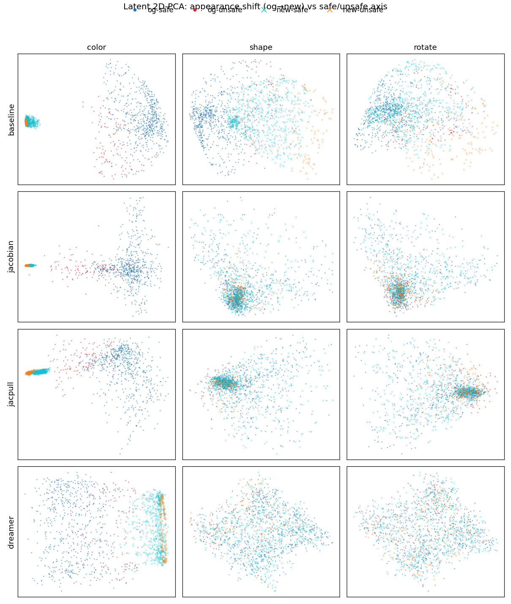

### Summary figure — direction vs distance

Summary view (`scripts/probe_summary_fig.py`) — zero-shot AUC (the red-trained margin held fixed,
scored on the shifted image; AUC <.5 = ranking inverted) vs
displacement (left) and vs alignment cos_la (right), all 12 cells. Left is a scattered cloud
(distance does NOT predict survival — shape at low displ and rotation at high displ both survive);
right trends down (alignment DOES — high cos_la → low AUC). The one outlier is Dreamer-rotate (below
chance at cos_la ≈ .39): it fails by scrambling the margin's ordering (corr −.07), the second failure
mode, not by alignment. jacpull-color uses the retrained head (zs_auc .69).

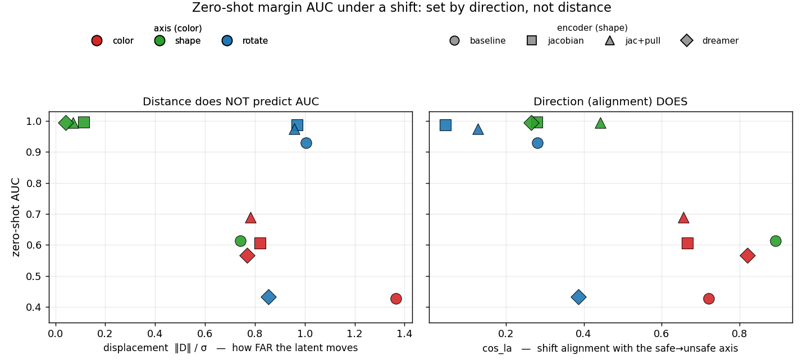

### The same view for the value function (critic)

The same figure for the reachability CRITIC (`scripts/valfn_summary_fig.py`), same encoding
(axis=color, encoder=shape), placed directly against the margin figure above so the two compare on
identical axes. Here `cos_la` uses the V* safe/unsafe axis (`valfn_geometry.py`, N=2000) and the
y-axis is the critic's zero-shot AUC (from the value-function critic table). 3 panels: (1) critic AUC
vs displacement — no trend. (2) critic AUC vs cos_la — predicts LESS cleanly than for the margin: the
critic collapses on color regardless of cos_la (jac+pull-color inverts to .20) and Dreamer-rotate
fails (.49) despite the LOWEST cos_la (.04). (3) critic AUC vs the MARGIN's own AUC (y=x diagonal) —
the best static predictor (r ≈ +.77 across the 12 cells, vs displ −.50 / cos_la −.43): shape/rotation
cluster near the diagonal (critic ≈ margin), but every color point sits BELOW it, most dramatically
jac+pull color (margin .69 → critic .20). So the critic coarsely tracks the margin axis-wise (it is
trained from the margin) but does NOT inherit its color robustness — the margin reads the latent
almost directly (geometric OOD behavior), while the critic is a learned Q memorized over the red
manifold, so its OOD failure is about being off that manifold / not re-grounding, not static latent
geometry.

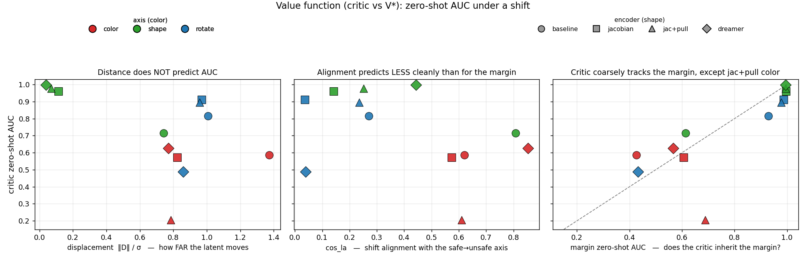

### Findings — direction predicts, not distance

No single distance predicts zero-shot; the margin-referenced direction does:

1. Shape works by literal "similar spots": the reg'd encoders map diamond ≈ circle
   (displ .04–.11, medrank 0, retrieval `nn1` ≈ 1.0, signuis 7–22, dbias ~0). Baseline is the
   exception — it moves (displ .74, medrank 460), and its move is aligned with the label axis
   (cos_la .89, signuis .92 <1) so it loses its threshold (dbias −1.4).
2. Rotation refutes "map to similar spots": rot90 lands NOWHERE near red for JEPA (medrank
   ~2760–3070 ≈ random, displ ~1.0, mostly deformation), yet JEPA holds zero-shot. It holds
   because the move is nearly orthogonal to the margin gradient (cos∥ .05) and to the label axis
   (cos_la .05–.13), so the margin value is untouched (dbias ~0) and its ordering survives
   (corr .82–.88). Dreamer's rotation move is more label-aligned (cos_la .39, cos∥ .16) and
   scrambles the ordering (corr −.07) → it breaks.
3. Color is the harmful kind — bad on BOTH counts: the nuisance exceeds the signal (signuis .34–.70
   <1 for all, incl jac+pull) AND the shift runs along the label axis (cos_la .66–.82), driving the
   margin down (dbias −.84 to −1.6). Reg dents it: jac+pull moves least (displ 1.37→.78) and least
   harmfully (dbias −1.6→−.84), and with its retrained head the ranking survives best (corr .36,
   zs_auc .69) where baseline inverts (corr −.13) — but even its color shift is 66% label-aligned.

### Why each metric alone fails

Why each distance metric alone fails (the point of running several):
- retrieval (medrank/nn1): ~random for BOTH color and rotation → cannot tell the axis that WORKS
  (rotation) from the one that FAILS (color).
- signuis: flags color (<1) and shape correctly, but is FOOLED by rotation (looks great, 5–12)
  because rotation is a near-zero-MEAN warp — signuis only sees the systematic translation, not the
  per-state deformation.
- cka (in the log): low for rotation even on JEPA (.39–.57) despite zero-shot working.
The one thing that tracks zero-shot across all 12 cells is whether the move disturbs the MARGIN —
either along the label axis (cos_la / cos∥, the color failure) or by scrambling its ordering
(corr, the rotation-on-Dreamer failure). "Do red and purple map to similar spots" is the wrong
question; "does the recolor move along the safe/unsafe direction" is the right one.

### Caveat — head-dependent columns depend on the head

Note on the head-dependent columns (cos∥, dbias, corr) — they run the deployed `margin_heads.pt`
head, so they depend on the specific head, unlike the head-free geometry (displ/displ_cg/medrank/
signuis/cos_la). jac+pull's use its RETRAINED head (color corr .36, zs_auc .69 — consistent with the
projector-feature margin study's .75, and with the "Head vs feature" fix); the other encoders use
their deployed heads. Single seed (N=6000 states). Data: `run_logs/latent_probe.txt`, coords
`run_logs/probe_coords/`, figure `figs/latent_probe_pca.png`.

### Why rotation is JEPA's easy axis and color its hard one (and Dreamer fails both)

The organizing principle: a nuisance needs invariance reg only if it is a PREDICTIVE SHORTCUT
in-distribution. Color perfectly predicts the obstacle label in the training set (only obstacles are
red), so JEPA's predictive objective latches onto it — baseline collapses zero-shot (margin AUC .144,
ranking inverts) and only the pull term removes it (jac+pull .753). Rotation carries NO label signal
(safety is invariant to rigid world rotation), so the encoder never uses absolute pose as a shortcut
— baseline JEPA is ALREADY rotation-robust with no reg (.830 acc / .956 AUC), jacobian/jac+pull
.98/.99. So within JEPA the difficulty ordering is color (needs the full jac+pull) > shape (jacobian
suffices) > rotation (robust for free, architectural).

Dreamer breaks BOTH color (AUC .638) and rotation (.480, inverts) regardless of reg, because its
RECONSTRUCTION objective must decode the colored, oriented image — so both appearance and absolute
pose are forced into the latent, and no invariance reg can remove them without breaking the
reconstruction it is trained for (whereas JEPA has no decoder, so invariance is compatible with its
predictive objective). The probe shows the mechanism: Dreamer's rotation move is label-aligned
(cos_la .39) and scrambles the safety ordering (corr −.07), while JEPA's rotation move is orthogonal
(cos_la .05–.13) and order-preserving (corr .78–.88) — far in the latent but off the margin axis.

The small residual JEPA rotation drop (in-dist ~.98 → zero-shot ~.96) is the ViT's imperfect
equivariance: a 90° rotation permutes the patch grid cleanly, but absolute position embeddings leave
a little rotation-sensitivity; an arbitrary (non-grid-aligned) angle would drop more.

## Diffusion policy + CBF filter under OOD (closed-loop, the deployed-controller payoff)

Takes the value-function thread to a real controller: the `FilteredDiffusionController` (a diffusion
policy whose actions are screened by a WM-based CBF filter that consults the DDPG critic). Reused the
EXACT non-OOD setup (`run.sh` cbf branch, `collect_trajs.py --controller diffusion --config
diffusion_wm --filter_mode cbf`, seed 0, N=1000, the same `seed0/PyHJ/{gp,nogp}` critic policies);
the ONLY change is the obstacle appearance, injected via env-var hooks added to
`dubins/dubins_env.py` (defaults reproduce the red-circle scene byte-for-byte). Models: baseline
(`sigreg_only`), jacobian (`jacobian_w1`), jacpull (`jacpull50`) lewm backend gp+nogp, plus dreamer
baseline (dreamer backend, gp only — no nogp critic on disk). `scripts/diffusion_cbf_ood.sh`.

Control check: jacpull/red/gp 83.6% success / 1.5% collision reproduces the recorded non-OOD
82.1% / 1.6% — the env edit changed nothing but appearance.

### No-filter reference (nominal policy)

No-filter reference (nominal diffusion policy, `filter_mode none`): red 91.4% success / 55.4%
collision (N=500; `run_logs/diffusion_nominal/`). Purple/diamond equal the 0-engagement cells below
(baseline purple 83/52, diamond 93/43 — the filter fires 0 times there, so those ARE the raw policy).
Two things this pins down: (1) the raw policy is UNSAFE in-dist (55% collision) but good at the goal
(91%), so the filter is genuinely needed; jacpull's filter earns its keep (55.4→1.5% collision for
~8% success cost), while baseline's is worse than no filter at all (69.9 > 55.4 collision, success
91→43). (2) nominal red collision (55.4%) ≈ nominal purple (~52%): the POLICY's collision barely
changes with recolor, so the entire in-dist→color collision jump (1.5→54%) is the FILTER dying, not
the policy degrading.

### Per-cell results — success / collision / engagement

Each cell is success % / collision % / filter engagement (avg overrides per ~53-step episode).
Success and collision are NOT complementary — an episode can reach the goal AND collide en route
(collision = any obstacle contact; success = goal reached). Engagement is the log's "Average number
of filtered actions" (filter magnitude 1.0–1.5 wherever >0, exactly 0.00 at 0).

gp critic:

| model | red (in-dist) | purple (color) | diamond (shape) |
| --- | --- | --- | --- |
| baseline | 43.4 / 69.9 / 18.9 | 83.3 / 52.3 / 0.0 | 93.1 / 43.2 / 0.0 |
| jacobian | 77.4 / 7.7 / 11.3 | 85.5 / 55.1 / 0.0 | 83.1 / 3.2 / 10.6 |
| jacpull | 83.6 / 1.5 / 9.2 | 84.0 / 53.9 / 0.0 | 83.7 / 3.9 / 8.8 |
| dreamer | 83.8 / 0.1 / 9.1 | 83.0 / 54.4 / 0.0 | 85.6 / 0.0 / 9.3 |

nogp critic (dreamer has no nogp critic on disk):

| model | red (in-dist) | purple (color) | diamond (shape) |
| --- | --- | --- | --- |
| baseline | 78.4 / 59.3 / 7.9 | 85.0 / 53.3 / 0.0 | 93.4 / 44.9 / 0.0 |
| jacobian | 90.9 / 17.6 / 3.9 | 84.3 / 54.7 / 0.0 | 88.7 / 24.0 / 3.7 |
| jacpull | 87.7 / 5.7 / 4.1 | 85.3 / 52.7 / 0.0 | 90.4 / 19.3 / 3.4 |

### Filter engagement — the mechanism dial

Engagement is the mechanism dial, and it explains every collision/success number:
- PURPLE = 0 engagements for EVERY model — the critic collapses so hard the filter never fires (pure
  pass-through). So the ~54% purple collision is the UNFILTERED diffusion policy (confirmed by the
  nominal run below).
- BASELINE red = 18.9 overrides (~2× the reg'd 9–11, ~36% of steps): a confidently-wrong critic
  constantly substitutes bad actions → lowest success (43%) AND highest collision (70%). Over-
  engagement with a broken critic is worse than no filter.
- DIAMOND splits by encoder and matches the representation story: the reg'd critics SURVIVE shape
  (engage 8–11, keep filtering → collision 3–4%), but baseline's critic COLLAPSES on diamond too
  (0 engagements → collision 43%, unfiltered). Shape is robust for the reg'd models only.
Wherever engagement is 0, BOTH success and collision revert to the raw-policy level (this is why
baseline's success jumps 43→83 under OOD — the harmful filter stops firing); high engagement with a
good critic gives low collision at high success; high engagement with a bad critic (baseline red) is
actively harmful on both.

### Findings

1. COLOR universally breaks the CBF filter. Every model — even jacpull (1.5%) and dreamer (0.1%),
   near-perfect in-dist — collapses to ~52–55% collision under purple. The reg buys nothing here
   because the filter consults the model-free CRITIC, whose color zero-shot collapses for every
   encoder (the value-function result above). jacpull's margin-level color robustness does NOT reach
   the deployed filter, which reads the critic, not the margin. The closed-loop confirmation of the
   whole value-function thread.
2. SHAPE (diamond, genuine L1 geometry) does NOT break it: the reg'd models stay 0–4% collision
   (jacpull 3.9, jacobian 3.2, dreamer 0.0). Shape was always the robust axis; it holds in the loop.
3. Baseline is pathological even in-dist (gp 69.9% collision): its learned CBF is net-harmful
   (consistent with §7's safety-layer finding). Its collision even drops under OOD because the broken
   filter interferes less destructively — an artifact of a bad filter, not robustness.
4. Ties to model-based value: the fix implied by the model-based result (roll the shared dynamics +
   margin instead of reading the memorized critic) is exactly what this filter does NOT do — it reads
   the model-free critic and inherits its color collapse. A model-based filter is the natural remedy.

Caveat: both the diffusion policy and the filter consume the recolored image, so ~54% purple is
policy+filter failing together; a nominal (no-filter) purple run is needed to attribute the split.
The in-dist→purple collapse of the FILTERED system is unambiguous regardless. Data:
`run_logs/diffusion_cbf_ood/` (per-cell logs + `SUMMARY.txt`).

## JEPA + GRU memory — is Dreamer's fragility reconstruction or memory? (ablation)

Ablation: add a Dreamer-style carried recurrent state to predictive JEPA (no reconstruction) and
see if it reintroduces OOD fragility. Built `module.GRUPredictor` (GRU hidden deter_dim 512, carried
across the rollout) + `config/train/model/lewm_gru.yaml`; the adapter threads deter_h through
observe/imagine and exposes get_feat = concat(embed, deter_h) = 704-d — Dreamer's [stoch, deter]
shape, but predictive. Trained baseline reg (sigreg only, to match Dreamer-baseline), 50 epochs,
val pred_loss .0017. Note: for a single frame deter_h=0 (no history), so the memory only engages in
rollouts — the static margin is identical to plain JEPA; the informative test is re-grounding.

Policy-free re-grounding (`scripts/regrounding_gru.py`): roll red+purple under IDENTICAL zero actions,
divergence normalized per step by the red cloud's RMS-pairwise spread. Embed-part divergence, step
0→10:

| model | step 0 | step 10 | trend |
| --- | --- | --- | --- |
| baseline (transformer) | 1.37 | 1.00 | contracts |
| jacobian (transformer) | 0.82 | 1.04 | ~flat |
| jacpull (transformer)  | 0.78 | 0.70 | contracts (re-grounds) |
| GRU baseline (carried memory) | 1.42 | 1.88 | DIVERGES |
| GRU baseline deter_h (memory) | 0.00 | 1.73 | accumulates |
| GRU jac+pull (carried memory) | 0.84 | 0.98 | flat (no runaway) |
| GRU jac+pull deter_h (memory) | 0.00 | 0.90 | accumulates half as much |

The GRU is the only model whose rollout DIVERGES instead of re-grounding, and its memory subspace
accumulates the color difference monotonically (0→1.73). Clean ablation: same reg (sigreg), same ViT
encoder, same predictive objective, NO reconstruction — the only change from the transformer baseline
is the carried recurrent state, and it flips re-grounding (1.37→1.00) into divergence (1.42→1.88).
Verdict on "reconstruction or memory": BOTH, independently. Carried memory alone reproduces Dreamer's
nuisance accumulation without any reconstruction — the transformer's windowed predictor re-grounds
because each step depends only on the last few frames (pulled back toward the training manifold),
while the GRU's persistent state holds onto the initial red↔purple difference and compounds it.
Prediction: GRU-JEPA's model-based value would NOT recover color (no re-grounding), landing it with
Dreamer. Follow-up — does the PULL term tame carried memory (it made the transformer predictor
contractive: jacpull re-grounds, jacobian doesn't)? Trained a jac+pull GRU (`lewm_gru_jacpull`, val
pred_loss .033 — the reg costs prediction accuracy). ANSWER: partially tames, but does NOT re-ground.
The pull term (1) gives a more color-invariant encoder up front (embed div starts 0.84 vs 1.42), (2)
PREVENTS the runaway divergence (embed div stays ~flat 0.84→0.98 vs baseline GRU's 1.42→1.88), and
(3) HALVES the memory accumulation (deter_h 0→0.90 vs 0→1.73). But it never CONTRACTS the way the
transformer jacpull does (0.78→0.70) — the carried state still holds the nuisance and never pulls
purple back onto red. So carried memory is PARTIALLY TAMEABLE but FUNDAMENTALLY ANTI-RE-GROUNDING:
regularization dampens the runaway but can't buy the contraction a windowed predictor gets for free.
Single seed, N=2000, zero-action rollout. Data `run_logs/regrounding_gru.txt`; artifacts
`le-wm/module.py` (GRUPredictor), `config/train/model/lewm_gru.yaml`, `scripts/train_gru.sh`,
`scripts/train_gru_jacpull.sh`, `lewm_adapter.py` (gru branch).

### GRU CBF — closed-loop

GRU CBF (2026-09-16, `scripts/gru_cbf.sh`, same setup as the transformer models: margin(704-d) →
gp+nogp critics → closed-loop diffusion+CBF). Success / collision / engagement:

| condition | gp | nogp |
| --- | --- | --- |
| red (in-dist) | 45.0 / 70.1 / 11.4 | 58.1 / 63.3 / 7.0 |
| purple (color) | 83.3 / 52.6 / 0.0 | 84.8 / 53.4 / 0.0 |
| diamond (shape) | 47.0 / 68.9 / 13.1 | 62.0 / 64.2 / 8.6 |

The GRU makes a net-harmful CBF WHEREVER it engages: red 70% collision (as bad as baseline, worse
than the nominal 55% raw policy) and diamond 69% (worse than nominal 43%) — it engages a lot (11–13
overrides) but harmfully; only color is a no-op (0 engagement → raw policy). So the GRU isn't just
OOD-fragile (the re-grounding result) — it's a worse world model for control even IN-DIST, producing
a critic that's harmful with no shift at all (cf transformer jacpull red 1.5%, diamond 3.9%).
Consistent with its weaker dynamics (pred_loss .0017 vs transformer .0003) + memory accumulating
noise. Caveat: memory length is inconsistent across the pipeline (margin trains on 4-frame chunks,
critic accumulates over episodes, filter uses H≈5–8), unlike the transformer's fixed 3-frame window
— so part of the in-dist degradation may be that mismatch rather than purely fundamental. Data
`run_logs/gru_cbf/` (+ SUMMARY.txt).

### GRU static margin/critic — does memory reshape the encoder?

GRU static margin/critic (does the memory reshape the ENCODER?). Single-frame probe → deter_h=0, so
this reads the GRU-JEPA encoder + 704-d head with the memory OFF (like Dreamer's static probe, where
its deter is also ~constant on one frame and the stoch carries the frame). Kept out of the summary
figures (encoder-only / memory-off view + a 5th encoder would clutter); numbers here. Margin
zero-shot AUC: color .61, shape .86, rotate .92. Critic zero-shot AUC vs V*: red .87, color .60,
diamond .62, rot90 .89. Vs the transformer reg'd models the GRU encoder is notably WORSE at SHAPE
invariance — shape margin displ 0.42 (vs jacpull 0.07, it does NOT map diamond≈circle), margin AUC
.86 (vs .99), critic diamond AUC .62 (vs .98) — while color stays mediocre (~.60) and rotation is
preserved (~.90). So the h DOES reshape the latent, specifically degrading shape (matching the GRU
CBF's diamond failure). The memory hurts twice: it degrades the encoder's shape mapping at train
time AND accumulates the nuisance over rollouts.

## Safe/unsafe separation and nuisance projection (color)

Two follow-ups to the probe: how well-separated are safe/unsafe in each latent space
(in-distribution), and can we recover color OOD by projecting out the recolor direction
at the readout. Both use in-dist features Z0 (red, circle labels), N=6000, single seed.

Metrics:
- probe_auc: 5-fold linear (logistic) probe safe-vs-unsafe on Z0 — does a boundary exist.
- fisher, classgap/σ: centroid separation (‖μ_unsafe−μ_safe‖) as a Fisher ratio and
  scaled by the cloud's RMS pairwise distance — separation carried by the class means.
- head d′: (mean h_safe − mean h_unsafe) / pooled std, in the deployed margin head's own
  scalar output. How many "noise-widths" apart the safe/unsafe score humps sit — the
  concrete measure of how WIDE (easy) the separation is. Bigger = roomier.
- robust_ratio: mean|h(purple)−h(red)| ÷ (safe−unsafe head gap). The color shift measured
  in units of the whole class separation. >1 must flip; <1 can still flip if aligned.
- head_auc (in-dist): the deployed red margin head's own AUC scored on in-dist (red) features —
  the head's clean-data ceiling, for comparison against the projected/OOD numbers below.
- Also in the log, not tabled: `probe_acc` = the 5-fold linear probe's accuracy (companion to
  probe_auc); `nearbdry` is emitted but DEGENERATE (its threshold is the 25th percentile of |h|, so
  it is 0.25 by construction) — ignore it; head d′ is the clearance measure that replaces it.

Projection notation: the recolor cloud is D = z(purple)−z(red) over the paired states; we build a
projector P = I − UUᵀ from a k-dim basis U and re-score the frozen head on Pz (the orthogonal
complement of U). `mode=mean, k=1` removes only the global recolor offset (U = the single
direction of mean D — the bias-fixable part); `mode=svd, k` removes the top-k right-singular
vectors of the centered D cloud (offset + state-dependent deformation). "best projection" is the
(mode, k) with the largest OOD gain at ≤ small in-dist cost; Δ in-dist is that cost.

| encoder | dim | probe_auc | fisher | classgap/σ | head d′ | robust_ratio | head_auc (in-dist) |
| --- | --- | --- | --- | --- | --- | --- | --- |
| baseline | 192 | .993 | .170 | .403 | 2.99 | .90 | .965 |
| jacobian | 192 | .998 | .073 | .267 | 5.40 | .66 | .999 |
| jacpull  | 192 | .999 | .072 | .267 | 4.89 | .54 | .999 |
| dreamer  | 544 | .988 | .126 | .343 | 4.47 | .62 | .999 |

Read: safe/unsafe is linearly separable everywhere (probe_auc ≈ .99) — geometry is never
the problem. The reg's payoff is a WIDER margin, not a better boundary: head d′ ≈ 3 for
baseline vs ≈ 5 for the reg'd encoders (jacobian widest). Note the reg'd encoders have
LOWER centroid separation (fisher .07, classgap .27 vs baseline .17/.40) yet higher d′ and
probe_auc — separation is distributed across the hyperplane, not carried by the mean shift.

Nuisance projection at readout (project out top-k of the recolor cloud D = z(purple)−z(red),
re-score the frozen head on the orthogonal complement):

| encoder | color OOD AUC (no proj) | best projection | recovered OOD | Δ in-dist |
| --- | --- | --- | --- | --- |
| baseline | .427 (inverted) | svd k=2 | .671 (+.244) | −.013 |
| jacobian | .606 (best raw)  | none helps | .606 | — |
| jacpull  | .420 (inverted, pre-fix) | svd k=4 | .550 (+.129) | −.003 |
| dreamer  | .565            | mean k=1 | .797 (+.233) | −.008 |

Read: removing 1–2 nuisance dims recovers a large chunk of color OOD at ~0 in-dist cost —
mechanistic proof that "keep the nuisance off the readout axis" is the operative lever.
Dreamer's color shift is a pure global offset (mean k=1 wins, svd doesn't) — one translation
fixes it; baseline's is a 2-dim deformation (needs svd k=2). Jacobian already has color
mostly off-axis raw (.606, best LEWM) so nothing clean is left to project. Nobody recovers to
full in-dist AUC (~.99), so color is partly a removable nuisance and partly genuinely fused —
the remainder needs data-level decorrelation (randomize obstacle color at train time).

Takeaway reconciling separation with the probe: easy separation is NECESSARY but not
SUFFICIENT. The reg widens the margin (d′ 3→5) AND, for jacobian, tilts the nuisance off-axis.
Color fails whenever the second doesn't happen, regardless of margin width — robust_ratio < 1
for all four, yet three of four still invert, because color's shift is small but coherent and
ALONG the margin axis. Jacobian is the only LEWM encoder that got both wide margin and
off-axis nuisance, which is why it survives color raw and why projection can't improve it.
Data: `run_logs/nuisance_proj.txt`.

Projection recovery in the (alignment, AUC) plane — margin vs critic:

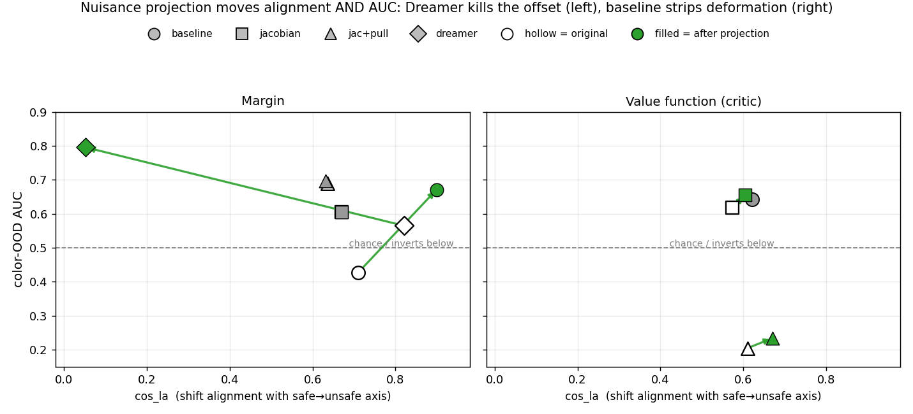

Each encoder's color cell is plotted at its cos_la (x, shift alignment with the safe→unsafe
axis) and color-OOD AUC (y), hollow BEFORE and filled AFTER its best projection, both recomputed
in the SAME (projected) space so the arrow shows how projection moves alignment AND the classifier
together (`compute_proj_cosla.py`, `proj_recovery_fig.py`). The margin panel shows the two distinct
recovery mechanisms:
- Dreamer (mean k=1): the color shift is a global OFFSET nearly along the margin axis
  (cos_la .82), so projecting out that one direction ANNIHILATES the alignment (cos_la .82→.05)
  yet lifts AUC .57→.80 — it deletes the very direction the shift rode on.
- baseline (svd k=2): projecting out the color DEFORMATION leaves a residual shift that is MORE
  aligned with the axis (cos_la .71→.90) and AUC recovers .43→.67 — the misaligned nuisance was
  the deformation, not the mean.
Opposite moves in x, same outcome in y — two geometrically different color nuisances (offset vs
deformation), each removable by the matching projection mode. The critic panel barely moves either
coordinate (jacobian/jacpull value AUC .62→.66 / .20→.23, cos_la ~unchanged): the critic's color is
a high-dim fused deformation with no low-rank direction to delete, so projection can't recover it.

## Head vs feature — what drives color robustness (resolving the seam)

The margin study (projector feature, fresh red-trained head) had jacpull surviving color
(AUC ~.75); the deployed head (get_feat feature, `margin_heads.pt`) inverts (~.42). Two
studies, same encoder, opposite verdict — is the difference the FEATURE the head reads or the
head WEIGHTS? Diagnostic: same sampled states, each pipeline run natively, crossed into three
cells scored zero-shot on color (M_red on purple). B vs A isolates the head weights (same
feature); C vs B isolates the feature (same fresh-training protocol). Obstacle geometry and
bounds verified identical across the two pipelines, so states pair cleanly. Read AUC (ranking) —
acc is pinned to base-rate here (17% unsafe). n=3 seeds; `scripts/diagnose_head_vs_feature.py`.

| encoder | A: get_feat + deployed | B: get_feat + fresh | C: projector + fresh |
| --- | --- | --- | --- |
| baseline | .43 ± .01 | .16 ± .06 | .14 ± .03 |
| jacobian | .62 ± .01 | .61 ± .04 | .67 ± .08 |
| jacpull  | .42 ± .01 | .77 ± .13 | .76 ± .04 |

The seam has a DIFFERENT cause per encoder:
- jacpull — it is the HEAD, not the feature. B (.77) ≫ A (.42) on the SAME get_feat feature, so
  the deployed `margin_heads.pt` is the failure; a freshly trained head on the identical deployed
  feature recovers color, matching the projector study (C .76). jacpull's encoder features are
  color-robust in BOTH spaces; its deployed .42 is a stale-head artifact, fixable by retraining
  the head alone. This resolves the caveat flagged in the probe/projection sections.
- jacobian — flat and partial. A ≈ B ≈ C, all .61–.67 and overlapping within noise: neither
  swapping the head nor the feature moves it. Its color ranking is only partially robust (~.63)
  and not cleanly attributable to either factor. (Seed 0 alone suggested a feature edge, C .757;
  it shrank to .61–.66 at the other seeds — mostly noise.)
- baseline — broken everywhere. Every cell inverts (.14–.43): with no reg there is no color
  robustness to recover in any feature or head.

Takeaway: the deployed-head discrepancy across earlier studies was real but a HEAD artifact for
jacpull (retrainable), while jacobian's weaker color number is intrinsic to the encoder (both
features cap ~.63). The fresh-head cells are seed-noisy (jacpull B .62–.87), so lean on the mean.
Data: `run_logs/headfeat_diag.txt`.

Fix applied (2026-09-14): retrained jacpull's deployed `margin_heads.pt` (both margin_gp and
margin_nogp) on the current in-dist red get_feat features via `save_ood_margin_lewm.py --cond red`
— the exact deployed format, drop-in. In-dist AUC preserved (.998) and color zero-shot recovers
from .420 (inverted) to .689 (single seed; the fresh-head mean is ~.77 with high variance). The
original is backed up at `margin_heads.pt.bak-preheadfix-20260914`.

Table changed by this fix: the jacpull row, cell A (get_feat + deployed) of the
[Head vs feature table](#tbl-headfeat) — .42 (inverted) → .69 (functional). The freshly retrained
deployed head now matches its own cell B (get_feat + fresh) rather than the stale-head number.

Downstream, this also feeds the reachability critic (value function), which uses the margin as its
reward. The jacpull row of the [Value function critic table](#tbl-value) was trained against the
old (inverted) margin; retraining it against the fixed margin left its color zero-shot unchanged
(still inverted, AUC .20) — the critic does not inherit the margin's color robustness. See the
head-fix follow-up note under that table.

# Negative results / dead-ends

Things tried that did NOT work — recorded so they aren't re-tried.

## Architecture / world model
- JEPA + GRU memory. Adding a Dreamer-style carried recurrent state hurt on every axis: the rollout
  DIVERGES instead of re-grounding (memory accumulates the nuisance), it makes a net-harmful CBF even
  IN-DIST (red 70% collision, as bad as baseline), and it DEGRADES the encoder's shape invariance.
  The jac+pull GRU only partially tames it and never re-grounds. Memory reintroduces the fragility.
- jacobian reg alone (no pull) for re-grounding: jacobian's predictor EXPANDS the red↔purple gap; only
  the PULL term makes the predictor contract/re-ground.
- Dreamer/RSSM for OOD: reconstruction bakes appearance into the latent → breaks color+rotation, can't
  be regularized away, and its predictor does NOT re-ground (great in-dist, flat on purple).

## Metrics that don't predict zero-shot
- displacement (`displ`, r −.55) — weak and confounded (shape-vs-color); breaks on rotation (far, yet
  survives). `displ_cg` (−.40) same. `medrank`/retrieval (−.13) useless. `signuis` (+.43) fooled by
  rotation. Only `cos_la` (−.75) is a strong independent (head-free) predictor; the stronger `corr`
  (+.93) / `dbias` (+.73) just re-measure the outcome (whether the margin's ranking survived).
- For the value-function critic, NO static geometry metric predicts cleanly (best proxy is the
  margin's own AUC, r +.77, and even that breaks on jac+pull color).

## Fixes for the critic's color collapse — all failed
- Retraining the critic with the fixed (color-robust) margin: no change (.20, still inverted).
- Nuisance projection (lever #3) on the critic input: no recovery (.23) — color is a high-dim
  deformation, not a low-rank axis to subtract.
- Model-based value as a UNIVERSAL fix: only works for jacpull; WORSE than the model-free critic for
  baseline. Needs both a robust margin AND a re-grounding predictor.
- Net: the critic's color collapse is fixable only by retraining ON purple (domain randomization).

## Deployed controller (diffusion + CBF)
- CBF filter under color: collapses to a no-op for EVERY model (0 engagements) — no protection.
- baseline's CBF filter: net-harmful even in-dist (70% coll, worse than the 55% no-filter policy).
- Rotation in the closed-loop diffusion setup: ill-posed (fixed-goal policy) — not testable cleanly.

## Protocol / setup dead-ends
- Easy dataset-replay CEM protocol: couldn't discriminate models (~94%/8% for all) → switched to
  sg25clean.
- Stale deployed jac+pull margin head: silently inverted color (.42) → wrong numbers until retrained
  (.69).
- Static probe for the GRU: uninformative (deter_h=0 on single frames → memory off) → had to use the
  trajectory tests instead.
- min-intervention CBF-QP filter (E1, TwoRoom): projection worked but onto the wrong target;
  neutral-to-worse than no filter ("it's the rollout, not the filter geometry").
- Original V*-labelled OOD study: accidentally regressed HJ V* instead of the margin → scrapped, redone
  with the real `margin_gp`.

# Post Sept 16

## Isolating the predictor's role in the value function (GT-margin reward)

The reachability critic (value function) depends on TWO learned pieces: the margin
(its reward) and the predictor (both the dynamics it bootstraps over AND the latent
feature it reads). Earlier work (model-based value, nuisance projection) tangled the
two. This ablation removes the margin's contribution to isolate the predictor: train
the critic with the GROUND-TRUTH margin as reward and see what OOD failure survives a
perfect reward.

Setup: `CRITIC_GT_MARGIN=1` in the latent gym env (`dubins-wm-dp.py`) tracks the true
(x,y,θ) alongside the latent rollout — frameskip=1, so one predictor imagine step = one
RK4 dubins step at ω = action·turnRate — and returns reward = tanh(signed distance to the
nearest obstacle) instead of `tanh(margin_gp(get_feat(z)))`. Everything else is the
canonical in-dist critic: same buffer reset, same learned predictor dynamics, same latent
features fed to the critic, same DDPG/8-epoch schedule. Only the reward is oracle-clean.
Then eval value AUC vs HJ V* on red/purple/diamond/rot90 (`critic_ood_eval.py`), and
compare to the V*-based displacement + cos_la geometry (`valfn_geometry.txt`).
Pipeline: `scripts/gt_margin_value.sh`; logs `run_logs/gt_margin_value/`.

Sanity — in-dist (red) AUC is unchanged by the reward swap (baseline .932→.927, jacobian
.994→.996, jacpull .995→.997, dreamer .997→.997): the GT reward reproduces the same in-dist
value quality, so any OOD difference is attributable, not an artifact of a weaker reward.
Dreamer uses the RSSM backend (`gt_margin_value_dreamer.sh`); the GT-margin env logic is
backend-agnostic (tracks the true state from the buffer's privileged_state alongside the
latent rollout).

| encoder | axis | displ | cos_la | learned-margin AUC | GT-margin AUC | Δ |
| --- | --- | --- | --- | --- | --- | --- |
| baseline | color  | 1.374 | .621 | .643 | .808 | +.165 |
| baseline | shape  | 0.743 | .808 | .712 | .150 | −.562 |
| baseline | rotate | 1.007 | .271 | .804 | .883 | +.079 |
| jacobian | color  | 0.823 | .574 | .619 | .530 | −.089 |
| jacobian | shape  | 0.113 | .141 | .964 | .986 | +.022 |
| jacobian | rotate | 0.970 | .037 | .913 | .928 | +.015 |
| jacpull  | color  | 0.784 | .610 | .204 | .356 | +.152 |
| jacpull  | shape  | 0.071 | .252 | .977 | .987 | +.010 |
| jacpull  | rotate | 0.956 | .235 | .886 | .913 | +.027 |
| dreamer  | color  | 0.771 | .854 | .649 | .603 | −.046 |
| dreamer  | shape  | 0.040 | .443 | .997 | .997 | +.000 |
| dreamer  | rotate | 0.858 | .039 | .483 | .579 | +.096 |

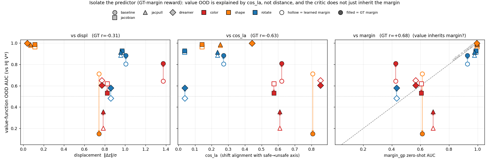

Value-fn zero-shot AUC (vs HJ V*) against three x's, hollow = learned-margin critic → filled =
GT-margin critic (`gt_margin_value_fig.py`). Correlation across the 12 cells:
- displacement (panel 1): r = −0.48 (learned) → −0.31 (GT) — displacement never explained value
  OOD and matters even less once the reward is clean.
- cos_la (panel 2): r = −0.40 (learned) → **−0.63 (GT)** — removing the reward confound tightens
  the alignment↔AUC law. cos_la (how much the predictor's latent shift lies ALONG the safe→unsafe
  axis) is what governs the value function's OOD quality. Excluding the one architectural
  outlier (dreamer-rotate, below) the GT correlation is **−0.77**; on the three LEWM encoders
  alone (9 cells) it is −0.87.
- margin_gp AUC (panel 3, y=x diagonal): does the critic just inherit the margin? Only coarsely —
  see the "margin vs value" read below.

Read:
- The predictor sets the ceiling. Where the predictor keeps the shift off-axis (low cos_la:
  jacobian/jacpull shape+rotate, cos_la ≤ .25) the GT-margin critic is near-perfect (.91–.99);
  where the shift is aligned (high cos_la) value stays poor no matter how clean the reward.
- A perfect margin recovers color where the LEARNED MARGIN was the bottleneck — baseline
  +.17 (.81) and jacpull +.15 — but cannot rescue it (jacpull color still .356): the residual
  is the predictor's aligned color shift (cos_la .61), consistent with the nuisance-projection
  finding that the critic's color is a high-dim fused deformation with no low-rank direction to
  delete.
- baseline shape is the sharpest evidence: cos_la .808 (highest of the LEWM cells) → GT AUC .150
  (worst, inverted), a −.56 drop from the learned critic's .712. The learned margin's imprecision
  was ACCIDENTALLY compensating for a badly-aligned shape latent; a perfect reward exposes that
  the predictor's shape geometry is the real problem. Reward quality was masking a predictor flaw,
  not fixing it.
- Dreamer confirms the mechanism at both extremes. Dreamer color has the HIGHEST cos_la of all
  cells (.854) and the GT margin does NOT help it (.649→.603, −.05): where the predictor's shift
  is maximally aligned, no reward rescues value — the strongest single datapoint for the thesis.
  Dreamer shape is tiny (displ .04) and stays perfect (.997). Dreamer rotate is the one architectural
  OUTLIER: cos_la .039 (very off-axis) yet AUC only .579 — Dreamer's reconstruction-tied latent is
  broken for rotation for a reason cos_la doesn't capture (rotation is a pure deformation, offset≈0,
  but the decoder objective still garbles it). It is the cell that drags the 12-cell correlation
  down; excluding it, r(cos_la) = −0.77.
- jacobian color actually drops slightly (−.09): its learned margin already had color mostly
  off-axis, so a GT reward buys nothing and the sharper fit extrapolates marginally worse.

Bottom line: the value function's OOD behavior is predictor-limited. Given a perfect reward, its
AUC is explained by cos_la (r −0.63 over 12 cells; −0.77 excluding the dreamer-rotate architectural
outlier; −0.87 on the LEWM encoders alone), not displacement (r −0.31); the only OOD wins a better
margin can buy are in cells where the margin — not the predictor's alignment — was the bottleneck.

Margin vs value function (panel 3 above — does the critic just inherit the margin?): x =
instantaneous margin_gp zero-shot AUC; y = value-fn (critic) zero-shot AUC vs HJ V*; hollow =
learned-margin critic, filled = GT-margin critic (vertical arrow = the reward swap; margin x is fixed
because it doesn't touch the encoder). The y=x diagonal is "the value just tracks the margin." Read:
- The critic does NOT simply inherit the margin. baseline color sits far ABOVE the diagonal — the
  margin is inverted (.43) yet the value reads .64→.81 (the Bellman rollout re-grounds what the
  static classifier gets wrong). Conversely baseline shape falls far BELOW: margin .61 but the
  GT-margin value collapses to .15 (the diamond breaks the critic even though the margin is fine).
- shape/rotate for the reg'd encoders cluster at the top-right, on/near the diagonal (both high).
- jac+pull and jacobian color sit BELOW the diagonal (value < margin): a good static color margin
  does not guarantee a good color value — the predictor's aligned shift caps the critic.
So "critic ≈ margin" holds only where both are easy; on the hard OOD cells the value and the margin
come apart in both directions, confirming they are limited by different things (predictor geometry
for the value, the margin's own alignment for the margin).

## Obstacle color augmentation (data-level color decorrelation, purple held out)

Direct test of this doc's recurring prediction — that the residual color fusion needs
"data-level decorrelation: randomize obstacle color at train time." Recolor the red
obstacle to random NON-purple training colors so the WM sees many obstacle colors; purple
is held OUT of the palette so it stays a genuine OOD test.

Recolor mechanism (obstacle ONLY — color is semantic here: green goal / blue agent, and the
`AugInvarianceReg` caution shows global hue-invariance collapses success 62.5%→15.5%).
Isolate the obstacle by its redness `a = relu(min(R−G, R−B))/255` (1.0 in the pure-red
interior, fractional on antialiased red-on-white edges, 0 on goal/agent/bg) and remap
`out = x + a·(C − RED)` — exact for a red-on-white blend since RED and white share R=255.
Verified byte-exact: obstacle recolors, goal/agent/background unchanged (`figs/recolor_check.png`).
Palette (8, red kept in-dist): red, orange, gold, brown, olive, salmon, maroon, teal; uniform
so red ~1/8. Purple(128,0,128)/magenta excluded. Impl: LEWM `le-wm/utils.py::ObstacleRecolor`
+ `train.py +color_aug=true` (per window); Dreamer `dreamer_offline.py::color_aug_stream`
+ `--color_aug` (per sequence). Four WMs retrained (3 LEWM 50ep, Dreamer 40k steps). Stage-1
design = WM-only aug, downstream trained by the ORIGINAL procedure (LEWM margin on the RED
buffer; probe margin for the AUC; gp critic) so the WM change is isolated. NB Dreamer's margin
is trained JOINTLY inside the RSSM, so Dreamer's margin is color-aug'd (LEWM's is not) — caveat.
Scripts: `train_coloraug.sh`, `train_coloraug_dreamer.sh`, `coloraug_downstream_{lewm,dreamer}.sh`.

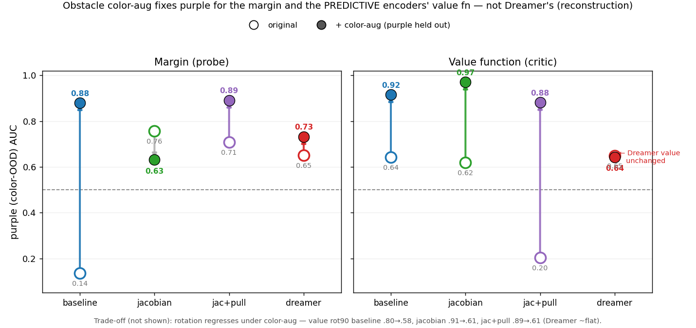

Margin (probe zero-shot AUC), original → color-aug:

| encoder | red (in-dist) | color (purple) | shape | rotate |
| --- | --- | --- | --- | --- |
| baseline | .980 → .994 | .136 → **.880** (+.744) | .885 → .964 | .973 → **.526** (−.447) |
| jacobian | .992 → .993 | .757 → .631 (−.126) | .993 → .969 | .991 → **.616** (−.375) |
| jac+pull | .984 → .994 | .707 → **.891** (+.184) | .977 → .981 | .980 → **.421** (−.559) |
| dreamer  | .999 → .999 | .651 → .732 (+.081) | .993 → .994 | .486 → .469 |

Value function (critic AUC vs HJ V*), original → color-aug:

| encoder | red | color (purple) | shape | rotate |
| --- | --- | --- | --- | --- |
| baseline | .932 → .924 | .643 → **.915** (+.272) | .712 → .913 (+.201) | .804 → **.579** (−.225) |
| jacobian | .994 → .980 | .619 → **.970** (+.351) | .964 → .973 | .913 → **.613** (−.300) |
| jac+pull | .995 → .988 | .204 → **.881** (+.677) | .977 → .987 | .886 → **.610** (−.276) |
| dreamer  | .997 → .993 | .649 → .642 (−.007) | .997 → .993 | .483 → .473 |

In-dist (red) margin is preserved — slightly improved — under color-aug (ogog_auc: baseline
.980→.994, jacobian .992→.993, jac+pull .984→.994): red is still ~1/8 of windows and the added
color diversity acts as mild regularization. So the color fix costs nothing in-distribution for
the margin (as for the value, red .92–.99); the only price color-aug paid was rotation.

Read — three findings:
- **Color-aug fixes purple, and the value-function fix is the big one.** For the PREDICTIVE
  JEPA encoders every purple value AUC jumps to .88–.97: baseline .64→.92, jacobian .62→.97,
  jac+pull .20→.88 (its worst cell, now near-solved). The margin follows (baseline's inversion
  .14→.88; jac+pull .71→.89). In-dist red is preserved (.92–.99). So a color-diverse WM genuinely
  RELOCATES purple onto the training manifold — the predictive encoder learns to treat obstacle
  color as nuisance, so purple lands where the trained colors do and both the margin and the
  critic work on it. (Confirms the earlier re-grounding thesis by construction.)
- **Dreamer's value function does NOT benefit** (.649 → .642). Reconstruction forces the RSSM to
  keep obstacle color encoded, so even after seeing many colors it cannot collapse purple onto the
  trained region; the critic's latent still places purple off-manifold. Its margin improves a
  little (.65→.73) but the value fn — the deployed object — is unchanged. Sharpest architectural
  contrast in the study: the SAME data intervention fixes the predictive encoders' critic and does
  nothing for the reconstructive one. Consistent with the GT-margin ablation (value is predictor-
  /latent-geometry-limited) and with [[jepa-gru-memory-ablation]] / [[ood-invariance-payoff]].
- **Rotation is traded away.** Every LEWM encoder's rotation robustness regresses sharply — value
  rot90 baseline .80→.58, jacobian .91→.61, jac+pull .89→.61; margin rotate .97→.53 / .99→.62 /
  .98→.42. Dreamer (already poor at rotation) is flat. Forcing color-invariance in the predictive
  encoder disturbs the incidental rotation invariance it had — color and rotation robustness compete
  for representation. Shape is untouched or slightly better; diamond even improves for baseline
  (.71→.91). Net: color-aug is a targeted fix, not free — it buys color at rotation's expense.
- jacobian color is the one non-monotone margin cell (.76→.63): it already had color mostly
  off-axis raw, so the added color variance perturbs more than it helps its margin — yet its VALUE
  still jumps (.62→.97), i.e. the color-diverse latent helps the critic even where the fresh probe
  margin doesn't. Data: `run_logs/coloraug/`.

### Color + rotation augmentation (can we recover both?)

The color-only aug traded rotation away (a representation trade-off). Natural follow-up:
add rotation to the aug too. Rotation ISN'T obstacle-local like color — but the rot90 OOD
test is `np.rot90` on the WHOLE image, which preserves the safety label (relative agent–
obstacle geometry is unchanged). So augment with whole-window k·90° rotations (one random k
per window, all frames consistent) on top of the recolor. Valid for LEWM specifically: the
encoder is image-only (`jepa.py::encode`) and a globally-rotated rollout with the SAME
angular-velocity action is a valid rollout. Impl: `ObstacleRecolor(rotate=True)` via
`+color_aug_rot=true`; runs `coloraug_rot_{baseline,jacobian,jacpull}`. LEWM-only (Dreamer
consumes/reconstructs heading `obs_state`, which rotation would have to rotate too; skipped
since Dreamer's value didn't benefit from color anyway).

For the MARGIN, the two invariances compete for the ViT-tiny encoder's capacity: color-only
buys color and loses rotation; color+rot buys rotation back (all .89–.997) and loses color
(jac+pull collapses to .055). Shape stays ~.99 throughout. You can't get both in the static
margin from naive combined aug on this encoder.

Margin (probe zero-shot AUC), three training conditions (orig → color → **color+rot**)

| encoder | red | color | shape | rotate |
| --- | --- | --- | --- | --- |
| baseline | .980 → .994 → .990 | .136 → .880 → **.469** | .885 → .964 → .992 | .973 → .526 → **.885** |
| jacobian | .992 → .993 → .987 | .757 → .631 → **.580** | .993 → .969 → .989 | .991 → .616 → **.911** |
| jac+pull | .984 → .994 → .998 | .707 → .891 → **.055** | .977 → .981 → .996 | .980 → .421 → **.997** |

Value function (critic AUC vs HJ V*):

| encoder | red | color | shape | rotate |
| --- | --- | --- | --- | --- |
| baseline | .932→.924 → **.446** | .643→.915 → **.359** | .712 → .913 → .554 | .804 → .579 → **.261** |
| jacobian | .994→.980 → **.938** | .619→.970 → **.204** | .964 → .973 → .714 | .913 → .613 → **.150** |
| jac+pull | .995→.988 → **.980** | .204→.881 → **.930** | .977 → .987 → .947 | .886 → .610 → **.982** |

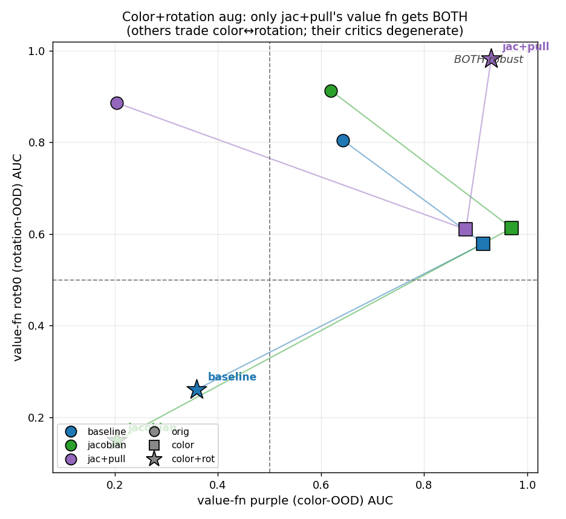

The value function tells a sharper story than the margin, and it has a clear winner:
- **jac+pull with color+rot gets BOTH** — purple .930 AND rot90 .982 (red .980, diamond .947),
  the only config anywhere in this study that is robust to color and rotation simultaneously.
  Note its static margin color COLLAPSED (.055) while its value nails color (.93): the pull-
  term re-grounding integrates the predictor dynamics, so the critic separates purple even when
  the static classifier can't — same mechanism as the model-based-value result.
- **baseline and jacobian critics degenerate under the combined aug.** baseline's critic
  collapses to a near-constant (loss/critic≈0 from step ~10; even in-dist red .446); jacobian's
  trains in-dist (red .938) but doesn't generalize (purple .204, rot90 .150). The heavier
  combined aug degrades their predictor dynamics enough that the DDPG critic fails, whereas the
  pull term keeps jac+pull's dynamics coherent. (Single-seed critics — the baseline collapse may
  be partly DDPG instability — but the direction is consistent with re-grounding.)

Takeaway: naive combined color+rotation aug makes the STATIC margin see-saw (capacity
competition on a tiny encoder), but for the deployed VALUE function the pull-term encoder
(jac+pull) escapes the trade-off and achieves both robustnesses at once — the re-grounding
dynamics matter more than static-margin capacity. Baselines without the pull term can't absorb
both augs and their critics collapse. Data: `run_logs/coloraug_rot/`.

### Why only jac+pull absorbs both augs — re-grounding probe (corrects the hypothesis)

Roll red vs {purple, rot90} latents under IDENTICAL zero actions (no critic — isolates the
predictor) and track div(t) = ‖feat_red − feat_shift‖ / σ_red over the rollout
(`regrounding_coloraug_rot.py`). I'd hypothesized the pull term wins via rollout CONTRACTION;
the data says the dominant effect is at t=0 — but not as encoder appearance-invariance (see the
raw/σ_red decomposition below); it's state-latent spread:

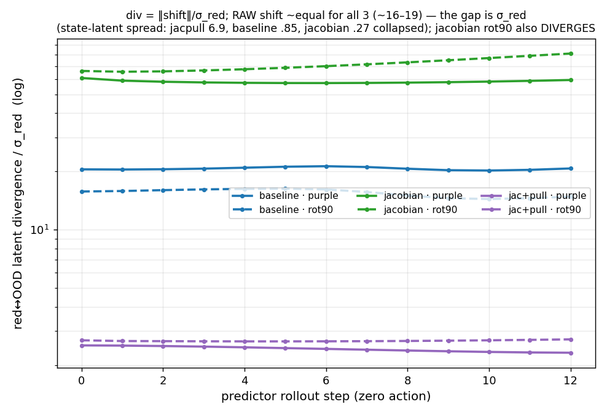

| encoder | purple div t0 → t12 | rot90 div t0 → t12 |
| --- | --- | --- |
| baseline | 20.5 → 20.7 (flat) | 15.8 → 14.8 (slight) |
| jacobian | 60.8 → 59.3 (flat) | 66.1 → **81.3 (diverges)** |
| jac+pull | **2.53 → 2.32** | **2.69 → 2.72** |

The t=0 magnitudes differ 24× — but div is ‖shift‖ / σ_red, so decompose it (both terms
measured separately). CRUCIAL: the RAW appearance shift is ~identical across all three encoders
(purple/rot90 raw ‖Δfeat‖ = baseline 16.2/12.5, jacobian 16.6/18.1, jac+pull 17.5/18.6). None is
more appearance-invariant — jacobian and jac+pull share the SAME encoder (jacobian) reg, so of
course the encoder isn't the difference. The div gap is ENTIRELY σ_red, the spread of the red
state-latent: baseline .853, jacobian **.274 (collapsed)**, jac+pull **6.945 (spread)** (feat norms
are all ~12–13, so it's the variance, not the scale).

So the real mechanism is state-latent COLLAPSE, not appearance invariance. A fixed ~17-unit
appearance shift is catastrophic against a collapsed latent (jacobian σ=.27 → shift is 60× the
state spread, swamps the safety signal) and negligible against a spread one (jac+pull σ=6.9 → shift
is 2.5× the spread).

The collapse is triggered SPECIFICALLY by the rotation aug. Red state-latent spread σ_red =
√(2·Σ var(feat_red)) across training conditions:

| encoder | original | color-aug | color+rot | collapse (orig→color+rot) |
| --- | --- | --- | --- | --- |
| baseline | 15.9 | 15.8 | 0.85 | 18× |
| jacobian | 18.7 | 17.5 | 0.27 | 68× |
| jac+pull | 18.7 | 17.6 | 6.9 | 2.7× (mildest) |

Original and color-only encoders all keep a healthy spread (~16–18) — color aug does NOT collapse
anything; only adding rotation does, to all three (the pull term least). This is
invariance-via-collapse: the cheapest way to be
invariant to a 90° WHOLE-SCENE rotation is to discard the spatial/state information the rotation
scrambles — which crams the states together. Color is separable from state (recolor obstacle pixels,
geometry intact) so color-only doesn't collapse; rotation is entangled with the state, so the
degenerate route to rotation-invariance throws the geometry away. What the pull term buys is exactly
its stated job — forcing the PREDICTOR to keep next-latent predictions action-separated (control
authority; a collapsed latent CAN'T, cf the fs=5 dubins failure [[lewm-frameskip-control-authority]])
— so it RESISTS the collapse (σ 6.9 vs 0.27), it doesn't prevent it. It's a PREDICTOR-side reg (its
context embeddings are detached, no direct encoder gradient) that lifts σ_red indirectly: pred_loss
(which does reach the encoder) must anchor the now-action-separated predictions to true next latents,
so the encoder can't fully collapse the states. The rollout adds a second-order twist: jacobian's
predictor AMPLIFIES the rotation shift over the horizon (66→81σ), matching its rot90 value collapse.

Correction to two earlier stories: (1) it is NOT rollout contraction (the contraction is a few %
over 12 steps), and (2) it is NOT the encoder being appearance-invariant (raw shift is identical).
It is the pull term keeping the STATE latent from collapsing, so the same-size appearance shift is
small RELATIVE to the state spread the critic was trained on. (jac+pull's static color margin still
inverts (.055) because that small residual shift is ALIGNED with the safe→unsafe axis — high cos_la;
its value survives because it integrates the small, non-growing shift over the rollout rather than
thresholding a single aligned projection.)

### What a predictor does with an unknown (off-manifold) state

The re-grounding probe is a special case of a general question: the training objective only shapes
on-manifold transitions, so a predictor's behavior on an UNKNOWN latent (one no training trajectory
visited — an OOD appearance, a novel configuration) is left undefined by the loss and decided
entirely by inductive bias / regularization. We observe all three possible regimes in one plot:
1. **Contract toward the manifold (re-grounding)** — jac+pull: the unknown latent is treated as a
   corrupted version of a known one and pulled back (div small, non-growing). The downstream
   critic/margin then see a canonical, in-distribution latent. Ideal when the unknown-ness is
   NUISANCE (color, rotation — dynamics unchanged).
2. **Persist, uncorrected** — baseline: the predictor neither fixes nor worsens the offset (div
   flat at 16–20σ). Downstream must cope with the raw OOD latent directly, and fails if it was
   never trained there.
3. **Amplify / diverge** — jacobian rot90: the predictor extrapolates the unfamiliar direction and
   compounds it every step (66→81σ) — the classic autoregressive OOD blow-up (off-distribution
   input → worse prediction → further off-distribution).

Two consequences matter for this system:
- **Rollout consumers amplify whatever regime holds.** A static classifier (the margin) sees the
  off-manifold latent ONCE; a value function or planner ROLLS the predictor K steps, so divergence
  (regime 3) or even a flat offset (regime 2) compounds over the horizon. This is why the value
  results are sharper than the margin results, and why a contractive/re-grounding predictor is
  disproportionately valuable for the deployed (rollout-based) objects.
- **Re-grounding is a double-edged default.** It's exactly right for nuisance-OOD (the appearance
  shifts here), because it discards the irrelevant variation and recovers the true dynamics. But it
  is BLIND to genuinely novel dynamics: a predictor that always projects the unknown onto the
  nearest known state would hallucinate familiar behavior for a real new regime and silently miss
  it. Current predictors don't distinguish nuisance-OOD from dynamics-OOD — they apply the same
  contraction/persist/diverge map to both. Handling the second case would need the predictor to
  FLAG off-manifold-ness (an uncertainty/energy signal) rather than quietly re-ground, which none
  of these models do. Data: `run_logs/coloraug_rot/`, `regrounding_coloraug_rot.py`.

### Is appearance orthogonal to safety? Conditioning vs data (resolves the "off-axis nuisance" question)

Hypothesis (why some regs make appearance shifts land off the safety axis): jacobian reg makes
the encoder-Jacobian singular values uniform, safety is low-rank, so perturbations end up orthogonal.
Tested it directly. Two measurements:

(1) Does cos_la fall as the Jacobian gets more isotropic? (`cosla_vs_jac.py`, 9 LEWM encoders + dubins
Dreamer.) **No.** On the dimension-invariant isotropy axis (σ₁-share = λ₁/Σλ of the encoder Jacobian J, so the 544-d
Dreamer RSSM is comparable to the ViT encoders), correlation with cos_la is ≈0 across all 10 models:
r(σ₁-share, cos_la_color) = −0.08, r(σ₁-share, cos_la_rot) = −0.03 (if anything the wrong sign). Within
just the ORIGINAL LEWM encoders color cos_la does fall monotonically with raw eff_rank (baseline .73 @
effrank 2.8 → jacobian .62 @ 33 → jac+pull .27 @ 37), but that trend does not survive once you (a) use a
dimension-fair axis and (b) add other models: at σ₁-share ≈ 0.10 (equally isotropic) jacobian is .62,
jac+pull-color+rot .61, and **Dreamer .81** — the *most*-aligned encoder despite having no Jacobian reg
— while the least isotropic model (baseline no-aug) is only mid-pack (.73). The far bigger lever is the
DATA: color aug slashes color cos_la at any isotropy (jacobian .62→.009, jac+pull .27→.04); rotation aug
re-inflates it (jacobian .009→.665).

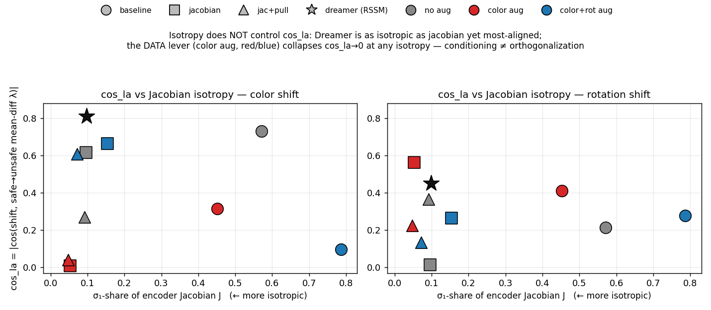

Plotted against **σ₁-share** (λ₁/Σλ of the encoder Jacobian, a dimension-invariant isotropy measure in
[0,1], lower = more isotropic) so the 544-d Dreamer RSSM is comparable to the ViT encoders. There is no
trend: at σ₁-share ≈ 0.10 (equally isotropic) sit **jacobian** (color cos_la .62), **jac+pull color+rot**
(.61), and **Dreamer** (**.81, the highest of all**) — a ~0.8 spread at fixed isotropy — while the least
isotropic model (baseline no-aug, σ₁-share .57) is only mid-pack (.73). The Dreamer star is the sharpest
case: as isotropic as jacobian, yet the most-aligned encoder, and it has no Jacobian reg at all. What
actually moves cos_la is the DATA (red = color aug → ~0 at every isotropy). So conditioning ≠
orthogonalization. (`cosla_vs_jac_fig.py`, Dreamer point `cosla_dreamer_point.py`.)

(2) THE PREMISE — is appearance ⊥ safety in PIXEL space? (`pixel_orthogonality.py`.) No, not for
color: cos_pix(color, failure axis) = **0.819**; the recolor touches the obstacle pixels and the
safety axis (unsafe = agent-in-obstacle) is dominated by those same obstacle pixels — 89% support
overlap. Color and safety are COLOCATED at the input. Rotation is more spread (cos_pix .206).

Conclusion — the mechanism is right but its premise fails for color:
- A well-conditioned (angle-preserving) encoder can only PRESERVE input geometry, not create
  orthogonality. Since color↔safety are entangled at the pixel level (.82), conditioning faithfully
  INHERITS that entanglement (baseline cos_la .73, jacobian .62 — both ≈ the .82 pixel value; neither
  orthogonalizes). So conditioning alone cannot fix color, which is exactly what we saw.
- The only thing that breaks the alignment is LEARNED decorrelation — color aug drives cos_la→0
  because seeing the obstacle in many colors teaches the encoder to discard the color CHANNEL of the
  obstacle pixels while keeping their geometry; a conditioning penalty can't express that choice.
- For rotation, which IS fairly orthogonal in pixel space (.206), conditioning DOES help preserve it
  (jacobian-orig rot cos_la .015) — the premise holds there.
So: conditioning controls MAGNITUDE (nuisance rejection / state-spread room, cf the σ_red collapse
story); DATA controls ALIGNMENT (orthogonality). They are different levers on different quantities,
and the "jacobian reg → off-axis nuisance" story only works when the nuisance is already input-
separable from the safety-defining object. Data: `run_logs/` (cosla_vs_jac, pixel_orthogonality).

# Safety-gymnasium transfer (does the dubins finding hold on a real 3D-physics pixel task?)

Ported the appearance-shift safety-representation study from the 2D dubins renderer to
**SafetyCarGoal1** (safety-gymnasium): a differential-drive Car navigating to a goal while
avoiding 8 hazards, top-down camera, MuJoCo 3D physics — a genuine domain jump (textured floor,
perspective, lighting, multiple objects), not a re-skin. Offline dataset matched to the dubins
protocol: 172k frames, **17.0% unsafe** (dubins was 169k/17%), goal-seek + hazard-loiter
trajectories, chunk-filtered to 17% on the DEFAULT geometry (no env change). WMs = the same
recipes (LEWM baseline/jacobian/jac+pull + Dreamer), no color aug. OOD = hold out one hazard
appearance; probe margin trained on in-dist features, scored zero-shot on the shift (same protocol
as `ood_margin_gp_jepa`). Scripts: `safety_gym_port/`, `le-wm/scripts/sg_margin_ood.py`,
`latent_cbf/.../sg_margin_ood_dreamer.py`. 2 seeds (probe-margin), spread ≤ .017.

Three appearance shifts: **color** (hazards blue→purple, live geom recolor), **rotate** (a REAL
90° camera rotation about vertical — rotate the fixedfar camera in-model, NOT `np.rot90` which is
non-physical on the angled perspective camera), **diamond** (hazards circle→box; hazards are
contype=0 visual-only, so a box-patched env with matched seeds gives paired renders).

Zero-shot OOD margin AUC (gp, 2-seed mean):

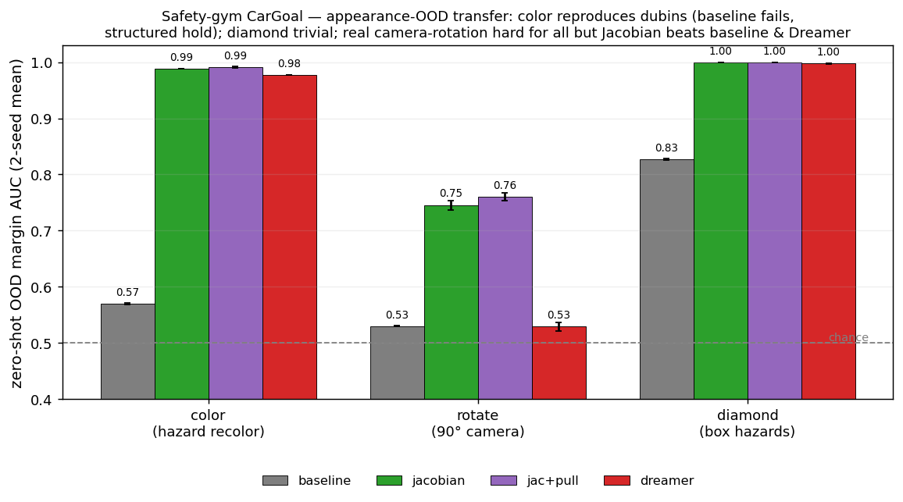

| encoder | color | rotate (90° cam) | diamond | in-dist | retrain (or_auc) |
| --- | --- | --- | --- | --- | --- |
| baseline | **.570** ≈ chance | **.530** ≈ chance | .827 | .99 | .98–.99 |
| jacobian | .988 | **.746** | .999 | 1.00 | .999 |
| jac+pull | .991 | **.761** | .999 | 1.00 | 1.00 |
| dreamer  | .977 | **.529** ≈ chance | .998 | .996 | .99 |

Three distinct verdicts:
- **Color — the core dubins finding TRANSFERS.** baseline collapses to chance (.57), while
  jacobian / jac+pull / Dreamer all hold (.98–.99). Regularization → appearance-OOD robustness,
  confirmed on real 3D pixels. `or_auc` .98–1.0 → it's a zero-shot TRANSFER failure (shifted
  features contain the safety signal), not undertraining — the same decisive control as dubins.
- **Diamond (shape) — trivially easy here; everyone holds.** Even baseline is .83; the structured
  models are ~perfect (.998–.999). A box-vs-circle hazard is a mild change and the safety geometry
  stays salient, so shape barely challenges any encoder.
- **Rotation — the clean test (real camera rotation) splits the models in a NEW way.** A 90°
  viewpoint rotation is genuinely hard (3D shadows/perspective/occlusion change), so it's the one
  axis where the structured models don't fully hold — BUT the **Jacobian family (.75–.76) beats
  baseline AND Dreamer (.53), both at chance.** The Jacobian reg's benefit extends to viewpoint
  changes; Dreamer's reconstruction does NOT help here (it collapses like baseline). dubins could
  not show this: there rot90 of the flat top-down was a trivial in-plane rotation everyone handled,
  so rotation looked "architectural"; the real 3D viewpoint rotation exposes that only the Jacobian
  reg buys genuine viewpoint robustness.

Why cos_la is uninformative here (and why baseline degrades to chance rather than INVERTING like
dubins' .14): pixel-space `cos_pix(color) = 0.02` on the sg eval vs **0.82** on dubins
(`pixel_orthogonality`-style check). In dubins the obstacle was BOTH the recolored object AND the
safety region (agent-inside-obstacle), so recoloring moved ALONG the safety axis (entangled). In
sg, safety is dominated by the AGENT's position (a small Car) while the shift recolors the HAZARDS
— nearly orthogonal at the input. So the appearance nuisance is off-axis for everyone → cos_la low
(.08–.45) and non-discriminative, and the shift adds off-axis noise (baseline → chance) rather than
pushing across the boundary (dubins → inversion). The SEVERITY of the OOD failure scales with how
entangled appearance is with safety at the input — exactly what cos_la measures — so it is
domain-dependent, even though the qualitative result (baseline fails, structured hold) transfers.

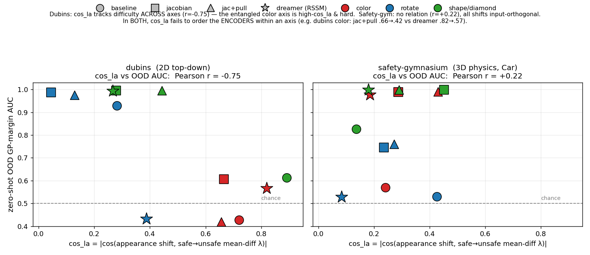

Plotting cos_la directly against the zero-shot OOD AUC (4 encoders × 3 shift axes) in both domains, with
a shared symbol/colour scheme (marker = encoder, colour = shift axis). Two different pictures:
- **Safety-gym (right): no relation, Pearson r = +0.22** (if anything the wrong sign). The three failures
  (AUC ≈ .53–.57) sit at completely different cos_la — Dreamer-rotate .08, baseline-color .24,
  baseline-rotate .43 — while every high-AUC model (>.97) is scattered across cos_la .18–.45. Because
  every sg shift is input-orthogonal (cos_pix .02), cos_la is uniformly low and carries no signal.
- **Dubins (left): r = −0.75**, but this is a BETWEEN-axis effect, not encoder ordering: dubins color is
  entangled in pixels (cos_pix .82) → high cos_la (.66–.82) *and* the hard axis (low AUC), while
  rotate/shape are low-cos_la and easy, so cos_la ends up tracking *which shift is hard*.
- **In BOTH, cos_la fails to order the ENCODERS within an axis** — the question that matters for "which
  reg is robust." E.g. dubins color: jac+pull cos_la .66 → AUC .42 vs Dreamer .82 → .57 (higher cos_la,
  higher AUC). So cos_la (mean-diff) is not a valid encoder-robustness predictor in either domain; it only
  reflects input-level appearance↔safety entanglement, which is domain- and axis-dependent.
  (`cosla_vs_auc_both_fig.py`.)

The sg analog of the dubins σ₁-share-vs-cos_la check (does cos_la fall as J gets more isotropic?), on the
same dimension-invariant axis so Dreamer is comparable:

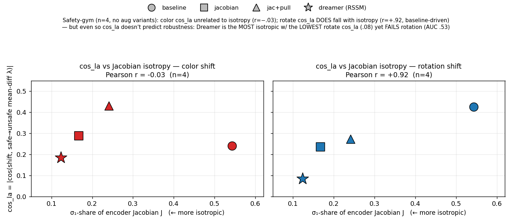

Only 4 models here (3 LEWM regs + Dreamer; no color-aug variants were trained for sg, so this is the
isotropy sweep only, without the dubins figure's aug-dissociation lever). Mixed, and honest: **color
cos_la is unrelated to isotropy** (r = −0.03 — baseline, the least isotropic at σ₁-share .54, is not the
most-aligned), but **rotate cos_la does fall with isotropy** (r = +0.92, though n = 4 and baseline-driven).
The decisive caveat holds regardless: even where isotropy lowers cos_la (rotate), cos_la still doesn't
predict robustness — **Dreamer is the most isotropic model (σ₁-share .12) with the lowest rotate cos_la
(.08), yet it fails rotation (AUC .53)**, while jacobian at higher rotate cos_la (.24) is robust (.75).
Consistent with the dubins figure and the discriminant analysis: conditioning ≠ orthogonalization, and
mean-diff cos_la is not the robustness lever. (`sg_cosla_vs_s1_fig.py`, Dreamer σ₁-share `sg_dreamer_s1.py`.)

Bottom line: the regularization → appearance-OOD-robustness finding **replicates on safety-
gymnasium for both LEWM and Dreamer** on the color axis; shape is trivially easy; and the clean
camera-rotation test surfaces a Jacobian-vs-Dreamer split (Jacobian buys viewpoint robustness,
reconstruction doesn't) that the 2D dubins env could not reveal.

## Mechanism — is jacobian robust here for the same reason as dubins?

Short answer: **color = same reason as dubins (magnitude); rotation = a different reason (neither
magnitude nor alignment); and the "orthogonality" hypothesis is a default, not a reg effect.**

Probes on the sg LEWM encoders (`sg_mechanism.py`): encoder-Jacobian conditioning + raw-shift
decomposition (latent displacement ‖Δz‖ ÷ σ_red, the state-latent spread), for color and real camera-rotation.

| encoder | eff_rank(J) | ‖J‖_F | color disp/σ | rotate disp/σ | color AUC | rotate AUC |
| --- | --- | --- | --- | --- | --- | --- |
| baseline | 2.9 | 7.59 | **0.70** | 0.90 | .57 | .53 |
| jacobian | 16.4 | 1.10 | **0.28** | 1.12 | .99 | .75 |
| jac+pull | 10.6 | 1.19 | 0.32 | 1.13 | .99 | .76 |
| dreamer  | — (RSSM) | — | 0.33 | 0.99 | .98 | .53 |

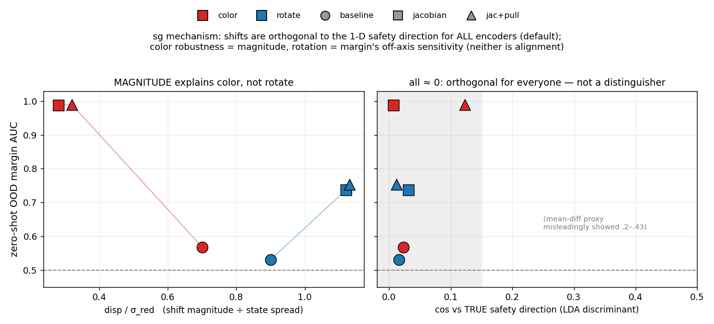

**1. Conditioning transfers.** baseline is ill-conditioned (eff_rank 2.9, ‖J‖ 7.6, one dominant
direction); jacobian/jac+pull cap it (eff_rank 16.4/10.6, ‖J‖ ≈ 1.1) — same picture as dubins
(baseline ~3 vs jacobian ~33).

**2. Color = magnitude rejection (same as dubins).** The ill-conditioned baseline amplifies the color
shift into a large latent displacement (disp/σ 0.70× the state spread) → margin degrades; jacobian
rejects it (0.28×) → robust.

**3. Rotation = neither magnitude nor alignment.** rotate disp/σ is *larger* for jacobian (1.12) than
baseline (0.90) yet jacobian is more robust (.75 vs .53), so it isn't magnitude. And it isn't alignment
either — see the note below.

**4. Dreamer fails rotation (.53) despite an orthogonal shift** — its reconstruction latent has no
conditioning, so the rotated (off-manifold) viewpoint scrambles the margin exactly like baseline.
Reconstruction buys no viewpoint robustness.

### On the "orthogonality" hypothesis and the two cos measures

Original hypothesis: *jacobian reg → uniform σ → safety is low-rank → perturbations become orthogonal
to safety*. The premise holds (conditioning is real; safety is genuinely 1-D — a single discriminant
separates safe/unsafe at AUC .90 baseline → .999 jacobian). **But orthogonality is the DEFAULT, not a
reg effect:** measured against the true decision axis (the logistic/LDA discriminant), *every* shift is
orthogonal for *every* encoder (cos .007–.123), because any high-dim shift is orthogonal to a 1-D axis
by concentration of measure.

Two cos measures, both valid, answering different questions (the discriminant **adds to**, doesn't
replace, the mean-diff analysis):

| measure | axis | color/rotate cos | what it says |
| --- | --- | --- | --- |
| cos vs **λ** (mean-diff) | centroid gap — a loose separation axis (1-D AUC .66–.87) | .24/.43 base, .29/.24 jac | shift *does* translate classes together (rotation more so for baseline) |
| cos vs **discriminant** | the margin's decision axis | ≈0 for all (.016 base-rot, .031 jac-rot) | shift misses the decision boundary for everyone |

The key fact reconciling them: **λ ⊥ discriminant** (cos(λ,disc) only .06–.27). So the shift lands in
the loose λ subspace (a real class-confusion signal) but misses the tight decision direction the
nonlinear margin (in-dist AUC ~.99) actually uses. That is why the earlier cos_la ordering (.43 vs .24)
looked like "alignment explains rotation" but is a coincidental correlate, not the cause.

**What actually distinguishes the encoders:** whether the trained margin leans on *stable* safety
directions or on *nuisance* directions that move under the shift. Baseline's ill-conditioned latent has
fake-variance directions — stable in-dist, moving under the shift — and its blue-trained margin leans on
them, so even an orthogonal shift degrades it (or_auc ≈ 1 confirms the info is present → transfer
failure, not lost signal). Jacobian's conditioned latent forces the margin onto the stable safety
direction and ignores the nuisance. Magnitude compounds this for color (baseline also amplifies the
shift); rotation is the same off-axis-sensitivity story with no magnitude help.

Data: `run_logs/sg/mechanism.log`, `/tmp/sg_cosla_disc.py`, `/tmp/sg_lambda_vs_disc.py`.

# Post Sept 26

## Robust training (Ilyas "Adversarial Examples Are Not Bugs, They Are Features", arXiv 1905.02175)

Our mechanism (the margin overfits *non-robust features* — appearance directions predictive in-dist but
moving under the shift) is a rediscovery of Ilyas et al.'s robust-vs-non-robust features, with the
**appearance shift as the threat model** instead of an L∞ ball. So we test robust training, staged:
readout-only first (frozen encoder), then encoder-level.

**Methodology fix (layout confound).** SafetyCarGoal1 has random per-episode hazard layouts and its
safety signal is layout-dependent, so a margin trained on one collection scores ~chance (.45) on a
*different* collection even at the same appearance — and the earlier "in-dist .99" was inflated by
train/test sharing episodes within one collection. Fix: one **layout-controlled** collection
(`safety_gym_port/collect_multicolor.py`, 5000 frames) where every appearance variant — 6 training
colors (blue/orange/teal/yellow/brown/green), held-out **purple**, and a real **90° camera rotation** —
is a render of the *same pose*. Split by frame → the appearance gap is measured on identical test frames,
isolating appearance from layout.

### Stage 1 — robust readout on FROZEN encoders (`le-wm/scripts/sg_robust_margin.py`, `figs/sg_robust_margin.png`)

Four margin arms per encoder: **plain** (blue only), **aug** (random training color), **robust**
(worst-case color, Ilyas min-max), **proj** (project out the color-nuisance subspace estimated from
within-frame color deltas = the Ilyas **D_R** "keep only robust features" construction, done as a real
feature-space projection). Zero-shot AUC on test-frame purple (same-type) / camera-rotation (cross-type):

| encoder | arm | in-dist | purple | rotate |
| --- | --- | --- | --- | --- |
| baseline | plain / aug / robust / proj | .99/.99/.64/.98 | **.60 / .58 / .54 / .52** | .57/.56/.46/.56 |
| jacobian | plain / aug / robust / proj | .99/.99/.96/1.0 | .99 / .99 / .97 / 1.0 | .64 / .69 / .52 / **.77** |
| jac+pull | plain / aug / robust / proj | 1.0/1.0/.92/1.0 | 1.0 / 1.0 / .93 / .99 | .68 / .70 / .44 / **.74** |
| dreamer  | plain / aug / robust / proj | .99/.99/.96/.80 | .96 / .98 / .95 / **.57** | .48/.51/.46/.50 |

**Conclusions:**
- **The encoder determines everything; the readout can't be rescued.** No arm lifts baseline color above
  ~.60 — same readout recipes give jacobian/jac+pull/dreamer ~.99. Color-OOD is an *encoder* property.
- **Worst-case (min-max) readout training is net-harmful** — it even breaks in-dist (baseline .99→.64,
  jac+pull .99→.92) and tanks rotation. The Stage-1 adversary is unstable at the readout.
- **The D_R projection is a clean win ONLY on a disentangled encoder.** It gains rotation on
  jacobian (.64→**.77**) and jac+pull (.68→**.74**) while keeping color/in-dist perfect; does *nothing*
  on baseline (color-nuisance is high-dim/color-specific — k=19 dims from 6 colors don't even span
  purple's direction); and **damages dreamer** (in-dist .99→.80, purple .96→.57) because its
  reconstruction latent entangles color↔safety, so removing the color-variation subspace removes safety.
- This is the sharpest statement of the whole study: **appearance robustness lives in the encoder** —
  conditioning (jacobian) both transfers color at the plain readout and makes the nuisance low-rank enough
  that a D_R projection buys extra (rotation) robustness; an entangled encoder (baseline/dreamer) supports
  neither. Data: `run_logs/sg_robust_margin.log`, `sg_robust_margin_dreamer.log`.

### Stage 2 — encoder-level robust training (`figs/sg_stage2_encoder.png`)

Since Stage 1 pins the bottleneck to the encoder, retrain baseline-recipe sg encoders and re-test the
*plain* readout: (a) **color-aug** (data lever — blue-hazard recolor, `utils.ObstacleRecolor(source="blue")`,
purple held out) and (b) **adversarial** color-invariance (`module.AdvColorInvarianceReg` — per-sample
worst-case recolor, Ilyas min-max at the encoder, `+loss.regularizers.adv_color_invariance.weight=1.0`).
Plain-readout zero-shot (in-dist blue / purple):

| encoder | in-dist blue | zs purple | note |
| --- | --- | --- | --- |
| baseline | .99 | .60 | fails color |
| **+ color-aug** (data) | .98 | **.79** (aug readout .87) | in-dist intact, color gap largely closed |
| **+ adversarial** (min-max) | **.67** | .72 | in-dist COLLAPSED — over-invariance |
| jacobian (conditioning ref) | 1.0 | .99 | ceiling |

**Conclusions — two, and they close the loop:**
- **Color-OOD IS fixable at the encoder** (Stage 1 said the readout can't): plain-readout color-aug lifts
  baseline purple **.60 → .79**, and with readout aug on top **.87**, while keeping in-dist ~.98. The
  encoder is both the bottleneck (Stage 1) and the fix (Stage 2).
- **But the method matters, and it's the SAME lesson at both stages: the min-max/adversarial lever is
  fragile; the data lever is robust.** The adversarial invariance reg over-invariantized — it equalized
  blue/purple (both ~.70) but by **collapsing the in-dist safety signal itself** (.99 → .67; its residual
  color subspace is only k=2 dims, i.e. it crushed color variation to near-nothing along with useful
  structure). This mirrors Stage 1, where the worst-case *readout* arm also broke in-dist. Augmentation
  robustifies without collapse; min-max invariance trades discriminability away.
- **Rotation stays hard** (~.45 for both retrained encoders) — color-specific training gives no cross-type
  transfer, consistent with rotation being a distinct nuisance subspace. Data: `run_logs/sg_robust_margin_stage2.log`.

Overall the robust-training arc lands the study's thesis on a real 3D task: **appearance-OOD safety
robustness is an encoder-representation property.** Conditioning (jacobian) or data-augmentation at the
encoder buys it; readout tricks and adversarial min-max invariance do not (the latter collapses the signal).

## Does the jacobian mechanism transfer to Dreamer? — direct falsification test (`run_logs/dreamer_jac_ood.log`)

The mechanism claim for *why* jacobian helps has been refined (see "On the 'orthogonality' hypothesis"
above) to: **the ‖∂z/∂x‖ penalty is a nuisance-agnostic tiebreaker that suppresses input directions the
primary WM objective is *indifferent* to.** JEPA's latent-prediction objective is indifferent to
appearance that is constant in-distribution (the obstacle is always red / hazards always blue → zero
variance → undemanded), so the jacobian tiebreak can strip it. A reconstruction objective is *not*
indifferent — decoding pixels *requires* representing color — so the prediction is that the same penalty
**cannot** rescue Dreamer. Until now that was an extrapolation (we had never trained a jacobian-regularized
Dreamer). This closes it.

Setup: the encoder-Jacobian penalty already exists in the Dreamer offline trainer
(`dreamer_offline.py::_encoder_lipschitz_reg`, `--enc_lip_keys image` regularizes the CNN/pixel branch =
‖∂embed/∂image‖, exact-VJP or finite-difference estimator). Checkpoints were already trained to 40k steps
at two weights but never OOD-evaluated. We ran the identical margin-OOD eval (`ood_margin_dreamer.py`,
fresh HJ-regression head on the 544-d RSSM feature, trained on red / tested on purple = `zs_auc`) across
all of them. `enc_lip_sweep_w1/image` is a direct mirror of the JEPA jacobian recipe (exact, weight 1.0,
target_L 1.0, 1 probe).

| Dreamer variant | recipe (‖∂embed/∂image‖) | in-dist AUC | color zs_auc (3 seeds) | rotate zs_auc |
| --- | --- | --- | --- | --- |
| baseline | none | .998 | **.786 ± .009** | .625 |
| image, w0.1 | exact | .998 | .737 ± .004 | .625 |
| image_fd, w0.1 | finite-diff | .998 | .639 ± .014 | .619 |
| **image, w1.0** | **exact, JEPA-matched** | .999 | **.739 ± .037** | .618 |
| image_fd, w1.0 | finite-diff | .998 | .756 ± .005 | .625 |

(color = mean ± population-sd over eval seeds 0/1/2; rotate = seed 0, dead flat so not re-seeded. The
deployed sign stays inverted for color everywhere — zs_acc ~.22 — so `zs_auc` is ranking-only.)

**Result: the jacobian does NOT rescue Dreamer — it is flat-to-slightly-worse, and the gap survives seed
noise.** Every regularized variant sits *below* the baseline's color .786 ± .009 (variants .64–.76), with
the closest (image_fd w1.0, .756 ± .005) still non-overlapping; the JEPA-matched exact/w1.0 recipe is
.739 ± .037. Rotation is dead flat (~.62 for all incl. baseline), and in-dist stays ~.998. This is the exact
opposite of JEPA, where the same penalty made jacobian the one LEWM encoder to get color off-axis
(baseline .43 → jacobian .61 on the WGAN-GP eval).

**Why this confirms rather than contradicts the mechanism:** the jacobian tiebreak only bites when the
primary objective is *indifferent* to the nuisance. Dreamer's decoder actively *demands* representing
appearance (constant-in-dist or not, you must reconstruct the red pixels), so there is nothing for the
penalty to tiebreak away; pushing it harder (w1.0) just trades a little reconstruction fidelity for **no**
robustness gain — hence the slight color *drop*. It is the same story as the Stage-1 D_R projection that
*damaged* Dreamer: the nuisance is demanded and fused with safety, so neither de-amplifying it (jacobian)
nor projecting it out (D_R) can separate it. **The mechanism is coupling-dependent, and Dreamer is the
case where the coupling goes the wrong way** — which is precisely why a latent-prediction WM (JEPA) is
robustifiable by a generic input-sensitivity prior and a reconstruction WM (Dreamer) is not.

Caveats: this eval's HJ-regression head puts Dreamer's baseline color at .789 vs the WGAN-GP head's .565
in the nuisance-projection table — different heads, so compare **deltas within this table** (jacobian vs
its own baseline), not absolute numbers across scripts. The load-bearing comparison is the sign of the
delta: **+ for JEPA, ≈0/− for Dreamer.**

# Post Oct 1
 